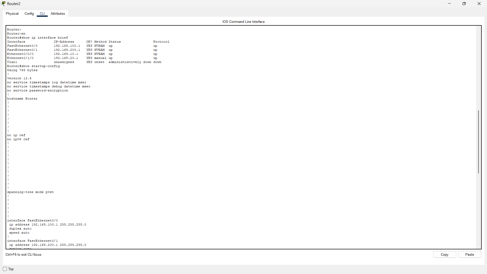
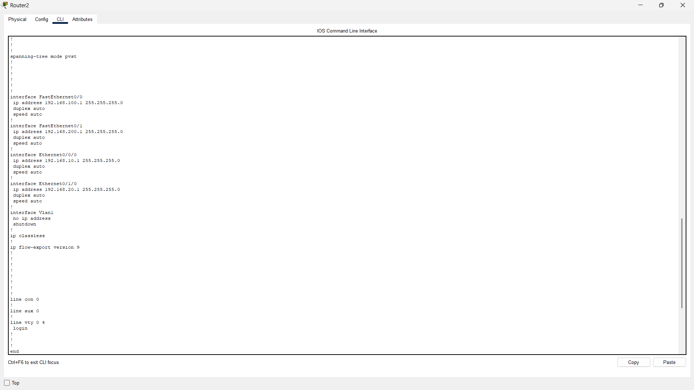
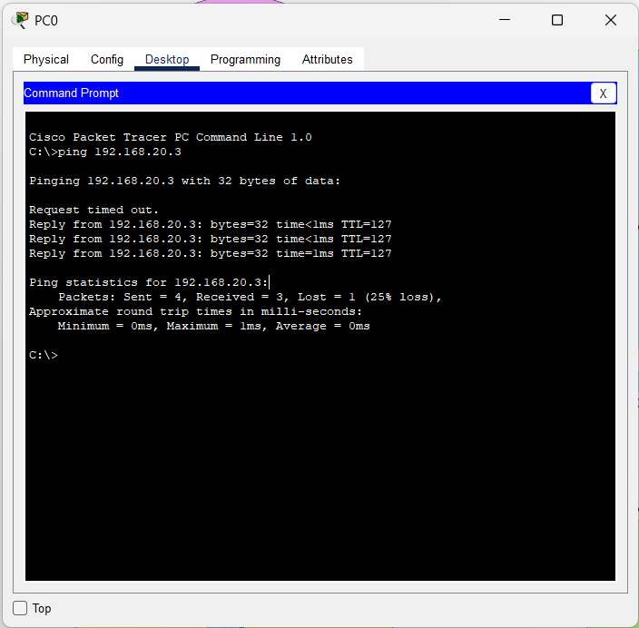

# 📡 Lab: Basic Connectivity
### *One Router · Four Switches · Eight PCs*

---

## 🎯 Objective

Configure and verify a **star-topology** network where a single router acts as the central gateway, enabling inter-subnet communication across four independent LANs — each served by its own switch and a pair of PCs.

---

## 🧠 Concepts Covered

| Concept | Description |
| :--- | :--- |
| **IP Subnetting** | Dividing the address space into four distinct `/24` subnets |
| **Default Gateways** | Assigning the router's interface IP as the gateway for each subnet |
| **Cisco IOS CLI** | Navigating privilege modes: `enable` → `configure terminal` → `interface` |
| **Interface Management** | Using `no shutdown` to bring interfaces out of administratively-down state |
| **Config Persistence** | Saving the running config with `copy running-config startup-config` |

---

## 🛠️ Devices Used

| Device | Qty | Role |
| :--- | :---: | :--- |
| **Router** | 1 | Central gateway — routes traffic between all four subnets |
| **Switch** | 4 | Layer 2 — provides ethernet connectivity within each subnet |
| **PC** | 8 | End hosts — two per subnet for intra- and inter-subnet testing |

---

## 🗺️ Network Plan

The network is divided into **four colour-coded zones**. Each zone maps to a unique `/24` subnet. The router has one interface per zone.

```
                        ┌─────────────┐
          Pink Zone ────┤             ├──── Yellow Zone
   192.168.100.0/24     │   Router    │     192.168.10.0/24
                        │  (Gateway)  │
           Blue Zone ───┤             ├──── Green Zone
    192.168.20.0/24     └─────────────┘     192.168.200.0/24
```

### Subnet Summary Table

| Zone | Subnet | Gateway (Router IF) | Usable Host Range |
| :--- | :--- | :--- | :--- |
| 🌸 **Pink** | `192.168.100.0/24` | `192.168.100.1` | `.2` – `.254` |
| 💛 **Yellow** | `192.168.10.0/24` | `192.168.10.1` | `.2` – `.254` |
| 🔵 **Blue** | `192.168.20.0/24` | `192.168.20.1` | `.2` – `.254` |
| 💚 **Green** | `192.168.200.0/24` | `192.168.200.1` | `.2` – `.254` |

---

## ⚙️ Configuration Steps

### Step 1 — Router Interface Configuration

> **Router2** was used as the central router. Each interface was assigned a gateway IP for its respective zone, then brought up with `no shutdown`.

---

#### 🌸 FastEthernet 0/0 → Pink Zone (`192.168.100.0/24`)

```bash
Router> enable
Router# configure terminal
Router(config)# interface FastEthernet0/0
Router(config-if)# ip address 192.168.100.1 255.255.255.0
Router(config-if)# no shutdown
Router(config-if)# exit
```

---

#### 💚 FastEthernet 0/1 → Green Zone (`192.168.200.0/24`)

```bash
Router(config)# interface FastEthernet0/1
Router(config-if)# ip address 192.168.200.1 255.255.255.0
Router(config-if)# no shutdown
Router(config-if)# exit
```

---

#### 💛 Ethernet 0/0/0 → Yellow Zone (`192.168.10.0/24`)

```bash
Router(config)# interface Ethernet0/0/0
Router(config-if)# ip address 192.168.10.1 255.255.255.0
Router(config-if)# no shutdown
Router(config-if)# exit
```

---

#### 🔵 Ethernet 0/1/0 → Blue Zone (`192.168.20.0/24`)

```bash
Router(config)# interface Ethernet0/1/0
Router(config-if)# ip address 192.168.20.1 255.255.255.0
Router(config-if)# no shutdown
Router(config-if)# end
Router# copy running-config startup-config
```

---

### Step 2 — PC Static IP Configuration

Each PC is manually assigned a static IP address within its zone's subnet, along with the correct gateway.

| PC | Zone | IP Address | Subnet Mask | Default Gateway |
| :--- | :--- | :--- | :--- | :--- |
| PC0 | 🌸 Pink | `192.168.100.2` | `255.255.255.0` | `192.168.100.1` |
| PC1 | 🌸 Pink | `192.168.100.3` | `255.255.255.0` | `192.168.100.1` |
| PC2 | 💛 Yellow | `192.168.10.2` | `255.255.255.0` | `192.168.10.1` |
| PC3 | 💛 Yellow | `192.168.10.3` | `255.255.255.0` | `192.168.10.1` |
| PC4 | 🔵 Blue | `192.168.20.2` | `255.255.255.0` | `192.168.20.1` |
| PC5 | 🔵 Blue | `192.168.20.3` | `255.255.255.0` | `192.168.20.1` |
| PC6 | 💚 Green | `192.168.200.2` | `255.255.255.0` | `192.168.200.1` |
| PC7 | 💚 Green | `192.168.200.3` | `255.255.255.0` | `192.168.200.1` |

---

## ✅ Verification Checklist

- [x] **Interface Status** — Run `show ip interface brief` on the router; all 4 interfaces must show `up/up`
- [x] **Intra-Subnet Ping** — PC0 → PC1 (same switch, Pink zone) ✅
- [x] **Inter-Subnet Ping** — PC0 (Pink `100.2`) → PC4 (Blue `20.2`) via Router ✅
- [x] **Config Saved** — `copy running-config startup-config` confirmed in CLI log ✅

### Useful Verification Commands

```bash
# On Router — check all interface statuses at a glance
Router# show ip interface brief

# On Router — view the saved startup config
Router# show startup-config

# On PC (Packet Tracer Command Prompt)
> ping 192.168.20.2
> ipconfig
```

## 📋 IOS Command Log — Key Observations

> The following patterns were observed directly from the Packet Tracer IOS Command Logs captured during this lab session.

| Observation | Detail |
| :--- | :--- |
| **Multiple retries** | The `ip address` command was entered twice for some interfaces (e.g., rows 56–57, 61–62). This is normal; IOS accepts the last command. |
| **Config lost then recovered** | `copy running-config startup-config` was run multiple times (rows 18, 32, 50, 70, 71) suggesting the router was reloaded mid-session. |
| **Router1 vs Router2** | Both routers were explored before settling on **Router2** as the final gateway device. |
| **Interface name confusion** | Early attempts used `FastEthernet0/1/0` instead of `Ethernet0/1/0` — causing CLI errors until the correct interface name was used. |
| **Switch config explored** | Switch2 was briefly entered (rows 90–96), confirming no Layer 3 config was needed on switches. |

---

## ❗ Common Issues & Fixes

| Issue | Symptom | Fix |
| :--- | :--- | :--- |
| **Forgot `no shutdown`** | Interface shows `administratively down` (red dot in PT) | Enter interface mode and run `no shutdown` |
| **Wrong Gateway on PC** | PC can reach same subnet but fails cross-subnet pings | Double-check gateway matches the router interface IP for that zone |
| **Interface Name Mismatch** | `% Invalid interface type` CLI error | Verify port type: `FastEthernet`, `Ethernet`, or `GigabitEthernet` |
| **Config lost after reload** | Router reverts to unconfigured state | Always run `copy running-config startup-config` before exiting |
| **IP typed twice** | IOS log shows duplicate `ip address` entries | Harmless — IOS overwrites with the last command entered |

---

## 📁 Lab File

> 💾 **Try it yourself** — Download [`one router 4 switch 8 pcs.pkt`](one%20router%204%20switch%208%20pcs.pkt) and open it in **Cisco Packet Tracer 8.1+**. Explore the live configuration with `show` commands, use Simulation Mode to watch packets travel hop-by-hop, or wipe a device and reconfigure it from scratch following this README.

---

## 🚀 What I Learned

- **The router is the "door"** between different network segments — without it, inter-subnet traffic has no path.
- **`no shutdown` is not optional** — interfaces are administratively down by default on Cisco routers.
- **`copy run start` saves lives** — any config not saved is wiped on reload. Learned this the hard way mid-session.
- **Interface naming matters** — `FastEthernet0/1` and `Ethernet0/1/0` are completely different ports; mistyping causes silent failures.
- **Subnetting clarity** — having colour-coded zones made it much easier to track which IP belongs to which physical segment.

---

## 📸 Screenshots

### Router Interface & Configuration

*Checking all interface statuses at a glance*


*Viewing the saved startup configuration*

### PC Connectivity Verification

*Verifying inter-subnet communication via Ping*
