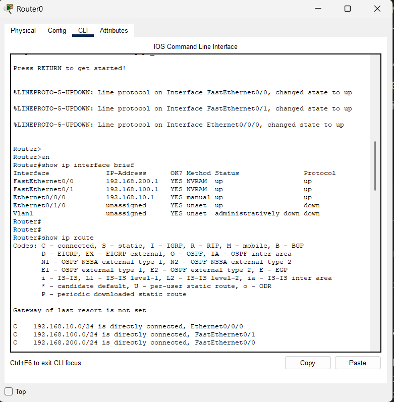
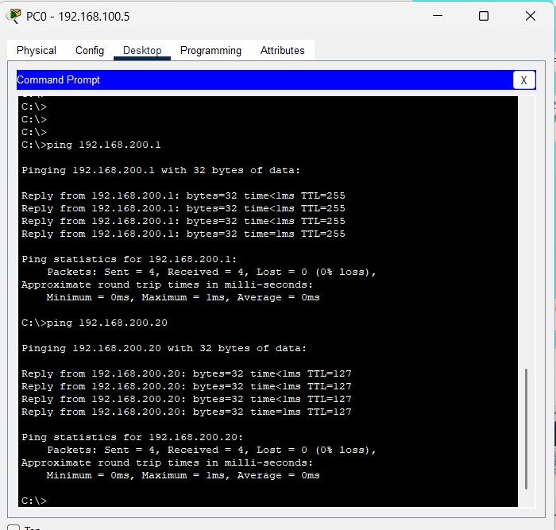
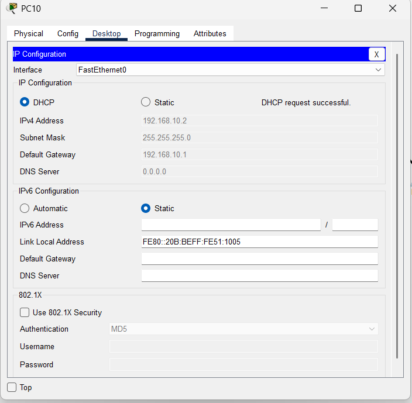

# 📡 Lab: DHCP Server & Relay (IP Helper)
### *One Router · Three Switches · Six PCs · One Server*

---

## 🎯 Objective

Configure and verify a **multi-subnet network** where a single **centralized DHCP server** in one subnet provides dynamic IP addressing to end devices across **all three subnets**. The router acts as the default gateway and uses **DHCP Relay (`ip helper-address`)** to forward broadcast DHCP requests across subnet boundaries.

---

## 🧠 Concepts Covered

| Concept | Description |
| :--- | :--- |
| **DHCP (Dynamic Host Configuration Protocol)** | Automatically assigns IP addresses, subnet masks, gateways, and DNS to end devices |
| **DHCP Relay / IP Helper** | Router forwards DHCP broadcast requests from remote subnets to the centralized DHCP server via unicast |
| **Multi-Subnet Routing** | Router interfaces act as default gateways, connecting three separate broadcast domains |
| **IPv4 Subnetting** | Dividing the address space into three distinct `/24` private subnets |
| **Interface Management** | Using `no shutdown` to activate router interfaces and verifying link status |
| **Config Persistence** | Saving the running configuration to NVRAM with `copy running-config startup-config` |

---

## 🛠️ Devices Used

| Device | Qty | Role |
| :--- | :---: | :--- |
| **Router0** | 1 | Central gateway — connects all three subnets and relays DHCP requests |
| **Switch** | 3 | Layer 2 — provides local ethernet connectivity within each subnet |
| **PC** | 6 | End hosts — two per subnet, configured for DHCP to receive automatic IPs |
| **Server0** | 1 | Centralized DHCP server — hosts IP pools for all three subnets |

---

## 🗺️ High-Level Network Plan

The network is divided into **three colour-coded zones**. Each zone is a separate `/24` subnet with its own switch. A single **DHCP server** in the Blue Zone serves IP addresses to all three zones. The router relays DHCP broadcasts from the Green and Bottom zones to the server.

```
                    ┌─────────────────────────────┐
                    │          Router0             │
                    │                              │
         Fa0/0     │                              │    Fa0/1
    ◄──────────────┤     Central Gateway          ├──────────────►
    192.168.100.1   │                              │   192.168.200.1
                    │          Eth0/0/0            │
                    └──────────┬───────────────────┘
                               │
                               │ 192.168.10.1
                               ▼
                        ┌─────────────┐
                        │  Switch 2   │
                        │ Bottom Zone │
                        └──────┬──────┘
                               │
                         ┌─────┴─────┐
                        PC6         PC7
                     (DHCP)       (DHCP)


    ┌─────────────┐                         ┌─────────────┐
    │  Switch 0   │                         │  Switch 1   │
    │  Blue Zone  │                         │ Green Zone  │
    └──────┬──────┘                         └──────┬──────┘
           │                                       │
     ┌─────┼─────┐                           ┌─────┴─────┐
    PC0   PC1  Server0                      PC4         PC5
  (DHCP) (DHCP) 192.168.100.10            (DHCP)       (DHCP)
                 [DHCP Server]
```

### Subnet Summary Table

| Zone | Subnet | Gateway (Router IF) | Interface | DHCP Server | Usable Host Range |
| :--- | :--- | :--- | :--- | :--- | :--- |
| 🔵 **Blue** | `192.168.100.0/24` | `192.168.100.1` | `Fa0/0` | Local (`192.168.100.10`) | `.2` – `.254` |
| 💚 **Green** | `192.168.200.0/24` | `192.168.200.1` | `Fa0/1` | Relayed via IP Helper | `.2` – `.254` |
| 🟤 **Bottom** | `192.168.10.0/24` | `192.168.10.1` | `Eth0/0/0` | Relayed via IP Helper | `.2` – `.254` |

### How DHCP Relay Works (The Big Picture)

```
PC4 (Green Zone)                  Router0                     Server0 (Blue Zone)
      │                              │                              │
      │──► DHCPDISCOVER ──►│         │                              │
      │    (Broadcast)      │         │                              │
      │                     │  ip helper-address                    │
      │                     │──► DHCPDISCOVER ──────────────────────►│
      │                     │    (Unicast to 192.168.100.10)        │
      │                     │                                       │
      │                     │◄────────────── DHCPOFFER ◄────────────│
      │◄── DHCPOFFER ◄─────│                                       │
      │                     │                                       │
      │      IP Assigned!   │                                       │
      │  192.168.200.x      │                                       │
```

> **Key Insight:** DHCP uses broadcasts (`255.255.255.255`). Routers **drop broadcasts by default** — they do not forward them between interfaces. The `ip helper-address` command tells the router: *"When you receive a DHCP broadcast on this interface, convert it to a unicast and forward it to this specific server."*

---

## ⚙️ Low-Level Configuration (Device-by-Device)

### 🌐 Phase I — Router0 Gateway Configuration

> **Purpose:** Router0 connects all three subnets. Each interface is assigned a gateway IP, and the `ip helper-address` is applied to remote-subnet interfaces so they can reach the DHCP server in the Blue Zone.

---

#### Step 1 — Configure the Blue Zone Gateway (`Fa0/0`)

This is the subnet where the DHCP server lives. No helper address is needed here because the server is **local** to this segment.

```bash
Router> enable
Router# configure terminal

! --- Blue Zone: Fa0/0 → 192.168.100.0/24 ---
! The DHCP server (192.168.100.10) is directly on this subnet
Router(config)# interface FastEthernet0/0
Router(config-if)# ip address 192.168.100.1 255.255.255.0
Router(config-if)# no shutdown
Router(config-if)# exit
```

**Why no `ip helper-address` here?** — The DHCP server (`192.168.100.10`) is directly connected to this subnet. When a PC in the Blue Zone sends a DHCP broadcast, the server receives it natively — no relay needed.

---

#### Step 2 — Configure the Green Zone Gateway (`Fa0/1`) with DHCP Relay

PCs in the Green Zone cannot reach the DHCP server by broadcast alone. The `ip helper-address` tells the router to relay their requests.

```bash
! --- Green Zone: Fa0/1 → 192.168.200.0/24 ---
! PCs here need DHCP from 192.168.100.10 (different subnet)
Router(config)# interface FastEthernet0/1
Router(config-if)# ip address 192.168.200.1 255.255.255.0
Router(config-if)# ip helper-address 192.168.100.10
Router(config-if)# no shutdown
Router(config-if)# exit
```

**What does `ip helper-address 192.168.100.10` do?**
1. PC5 sends a `DHCPDISCOVER` broadcast on the Green Zone
2. The broadcast hits the router's `Fa0/1` interface
3. The router sees the `ip helper-address` and converts the broadcast into a **unicast** packet addressed to `192.168.100.10`
4. The server receives it, allocates an IP from the `192.168.200.x` pool, and sends a `DHCPOFFER` back through the router
5. PC5 gets its IP address

---

#### Step 3 — Configure the Bottom Zone Gateway (`Eth0/0/0`) with DHCP Relay

Same logic as the Green Zone — this subnet also needs DHCP relay.

```bash
! --- Bottom Zone: Eth0/0/0 → 192.168.10.0/24 ---
! PCs here also need DHCP from 192.168.100.10 (different subnet)
Router(config)# interface Ethernet0/0/0
Router(config-if)# ip address 192.168.10.1 255.255.255.0
Router(config-if)# ip helper-address 192.168.100.10
Router(config-if)# no shutdown
Router(config-if)# exit
```

> **Note from Logs:** The initial attempt used `FastEthernet0/0` for this interface, which failed because the physical cable was connected to `Ethernet0/0/0`. Always verify the correct interface name with `show ip interface brief` before configuring.

---

#### Step 4 — Save Configuration

```bash
Router# copy running-config startup-config
Destination filename [startup-config]? [Enter]
Building configuration...
[OK]
```

---

#### Router0 Interface Summary

| Interface | Subnet | IP Address | IP Helper | Role |
| :--- | :--- | :--- | :--- | :--- |
| `FastEthernet0/0` | Blue Zone | `192.168.100.1` | *(none — server is local)* | Gateway for 192.168.100.0/24 |
| `FastEthernet0/1` | Green Zone | `192.168.200.1` | `192.168.100.10` | Gateway + DHCP Relay for 192.168.200.0/24 |
| `Ethernet0/0/0` | Bottom Zone | `192.168.10.1` | `192.168.100.10` | Gateway + DHCP Relay for 192.168.10.0/24 |

---

### 🖥️ Phase II — DHCP Server Configuration (Server0)

> **Purpose:** Server0 (`192.168.100.10`) provides IP addresses for **all three subnets**. It must have a separate DHCP pool for each subnet.

---

#### Step 1 — Static IP Assignment

Assign a static IP to the server itself (servers should **never** use DHCP).

| Setting | Value |
| :--- | :--- |
| **IP Address** | `192.168.100.10` |
| **Subnet Mask** | `255.255.255.0` |
| **Default Gateway** | `192.168.100.1` |
| **DNS Server** | `192.168.100.10` (self, if also acting as DNS) |

---

#### Step 2 — DHCP Pool Configuration

On the Server0 **Services** tab → **DHCP**, create three pools — one for each subnet:

| Pool Name | Network | Start IP | Subnet Mask | Default Gateway | DNS Server | Max Users |
| :--- | :--- | :--- | :--- | :--- | :--- | :--- |
| **Blue_Pool** | `192.168.100.0` | `192.168.100.20` | `255.255.255.0` | `192.168.100.1` | `192.168.100.10` | 234 |
| **Green_Pool** | `192.168.200.0` | `192.168.200.20` | `255.255.255.0` | `192.168.200.1` | `192.168.100.10` | 234 |
| **Bottom_Pool** | `192.168.10.0` | `192.168.10.20` | `255.255.255.0` | `192.168.10.1` | `192.168.100.10` | 234 |

> **Critical:** Each pool's **Default Gateway** must match the router's interface IP for that subnet. If the gateway is wrong, PCs will get an IP but **cannot route traffic** outside their subnet.

**Why three separate pools?** — The DHCP server determines which pool to use based on the `giaddr` (Gateway IP Address) field in the relayed DHCP packet. When the router relays a request from the Green Zone, it stamps the packet with `192.168.200.1` — the server matches this to the `Green_Pool`.

---

### 💻 Phase III — End Device Configuration (PCs)

> **Purpose:** All PCs are set to obtain IP addresses automatically via DHCP.

---

#### Step 1 — Set PCs to DHCP Mode

On each PC: **Desktop** tab → **IP Configuration** → Select **DHCP**.

| PC | Zone | Expected IP Range | Expected Gateway | Expected DNS |
| :--- | :--- | :--- | :--- | :--- |
| PC0 | 🔵 Blue | `192.168.100.20` – `.254` | `192.168.100.1` | `192.168.100.10` |
| PC1 | 🔵 Blue | `192.168.100.20` – `.254` | `192.168.100.1` | `192.168.100.10` |
| PC4 | 💚 Green | `192.168.200.20` – `.254` | `192.168.200.1` | `192.168.100.10` |
| PC5 | 💚 Green | `192.168.200.20` – `.254` | `192.168.200.1` | `192.168.100.10` |
| PC6 | 🟤 Bottom | `192.168.10.20` – `.254` | `192.168.10.1` | `192.168.100.10` |
| PC7 | 🟤 Bottom | `192.168.10.20` – `.254` | `192.168.10.1` | `192.168.100.10` |

After selecting DHCP, you should see:
```
DHCP request successful.
  IP Address:      192.168.200.20
  Subnet Mask:     255.255.255.0
  Default Gateway: 192.168.200.1
  DNS Server:      192.168.100.10
```

**If it says "DHCP request failed"** — check that:
1. The router interface for that subnet has `ip helper-address 192.168.100.10`
2. The DHCP server has a pool matching that subnet
3. All interfaces are showing `up/up` (run `show ip interface brief` on the router)

---

## ✅ Verification Checklist

- [x] **Interface Status** — Run `show ip interface brief` on Router0; all 3 interfaces show `up/up`
- [x] **Routing Table** — Run `show ip route`; all three subnets appear as `C` (Directly Connected)
- [x] **DHCP Success (Blue)** — PC0/PC1 receive IPs in `192.168.100.x` range ✅
- [x] **DHCP Success (Green)** — PC4/PC5 receive IPs in `192.168.200.x` range via IP Helper ✅
- [x] **DHCP Success (Bottom)** — PC6/PC7 receive IPs in `192.168.10.x` range via IP Helper ✅
- [x] **Intra-Subnet Ping** — PC0 → PC1 (same switch, Blue Zone) ✅
- [x] **Inter-Subnet Ping** — PC0 (Blue `100.x`) → PC7 (Bottom `10.x`) via Router ✅
- [x] **Server Reachability** — PC4 (Green) → Server0 (`192.168.100.10`) ping successful ✅
- [x] **Config Saved** — `copy running-config startup-config` confirmed ✅

### Useful Verification Commands

```bash
! --- On Router ---
Router# show ip interface brief           ! Check all interface statuses at a glance
Router# show ip route                     ! Verify routing table — should show 3 Connected networks
Router# show running-config               ! Full configuration audit

! --- On PCs (Packet Tracer Command Prompt) ---
> ipconfig                                ! Verify DHCP-assigned IP, gateway, and DNS
> ipconfig /renew                         ! Force a fresh DHCP request if needed
> ping 192.168.100.10                     ! Test reachability to the DHCP server
> ping 192.168.200.1                      ! Test reachability to the Green gateway
```

---

## 📋 IOS Command Log — Key Observations

> The following patterns were observed directly from the Packet Tracer IOS Command Logs captured during this lab session.

| Observation | Detail |
| :--- | :--- |
| **Interface name confusion** | Initially attempted to configure `FastEthernet0/0` for the Bottom Zone, but the physical cable was in `Ethernet0/0/0`. CLI returned errors until the correct interface type was used. |
| **IP Helper omission** | First attempt had PCs in the Green Zone failing DHCP. Fixed by adding `ip helper-address 192.168.100.10` to `Fa0/1`. |
| **Config saved multiple times** | `copy running-config startup-config` was executed (log #29) after confirming all DHCP assignments were working. |
| **Show commands used** | `show ip interface brief` and `show ip route` were used to verify link status and routing before testing DHCP. |

---

## ❗ Common Issues & Fixes

| Issue | Symptom | Fix |
| :--- | :--- | :--- |
| **Wrong interface name** | `% Invalid interface type` CLI error | Verify the correct port type with `show ip interface brief` — `FastEthernet`, `Ethernet`, and `GigabitEthernet` are different |
| **Missing `ip helper-address`** | PCs in remote subnets show "DHCP request failed" | Add `ip helper-address 192.168.100.10` to the router interface facing that subnet |
| **Wrong helper IP** | DHCP fails; router relays to the wrong device | The helper address must point to the **server** (`.10`), not the gateway (`.1`) |
| **Forgot `no shutdown`** | Interface shows `administratively down`; no link light | Enter the interface and run `no shutdown` |
| **Wrong gateway in DHCP pool** | PCs get IPs but cannot reach other subnets | Each pool's default gateway must match the **router's interface IP** for that specific subnet |
| **Server set to DHCP** | Server loses its own IP on reboot | Servers must always have a **static IP** — never set a server to DHCP |
| **Config lost after reload** | All IPs, helpers, and routes disappear | Always run `copy running-config startup-config` before exiting |

---

## 📁 Lab File

> 💾 **Try it yourself** — Download [`DHCP SERVER.pkt`](DHCP%20SERVER.pkt) and open it in **Cisco Packet Tracer 8.1+**. Test DHCP allocation on each VLAN, modify pool ranges, or observe the `ip helper-address` relay in Simulation Mode.

---

## 🚀 What I Learned

- **DHCP broadcasts die at the router** — routers do not forward broadcast traffic between interfaces by default. The `ip helper-address` command is the only way to make centralized DHCP work across multiple subnets.
- **One server, multiple pools** — a single DHCP server can serve dozens of subnets, as long as each subnet has its own pool with the correct gateway. The router's relay stamps the `giaddr` field so the server knows which pool to use.
- **Interface naming is not guesswork** — `FastEthernet0/0`, `Ethernet0/0/0`, and `GigabitEthernet0/0` are physically different ports. Mistyping causes silent failures. Always confirm with `show ip interface brief`.
- **Static IPs for infrastructure, DHCP for end devices** — servers, routers, and switches should always have static IPs. Only workstations and printers should use DHCP.
- **Test in layers** — first verify link status (`up/up`), then verify routing (`show ip route`), then test DHCP, and finally test end-to-end pings. Troubleshooting out of order wastes time.

---

## 📸 Screenshots

### Network Topology

*Multi-subnet network with centralized DHCP server and IP Helper relay*
