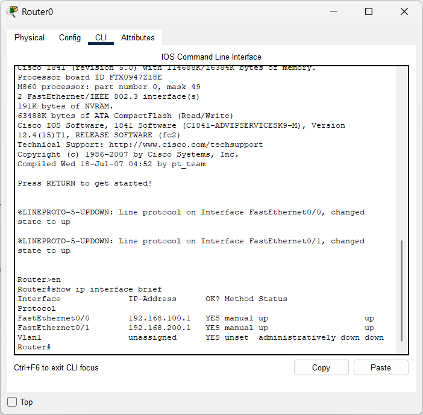
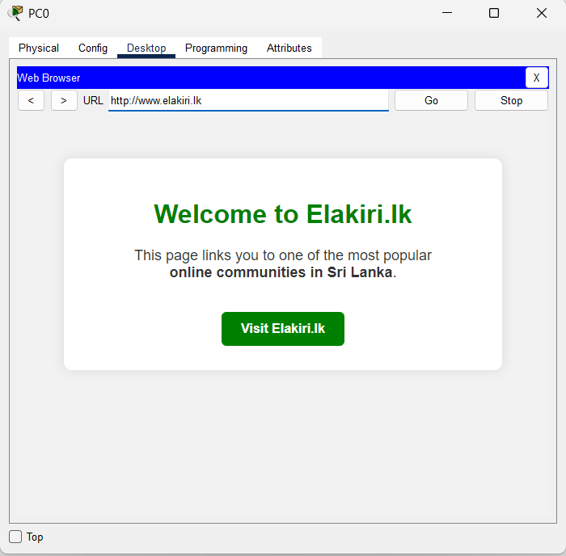
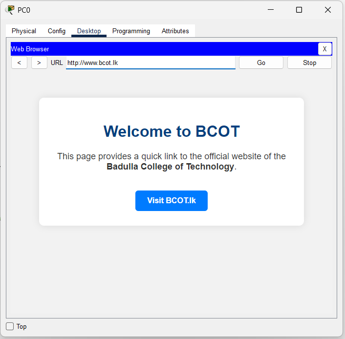
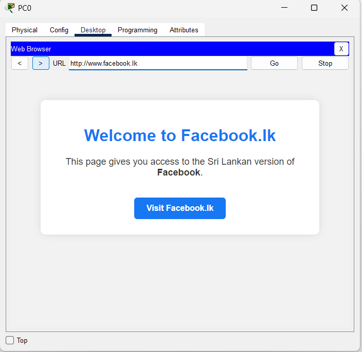

# 📡 Lab: DNS & Web Servers with Inter-Subnet Routing
### *One Router · Two Switches · Four Servers · Two PCs*

---

## 🎯 Objective

Configure and verify a **multi-subnet network** where end devices access **internal websites** (`www.bcot.lk`, `www.facebook.lk`, `www.elakiri.lk`) hosted across two subnets. A centralized **DNS server** resolves human-readable domain names to server IP addresses, while the **router** bridges both subnets to ensure full cross-segment web access.

---

## 🧠 Concepts Covered

| Concept | Description |
| :--- | :--- |
| **DNS (Domain Name System)** | Translates domain names (e.g., `www.bcot.lk`) into IP addresses (e.g., `192.168.100.20`) so browsers can locate servers |
| **HTTP (Web Services)** | Servers host HTML pages that PCs access via a web browser using URLs |
| **Inter-Subnet Routing** | Router connects two separate `/24` networks, enabling traffic flow between the server farm and the remote segment |
| **A-Record Configuration** | DNS database entries that map a fully qualified domain name to an IPv4 address |
| **Static IP Addressing** | Servers and infrastructure devices are assigned fixed IPs to ensure consistent reachability |
| **Config Persistence** | Saving the running configuration to NVRAM with `copy running-config startup-config` |

---

## 🛠️ Devices Used

| Device | Model | Qty | Role |
| :--- | :--- | :---: | :--- |
| **Router0** | Cisco 1841 | 1 | Central gateway — routes traffic between the two subnets |
| **Switch0** | 2960-24TT | 1 | Layer 2 — connects the server farm and local PCs (Left subnet) |
| **Switch1** | 2960-24TT | 1 | Layer 2 — connects the remote web server (Right subnet) |
| **Server1** | Server-PT | 1 | **DNS Server** — resolves all `.lk` domain names |
| **Server2** | Server-PT | 1 | **Web Server** — hosts `www.bcot.lk` |
| **Server3** | Server-PT | 1 | **Web Server** — hosts `www.facebook.lk` |
| **Server0** | Server-PT | 1 | **Web Server** — hosts `www.elakiri.lk` (remote subnet) |
| **PC0, PC1** | PC-PT | 2 | End-user workstations — used to test DNS resolution and web browsing |

---

## 🗺️ High-Level Network Plan

The network has **two subnets** connected by a single router. The Left subnet hosts the DNS server, two web servers, and two client PCs. The Right subnet hosts one web server (`www.elakiri.lk`). The router forwards traffic between these segments.

```
            LEFT SUBNET                                           RIGHT SUBNET
         192.168.100.0/24                                       192.168.200.0/24
                                                          
  ┌──────────────────────────────┐                       ┌──────────────────────┐
  │                              │                       │                      │
  │  Server1 (DNS)               │                       │                      │
  │  192.168.100.10      Fa0/1   │                       │                      │
  │        │              │      │    ┌──────────────┐   │   Fa0/1              │
  │  Server2 (bcot.lk)   │      │    │   Router0     │   │    │                 │
  │  192.168.100.20      ─┼──Switch0─┤  (1841)       ├───┼──Switch1            │
  │        │          Fa0/2│  Fa0/6  │              │Fa0/1│  Fa0/2              │
  │  Server3 (facebook.lk)│      │   │ Fa0/0    Fa0/1│   │    │                │
  │  192.168.100.30  Fa0/3│      │   │ .100.1   .200.1│  │  Server0            │
  │                       │      │   └──────────────┘   │  (elakiri.lk)        │
  │        PC1       PC0  │      │                       │  192.168.100.40*     │
  │     .100.52   .100.51 │      │                       │                      │
  │     Fa0/5     Fa0/4   │      │                       │                      │
  └──────────────────────────────┘                       └──────────────────────┘
```

> **\*Note:** Server0 (`www.elakiri.lk`) is physically on the Right subnet (Switch1) but uses the IP `192.168.100.40` — this is a design choice visible in the topology. Traffic to/from this server crosses the router.

### Addressing Summary

| Device | Role | IP Address | Subnet | Connected To |
| :--- | :--- | :--- | :--- | :--- |
| **Router0 Fa0/0** | Gateway (Left) | `192.168.100.1` | `192.168.100.0/24` | Switch0 Fa0/6 |
| **Router0 Fa0/1** | Gateway (Right) | `192.168.200.1` | `192.168.200.0/24` | Switch1 Fa0/1 |
| **Server1** | DNS Server | `192.168.100.10` | Left | Switch0 Fa0/1 |
| **Server2** | Web — `www.bcot.lk` | `192.168.100.20` | Left | Switch0 Fa0/2 |
| **Server3** | Web — `www.facebook.lk` | `192.168.100.30` | Left | Switch0 Fa0/3 |
| **Server0** | Web — `www.elakiri.lk` | `192.168.100.40` | Right | Switch1 Fa0/2 |
| **PC0** | Client Workstation | `192.168.100.51` | Left | Switch0 Fa0/4 |
| **PC1** | Client Workstation | `192.168.100.52` | Left | Switch0 Fa0/5 |

### DNS Resolution Flow

```
PC0 types "www.bcot.lk" in browser
      │
      ▼
┌─────────────────────┐      ┌─────────────────────┐      ┌─────────────────────┐
│  1. DNS Query        │      │  2. DNS Response     │      │  3. HTTP Request     │
│  "What is the IP     │─────►│  "www.bcot.lk =     │─────►│  GET http://         │
│   of www.bcot.lk?"   │      │   192.168.100.20"   │      │   192.168.100.20     │
│                      │      │                     │      │                      │
│  PC0 → Server1      │      │  Server1 → PC0      │      │  PC0 → Server2       │
│  (192.168.100.10)    │      │                     │      │  (192.168.100.20)    │
└─────────────────────┘      └─────────────────────┘      └─────────────────────┘
                                                                    │
                                                                    ▼
                                                           ┌─────────────────────┐
                                                           │  4. HTTP Response    │
                                                           │  "Welcome to BCOT"  │
                                                           │  HTML page rendered  │
                                                           │  in PC0's browser   │
                                                           └─────────────────────┘
```

> **Key Insight:** Without DNS, you would have to type `http://192.168.100.20` in the browser. DNS is the "phone book" of the network — it lets users type friendly names instead of memorizing IP addresses.

---

## ⚙️ Low-Level Configuration (Device-by-Device)

### 🌐 Phase I — Router0 (Cisco 1841) Configuration

> **Purpose:** Router0 connects the Left and Right subnets. Each FastEthernet interface is assigned a gateway IP and activated with `no shutdown`.

---

#### Step 1 — Configure the Left Subnet Gateway (`Fa0/0`)

This interface connects to Switch0 and serves as the default gateway for all devices in the `192.168.100.0/24` network.

```bash
Router> enable
Router# configure terminal

! --- Left Subnet: Fa0/0 → 192.168.100.0/24 ---
! DNS server, web servers, and PCs are all on this segment
Router(config)# interface FastEthernet0/0
Router(config-if)# ip address 192.168.100.1 255.255.255.0
Router(config-if)# no shutdown
Router(config-if)# exit
```

**Why `192.168.100.1`?** — By convention, the `.1` address is reserved for the gateway. Every PC and server on this subnet will use `192.168.100.1` as their default gateway so they know where to send traffic destined for other subnets.

---

#### Step 2 — Configure the Right Subnet Gateway (`Fa0/1`)

This interface connects to Switch1 and serves as the gateway for the remote segment.

```bash
! --- Right Subnet: Fa0/1 → 192.168.200.0/24 ---
! The elakiri.lk server connects through this switch
Router(config)# interface FastEthernet0/1
Router(config-if)# ip address 192.168.200.1 255.255.255.0
Router(config-if)# no shutdown
Router(config-if)# exit
```

---

#### Step 3 — Verify & Save

```bash
Router# show ip interface brief
```

Expected output (confirmed from CLI screenshot):

```
Interface           IP-Address      OK?  Method  Status    Protocol
FastEthernet0/0     192.168.100.1   YES  manual  up        up
FastEthernet0/1     192.168.200.1   YES  manual  up        up
Vlan1               unassigned      YES  unset   admin.down down
```

```bash
Router# copy running-config startup-config
```

**Why check `show ip interface brief`?** — This is the fastest way to confirm that both interfaces are `up/up` (Layer 1 physical link and Layer 2 protocol are active). If either shows `administratively down`, you forgot `no shutdown`.

---

### 🖥️ Phase II — DNS Server Configuration (Server1)

> **Purpose:** Server1 (`192.168.100.10`) acts as the central DNS server. It stores A-Records that map domain names to the IP addresses of the web servers.

---

#### Step 1 — Assign a Static IP to the DNS Server

Open Server1 → **Desktop** tab → **IP Configuration**:

| Setting | Value |
| :--- | :--- |
| **IP Address** | `192.168.100.10` |
| **Subnet Mask** | `255.255.255.0` |
| **Default Gateway** | `192.168.100.1` |

> **Why static?** — DNS servers must have a fixed, predictable IP address. Every device on the network points to this IP for name resolution. If it changed via DHCP, all DNS lookups would break.

---

#### Step 2 — Enable DNS Service & Create A-Records

Open Server1 → **Services** tab → **DNS**:

1. Toggle DNS Service to **ON**
2. Add the following A-Records:

| Domain Name | Record Type | IP Address | Purpose |
| :--- | :---: | :--- | :--- |
| `www.bcot.lk` | A | `192.168.100.20` | Points to Server2 — Badulla College of Technology portal |
| `www.facebook.lk` | A | `192.168.100.30` | Points to Server3 — Simulated Facebook.lk page |
| `www.elakiri.lk` | A | `192.168.100.40` | Points to Server0 — Simulated Elakiri.lk community page |

**How to add each record:**
1. In the **Name** field, type `www.bcot.lk`
2. Select **Type**: `A Record`
3. In the **Address** field, type `192.168.100.20`
4. Click **Add**
5. Repeat for the other two domains

**What is an A-Record?** — An "Address Record" is the most fundamental DNS entry. It simply says: *"When someone asks for `www.bcot.lk`, tell them the IP is `192.168.100.20`."* The browser then connects directly to that IP.

---

### 🌍 Phase III — Web Server Configuration

> **Purpose:** Each web server hosts a custom HTML landing page. The HTTP service must be explicitly enabled in Packet Tracer.

---

#### Server2 — `www.bcot.lk` (`192.168.100.20`)

**Static IP Configuration** (Desktop → IP Configuration):

| Setting | Value |
| :--- | :--- |
| **IP Address** | `192.168.100.20` |
| **Subnet Mask** | `255.255.255.0` |
| **Default Gateway** | `192.168.100.1` |
| **DNS Server** | `192.168.100.10` |

**HTTP Service** (Services → HTTP):
1. Toggle HTTP to **ON**
2. Edit the `index.html` file with your custom content (e.g., "Welcome to BCOT — Badulla College of Technology")

---

#### Server3 — `www.facebook.lk` (`192.168.100.30`)

| Setting | Value |
| :--- | :--- |
| **IP Address** | `192.168.100.30` |
| **Subnet Mask** | `255.255.255.0` |
| **Default Gateway** | `192.168.100.1` |
| **DNS Server** | `192.168.100.10` |

**HTTP Service:** Toggle **ON** and customize `index.html` with "Welcome to Facebook.lk" content.

---

#### Server0 — `www.elakiri.lk` (`192.168.100.40`)

> **Note:** This server is physically connected to Switch1 (Right subnet) but uses an IP in the `192.168.100.x` range.

| Setting | Value |
| :--- | :--- |
| **IP Address** | `192.168.100.40` |
| **Subnet Mask** | `255.255.255.0` |
| **Default Gateway** | `192.168.100.1` |
| **DNS Server** | `192.168.100.10` |

**HTTP Service:** Toggle **ON** and customize `index.html` with "Welcome to Elakiri.lk — one of the most popular online communities in Sri Lanka" content.

---

### 💻 Phase IV — End Device Configuration (PCs)

> **Purpose:** PCs need a static IP, the correct default gateway, and — critically — the DNS server IP so they can resolve domain names.

---

#### PC0 (`192.168.100.51`)

Open PC0 → **Desktop** tab → **IP Configuration**:

| Setting | Value | Why? |
| :--- | :--- | :--- |
| **IP Address** | `192.168.100.51` | Unique address within the Left subnet |
| **Subnet Mask** | `255.255.255.0` | Standard `/24` mask |
| **Default Gateway** | `192.168.100.1` | Router's Fa0/0 — needed to reach the Right subnet |
| **DNS Server** | `192.168.100.10` | Points to Server1 — without this, URLs won't resolve |

#### PC1 (`192.168.100.52`)

| Setting | Value |
| :--- | :--- |
| **IP Address** | `192.168.100.52` |
| **Subnet Mask** | `255.255.255.0` |
| **Default Gateway** | `192.168.100.1` |
| **DNS Server** | `192.168.100.10` |

> **Critical:** If you leave the **DNS Server** field blank, ping by IP will work perfectly, but typing `www.bcot.lk` in the browser will fail with **"Host Name Unresolved"**. The PC doesn't know which server to ask for name translation.

---

### 🔌 Phase V — Switch Port Connections

> **Purpose:** Switches are Layer 2 devices — no IP configuration needed. Just verify the correct physical port connections.

#### Switch0 (Left Subnet) — Port Map

| Port | Connected Device | Cable |
| :--- | :--- | :--- |
| `Fa0/1` | Server1 (DNS — `192.168.100.10`) | Straight-through |
| `Fa0/2` | Server2 (bcot.lk — `192.168.100.20`) | Straight-through |
| `Fa0/3` | Server3 (facebook.lk — `192.168.100.30`) | Straight-through |
| `Fa0/4` | PC0 (`192.168.100.51`) | Straight-through |
| `Fa0/5` | PC1 (`192.168.100.52`) | Straight-through |
| `Fa0/6` | Router0 Fa0/0 (Gateway) | Straight-through |

#### Switch1 (Right Subnet) — Port Map

| Port | Connected Device | Cable |
| :--- | :--- | :--- |
| `Fa0/1` | Router0 Fa0/1 (Gateway) | Straight-through |
| `Fa0/2` | Server0 (elakiri.lk — `192.168.100.40`) | Straight-through |

**Why no switch configuration?** — In this lab, the switches operate in their default state. No VLANs or trunking are needed because each switch serves a single flat subnet. The switches simply forward frames based on MAC addresses.

---

## ✅ Verification Checklist

- [x] **Router Interfaces** — `show ip interface brief` confirms Fa0/0 and Fa0/1 are both `up/up` ✅
- [x] **DNS Resolution** — `nslookup www.bcot.lk` on PC0 returns `192.168.100.20` ✅
- [x] **Web: bcot.lk** — Browser on PC0 loads "Welcome to BCOT" page ✅
- [x] **Web: facebook.lk** — Browser on PC0 loads "Welcome to Facebook.lk" page ✅
- [x] **Web: elakiri.lk** — Browser on PC0 loads "Welcome to Elakiri.lk" page (routed via Router0) ✅
- [x] **Cross-Subnet Ping** — PC0 (`192.168.100.51`) → Server0 (`192.168.100.40`) via Router ✅
- [x] **Config Saved** — `copy running-config startup-config` confirmed ✅

### Useful Verification Commands

```bash
! --- On Router ---
Router# show ip interface brief           ! Verify both interfaces are up/up
Router# show ip route                     ! Confirm both subnets are "C" (Connected)
Router# show running-config               ! Full configuration audit

! --- On PCs (Packet Tracer Command Prompt) ---
> ipconfig                                ! Verify IP, gateway, and DNS server
> nslookup www.bcot.lk                    ! Test DNS resolution (should return 192.168.100.20)
> ping 192.168.100.10                     ! Test reachability to the DNS server
> ping 192.168.100.20                     ! Test direct IP connectivity to bcot.lk server
```

### Web Browser Verification

Open the **Web Browser** on PC0 (Desktop tab) and navigate to each URL:

| URL | Expected Result | Server IP |
| :--- | :--- | :--- |
| `http://www.bcot.lk` | "Welcome to BCOT" — Badulla College of Technology landing page | `192.168.100.20` |
| `http://www.facebook.lk` | "Welcome to Facebook.lk" — Sri Lankan Facebook portal simulation | `192.168.100.30` |
| `http://www.elakiri.lk` | "Welcome to Elakiri.lk" — Popular Sri Lankan online community page | `192.168.100.40` |

---

## 📋 IOS Command Log — Key Observations

> The following patterns were observed directly from the Packet Tracer CLI logs and screenshots captured during this lab session.

| Observation | Detail |
| :--- | :--- |
| **Interface naming** | Router0 (1841 model) has two FastEthernet ports: `Fa0/0` and `Fa0/1`. Both were correctly identified and configured. |
| **Line Protocol messages** | CLI showed `%LINEPROTO-5-UPDOWN: Line protocol on Interface FastEthernet0/0, changed state to up` — confirming physical links are active. |
| **DNS field critical** | Initially, browsing by URL failed until the DNS Server field (`192.168.100.10`) was manually set on the PCs. Pings by IP worked fine, proving the issue was DNS, not routing. |
| **All three sites verified** | Browser screenshots confirm successful loading of bcot.lk, facebook.lk, and elakiri.lk with custom HTML content. |

---

## ❗ Common Issues & Fixes

| Issue | Symptom | Fix |
| :--- | :--- | :--- |
| **DNS field empty on PC** | Browser shows "Host Name Unresolved" but `ping 192.168.100.20` works | Set the DNS Server field to `192.168.100.10` in the PC's IP Configuration |
| **HTTP service OFF** | Browser shows "Request Timeout" despite successful DNS resolution | Open the server → Services → HTTP → Toggle to **ON** |
| **Forgot `no shutdown`** | Router interface shows `administratively down`; no traffic flows | Enter the interface and run `no shutdown` |
| **Wrong gateway on server** | Server can be pinged locally but not from the other subnet | Set the default gateway to the router's interface IP (`192.168.100.1`) |
| **DNS A-Record typo** | Browser can reach some sites but not others | Verify each A-Record's domain name and IP address in the DNS service tab |
| **Wrong DNS server IP** | `nslookup` fails or returns wrong results | Ensure PCs point to `192.168.100.10` (the DNS server), not the gateway (`.1`) |
| **Config lost after reload** | Router reverts to unconfigured state | Always run `copy running-config startup-config` before closing |

---

## 📁 Lab File

> 💾 **Try it yourself** — Download [`DNS+ Web Servers With Router.pkt`](DNS%2B%20Web%20Servers%20With%20Router.pkt) and open it in **Cisco Packet Tracer 8.1+**. Try pinging across subnets, browse to `technova.local` from a PC on a different subnet, or add a third subnet with a new static route.

---

## 🚀 What I Learned

- **DNS is the "phone book" of networking** — without it, users must memorize IP addresses. By configuring A-Records, I made the network feel like a real internet experience where typing a URL "just works."
- **HTTP requires DNS as a dependency** — the web browser relies on DNS to translate the URL before it can fetch the page. If DNS is down, all URL-based browsing fails even though the servers are perfectly reachable by IP.
- **Routing enables cross-subnet service access** — Server0 (elakiri.lk) sits on a different physical segment, but the router bridges the gap transparently. From the user's perspective, all three websites feel identical to access.
- **Layer-by-layer troubleshooting** — when browsing failed, I verified: (1) Link status → (2) IP connectivity via ping → (3) DNS resolution via nslookup → (4) HTTP service status. This systematic approach pinpointed the exact failure layer.
- **Servers must always use static IPs** — infrastructure devices (DNS, HTTP servers, routers) need predictable addresses. If the DNS server's IP changed, every device on the network would lose name resolution.

---

## 📸 Screenshots

### Network Topology

*Full network topology showing the Left subnet (DNS + Web Servers) and Right subnet (Elakiri.lk) connected via Router0*

### Router CLI — Interface Verification

*`show ip interface brief` confirming both FastEthernet interfaces are up/up*

### Web Browser — Successful DNS & HTTP Verification


*PC0 successfully accessing `www.elakiri.lk` — DNS resolved to 192.168.100.40*


*PC0 successfully accessing `www.bcot.lk` — Badulla College of Technology portal*


*PC0 successfully accessing `www.facebook.lk` — simulated Sri Lankan Facebook portal*
