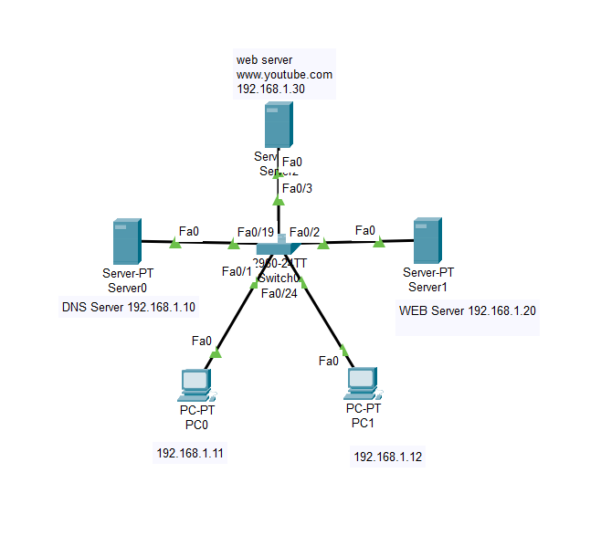
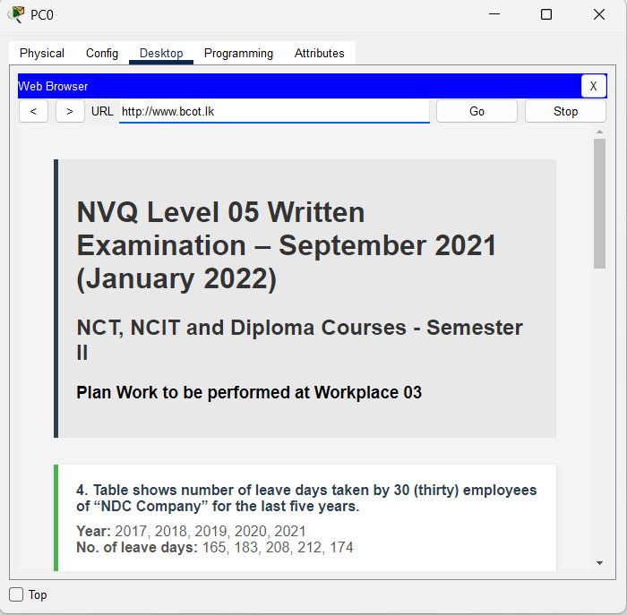
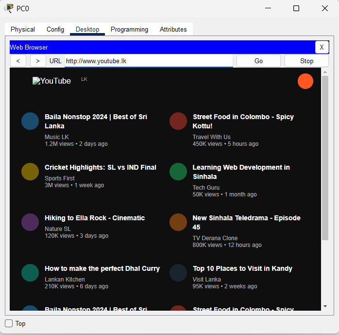

# 📡 Lab: DNS and Web Server Services

## 🎯 Objective
This lab demonstrates the configuration and verification of a small-scale network environment involving a **DNS Server** and multiple **Web Servers** to provide **domain name resolution** and **web hosting services** to client PCs. By the end of this lab, clients can type a human-readable URL (e.g., `www.youtube.lk`) into a web browser and have it automatically resolved to the correct server IP address, which then delivers the hosted web page.

## 🧠 Concepts Covered
- **Star Topology:** All devices connect through a single central Switch, forming a star layout. This simplifies management and isolates cable failures to individual links.
- **Static IP Addressing:** Each device is manually assigned a unique IPv4 address within the `192.168.1.0/24` subnet. No DHCP is used.
- **DNS (Domain Name System):** A dedicated server maps human-readable domain names (e.g., `www.youtube.lk`) to their corresponding IP addresses (e.g., `192.168.1.30`), allowing users to browse by name instead of memorizing IP addresses.
- **HTTP/Web Services:** Web servers host HTML content and serve it to clients over HTTP, simulating real-world websites like YouTube and BCot within the lab.

## 🛠️ Devices Used
| Qty | Device | Model / Type |
| :---: | :--- | :--- |
| 1 | Switch | Cisco Catalyst 2960-24TT |
| 3 | Servers | Generic Server-PT (DNS Server, YouTube Web Server, BCot Web Server) |
| 2 | End Devices | PC-PT (PC0, PC1) |

---

## ⚙️ Configuration Steps

### 1. High-Level Network Plan

The network is designed as a single **Local Area Network (LAN)** under the subnet `192.168.1.0/24` with a subnet mask of `255.255.255.0`. Since all devices reside in one subnet, they can communicate directly through the Switch without needing a Router.

#### Network Addressing Table

| Device | Role | IP Address | Subnet Mask | DNS Server | Default Gateway |
| :--- | :--- | :--- | :--- | :--- | :--- |
| **Server0** | DNS Server | `192.168.1.10` | `255.255.255.0` | — | — |
| **Server1** | Web Server (BCot) | `192.168.1.20` | `255.255.255.0` | — | — |
| **Server2** | Web Server (YouTube) | `192.168.1.30` | `255.255.255.0` | — | — |
| **PC0** | Client | `192.168.1.11` | `255.255.255.0` | `192.168.1.10` | — |
| **PC1** | Client | `192.168.1.12` | `255.255.255.0` | `192.168.1.10` | — |

> **Note:** No Default Gateway is required because all devices are on the same subnet and no inter-network routing is needed.

#### DNS Records Table

| Domain Name | Record Type | Resolves To (IP Address) | Hosted On |
| :--- | :---: | :--- | :--- |
| `www.youtube.lk` | A | `192.168.1.30` | Server2 |
| `www.bcot.lk` | A | `192.168.1.20` | Server1 |

#### Topology Diagram

```
                        ┌──────────────────┐
                        │     Server2      │
                        │  Web Server      │
                        │ www.youtube.lk   │
                        │  192.168.1.30    │
                        │    Fa0           │
                        └───────┬──────────┘
                                │
                              Fa0/3
                                │
┌──────────────┐     Fa0/19 ┌───┴───────┐ Fa0/2   ┌──────────────┐
│   Server0    │─────Fa0────┤  Switch0  ├────Fa0───│   Server1    │
│  DNS Server  │            │ 2960-24TT │          │  Web Server  │
│ 192.168.1.10 │            └───┬───┬───┘          │  www.bcot.lk │
└──────────────┘          Fa0/1 │   │ Fa0/24       │ 192.168.1.20 │
                                │   │              └──────────────┘
                              Fa0  Fa0
                                │   │
                          ┌─────┴┐ ┌┴─────┐
                          │ PC0  │ │ PC1  │
                          │.1.11 │ │.1.12 │
                          └──────┘ └──────┘
```

---

### 2. Low-Level Configuration (Interface / Device Level)

#### Step A: Physical Cabling

Connect all devices to the central **Switch0** using **Copper Straight-Through** cables:

| Cable # | From Device | From Interface | To Device | To Interface |
| :---: | :--- | :---: | :--- | :---: |
| 1 | Server0 (DNS) | Fa0 | Switch0 | Fa0/19 |
| 2 | Server1 (BCot Web) | Fa0 | Switch0 | Fa0/2 |
| 3 | Server2 (YouTube Web) | Fa0 | Switch0 | Fa0/3 |
| 4 | PC0 | Fa0 | Switch0 | Fa0/1 |
| 5 | PC1 | Fa0 | Switch0 | Fa0/24 |

> **Why Straight-Through?** When connecting an end device (PC or Server) to a Switch, always use a straight-through cable. Cross-over cables are used for switch-to-switch or PC-to-PC connections.

---

#### Step B: IP Addressing (All Devices)

Configure each device's IP settings through the Packet Tracer GUI.

##### Server0 — DNS Server (`192.168.1.10`)
1. Click on **Server0** → go to the **Desktop** tab → click **IP Configuration**.
2. Set the following:
   - **IP Address:** `192.168.1.10`
   - **Subnet Mask:** `255.255.255.0`
3. Leave Default Gateway and DNS Server blank (this server does not need to resolve names externally).

##### Server1 — BCot Web Server (`192.168.1.20`)
1. Click on **Server1** → go to the **Desktop** tab → click **IP Configuration**.
2. Set the following:
   - **IP Address:** `192.168.1.20`
   - **Subnet Mask:** `255.255.255.0`

##### Server2 — YouTube Web Server (`192.168.1.30`)
1. Click on **Server2** → go to the **Desktop** tab → click **IP Configuration**.
2. Set the following:
   - **IP Address:** `192.168.1.30`
   - **Subnet Mask:** `255.255.255.0`

##### PC0 — Client (`192.168.1.11`)
1. Click on **PC0** → go to the **Desktop** tab → click **IP Configuration**.
2. Set the following:
   - **IP Address:** `192.168.1.11`
   - **Subnet Mask:** `255.255.255.0`
   - **DNS Server:** `192.168.1.10` ⚠️ **Critical — this tells the PC where to send DNS queries**

##### PC1 — Client (`192.168.1.12`)
1. Click on **PC1** → go to the **Desktop** tab → click **IP Configuration**.
2. Set the following:
   - **IP Address:** `192.168.1.12`
   - **Subnet Mask:** `255.255.255.0`
   - **DNS Server:** `192.168.1.10` ⚠️ **Critical — this tells the PC where to send DNS queries**

> **Why set the DNS Server on PCs?** Without this, the PC has no idea which server to ask when it needs to translate `www.youtube.lk` into an IP address. The browser would display "Host Name Unresolved."

---

#### Step C: DNS Server Configuration (Server0)

This is where we create the mapping between domain names and IP addresses.

1. Click on **Server0** → go to the **Services** tab → click **DNS** from the left panel.
2. Ensure the **DNS Service** toggle is set to **ON**.
3. Add the first DNS record:
   - **Name:** `www.youtube.lk`
   - **Type:** `A Record`
   - **Address:** `192.168.1.30`
   - Click **Add**.
4. Add the second DNS record:
   - **Name:** `www.bcot.lk`
   - **Type:** `A Record`
   - **Address:** `192.168.1.20`
   - Click **Add**.
5. Verify both records appear in the resource records list.

> **How DNS Works in This Lab:**
> 1. PC0 types `www.youtube.lk` in the browser.
> 2. PC0 sends a DNS query to `192.168.1.10` (Server0).
> 3. Server0 looks up its records and replies: "`www.youtube.lk` → `192.168.1.30`".
> 4. PC0 now sends an HTTP request directly to `192.168.1.30` (Server2).
> 5. Server2 responds with the web page content.

---

#### Step D: HTTP/Web Server Configuration (Server1 & Server2)

##### Server1 — BCot Website (`www.bcot.lk`)
1. Click on **Server1** → go to the **Services** tab → click **HTTP** from the left panel.
2. Ensure both **HTTP** and **HTTPS** are toggled **ON**.
3. Click on `index.html` in the file list and click **Edit**.
4. Replace the default content with your desired HTML (e.g., the NVQ Level 05 Written Examination page).
5. Click **Save**.

##### Server2 — YouTube Website (`www.youtube.lk`)
1. Click on **Server2** → go to the **Services** tab → click **HTTP** from the left panel.
2. Ensure both **HTTP** and **HTTPS** are toggled **ON**.
3. Click on `index.html` in the file list and click **Edit**.
4. Replace the default content with your desired HTML (e.g., the YouTube LK clone interface).
5. Click **Save**.

---

## ✅ Verification

### Test 1: Ping Connectivity
Verify Layer 3 (IP) connectivity between devices.

From **PC0**, open **Desktop → Command Prompt** and run:

```
C:\> ping 192.168.1.10
```
**Expected Result:** 4 replies received with 0% packet loss, confirming the DNS server is reachable.

```
C:\> ping 192.168.1.20
```
**Expected Result:** 4 replies, confirming the BCot web server is reachable.

```
C:\> ping 192.168.1.30
```
**Expected Result:** 4 replies, confirming the YouTube web server is reachable.

### Test 2: DNS Resolution + Web Browsing
Verify the full DNS lookup → HTTP request cycle.

From **PC0**, open **Desktop → Web Browser**:

1. Type `www.youtube.lk` into the URL bar and click **Go**.
   - [x] **Expected:** The YouTube LK page loads with video thumbnails and content.
2. Type `www.bcot.lk` into the URL bar and click **Go**.
   - [x] **Expected:** The NVQ Level 05 examination page loads with course details.

### Test 3: Cross-Client Verification
Repeat Test 2 from **PC1** to confirm both clients can resolve and browse successfully.

- [x] `www.youtube.lk` loads correctly from PC1.
- [x] `www.bcot.lk` loads correctly from PC1.

---

## 📸 Screenshots

> **Network Topology** — Star topology with Switch0 at the centre, connecting the DNS server, two Web servers, and two client PCs.


> **Topology (Labelled)** — Clear view of all device names, IP addresses, and interface connections.



> **Verification: www.bcot.lk** — PC0 successfully browsing the BCot NVQ examination page via DNS resolution.



> **Verification: www.youtube.lk** — PC0 successfully browsing the YouTube LK clone page via DNS resolution.



---

## ❗ Common Issues

| Problem | Symptom | Solution |
| :--- | :--- | :--- |
| DNS Service is OFF | Browser shows "Host Name Unresolved" | Go to Server0 → Services → DNS and toggle the service **ON** |
| DNS IP not set on PC | Browser shows "Host Name Unresolved" | Go to PC → Desktop → IP Configuration and set DNS Server to `192.168.1.10` |
| Wrong IP in DNS record | Browser loads the wrong page or shows an error | Verify the A Record addresses on Server0 match the actual server IPs |
| HTTP Service is OFF | DNS resolves but browser shows "Request Timeout" | Go to the Web Server → Services → HTTP and toggle HTTP **ON** |
| Cable type mismatch | Link light is red/orange; no connectivity | Use **Copper Straight-Through** cables for device-to-switch connections |
| IP address conflict | Intermittent connectivity; duplicate address warnings | Verify each device has a unique IP within `192.168.1.0/24` |
| VLAN mismatch | Devices cannot reach each other despite correct IPs | Ensure all switch ports are in the default **VLAN 1** |

---

## 📁 Lab File

> 💾 **Try it yourself** — Download [`DNS and WEB Server.pkt`](DNS%20and%20WEB%20Server.pkt) and open it in **Cisco Packet Tracer 8.1+**. Use a PC's browser to visit `web.ccna.com`, then modify the DNS A record to point to a different server and watch the resolution change in real time.

- `DNS and WEB Server.pkt` — Complete working lab with DNS and HTTP services configured.

---

## 🚀 What I Learned
- **Full Web Request Cycle:** How a DNS lookup translates a domain name to an IP address, followed by an HTTP GET request that retrieves the web page from the correct server.
- **Star Topology Advantages:** The central switch manages all traffic, making it easy to add or remove devices without disrupting the rest of the network.
- **DNS Record Management:** How to create A Records that bind domain names to IP addresses, and why every client must be configured with the DNS server's IP address.
- **Web Server Hosting:** How to configure basic HTML content on a Packet Tracer server and serve it over HTTP to clients on the network.
- **Troubleshooting Methodology:** A systematic approach — check physical links first, then IP addressing, then service configuration — to isolate and resolve connectivity issues.
