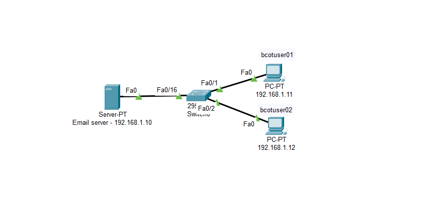
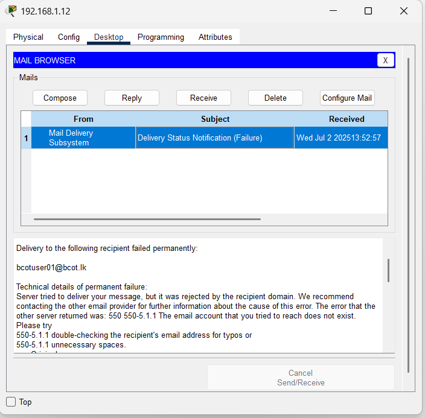
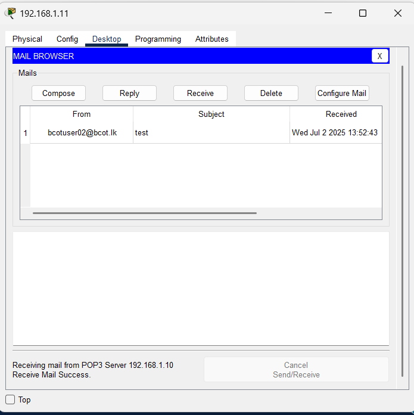

# 📡 Lab: Basic Email Service Connectivity

## 🎯 Objective
This lab demonstrates the configuration and verification of a centralized Email Service (SMTP/POP3) within a local area network using Cisco Packet Tracer, ensuring end-devices can communicate and exchange messages via a dedicated server.

## 🧠 Concepts Covered
- **Application Layer Services:** Configuring SMTP (Sending) and POP3 (Receiving) on a Server.
- **DNS Resolution:** Mapping a human-readable domain name (`bcot.lk`) to a Server IP.
- **Client Configuration:** Setting up Mail agents on end devices.
- **Error Analysis:** Troubleshooting SMTP error codes (e.g., 550 delivery failure).

## 🛠️ Devices Used
- **1x Server-PT:** Acting as both Email and DNS Server.
- **1x 2960 Switch:** Providing Layer 2 connectivity.
- **2x PCs:** End-user terminals representing `bcotuser01` and `bcotuser02`.

## ⚙️ Configuration Steps

### 1. High-Level Network Plan
The network is designed as a single subnet ($192.168.1.0/24$). All devices reside in the same broadcast domain, allowing for efficient communication without the need for a router.

| Device | IP Address | Role |
| :--- | :--- | :--- |
| **Server** | `192.168.1.10` | Mail (SMTP/POP3) & DNS |
| **PC01** | `192.168.1.11` | User: `bcotuser01` |
| **PC02** | `192.168.1.12` | User: `bcotuser02` |

- **Subnet Mask:** `255.255.255.0`
- **Domain Name:** `bcot.lk`

### 2. Low-Level Configuration (Device Level)

#### **A. Server Configuration (Services Tab)**
1.  **Email Service:**
    - Navigate to **Services > EMAIL**.
    - Set the **Domain Name** to `bcot.lk` and click **Set**.
    - **User Accounts:**
        - User: `bcotuser01` | Password: `123` (Click **+**)
        - User: `bcotuser02` | Password: `123` (Click **+**)
    - Ensure both **SMTP** and **POP3** services are turned **ON**.
2.  **DNS Service:**
    - Navigate to **Services > DNS**.
    - Turn the service **ON**.
    - Create an **A Record**:
        - Name: `bcot.lk`
        - Address: `192.168.1.10`
    - Click **Add**.

#### **B. PC Configuration (Desktop Tab)**
1.  **IP Configuration:**
    - Assign Static IPs (`192.168.1.11` and `192.168.1.12`).
    - Set the **DNS Server** to `192.168.1.10`.
2.  **Mail Setup:**
    - Open the **Mail** application.
    - **Your Name:** User Display Name (e.g., `bcotuser01`).
    - **Email Address:** `bcotuser01@bcot.lk`.
    - **Incoming/Outgoing Mail Server:** `192.168.1.10` (or `bcot.lk`).
    - **Username:** `bcotuser01`
    - **Password:** `123`

## ✅ Verification
- [x] **Ping Test:** PC `192.168.1.12` can successfully ping Server `192.168.1.10`.
- [x] **Service Status:** Confirmed SMTP/POP3/DNS services are active on the server.
- [ ] **Mail Success:** Successfully compose and send an email from `bcotuser02` to `bcotuser01`.

## 📸 Screenshots

### Network Topology

### Email Service Configuration

### Mail User Setup on PC

### Troubleshooting Error (550)

## ❗ Common Issues
- **550 5-5.1.1 Error:** The server rejected the mail because the recipient account (`bcotuser01`) was either not created yet or misspelled in the TO field.
- **Domain Not Set:** Forgetting to click the "Set" button after typing the domain name in the Email service tab.
- **DNS Mismatch:** Using the domain `bcot.lk` in mail settings without a DNS A-record pointing to the server’s IP.

## 📁 Lab File

> 💾 **Try it yourself** — Download [`mail practical.pkt`](mail%20practical.pkt) and open it in **Cisco Packet Tracer 8.1+**. Compose and send an email between the two user accounts, then try mis-typing the domain name to trigger a `550` error and diagnose it.

- [`mail practical.pkt`](mail%20practical.pkt) — Complete working SMTP/POP3 mail lab.

## 🚀 What I Learned
- The distinction between **Network Connectivity** (Ping) and **Service Connectivity** (User accounts/Service logic).
- How to interpret SMTP error codes to pinpoint configuration gaps.
- The critical role of DNS in simplifying service access for end-users.
