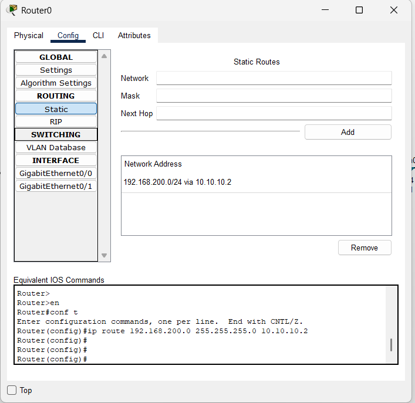
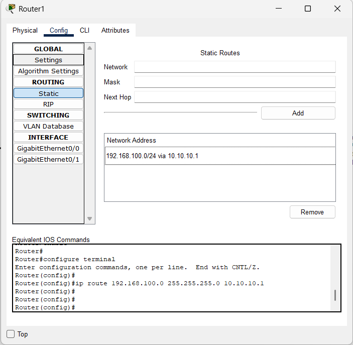
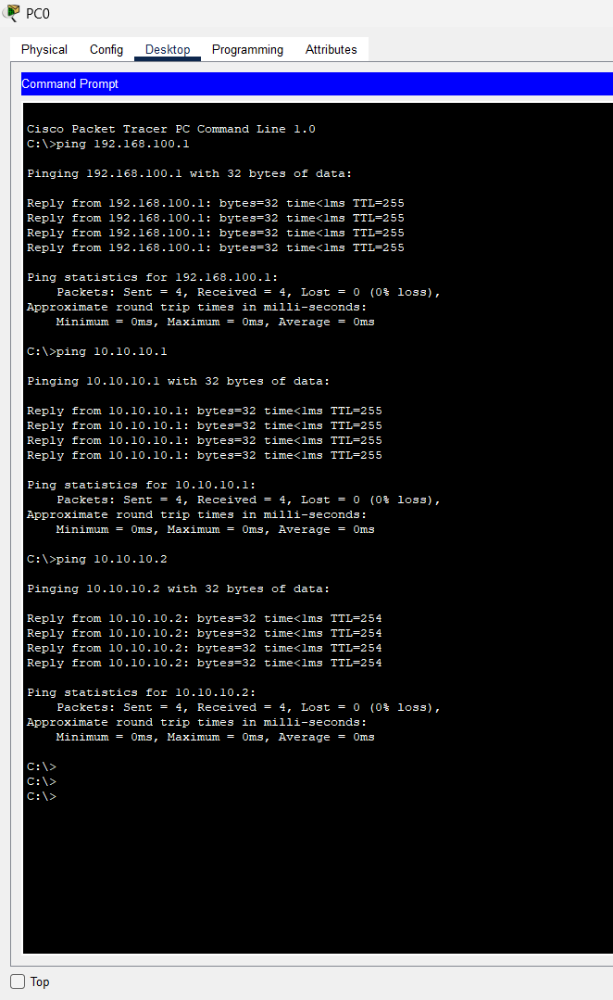
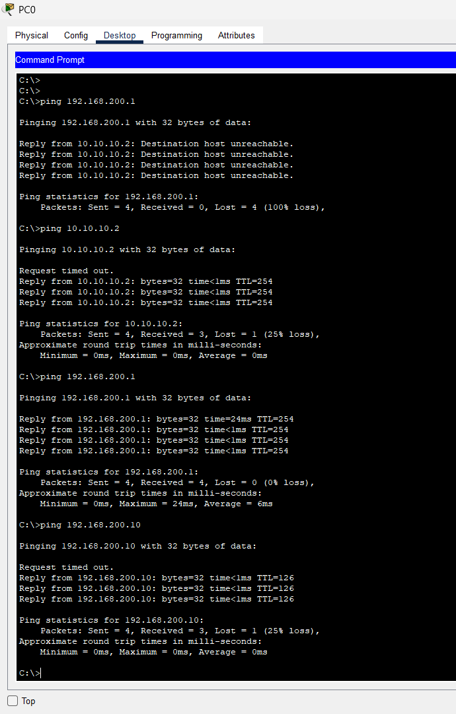

# 📡 Lab: Web Server with Inter-Network Static Routing

## 🎯 Objective
This lab demonstrates the configuration of a **Web Server** hosted behind a remote router, accessible from a client PC on a different subnet via **Static Routing**. The lab covers inter-network communication between two separate LANs (`192.168.100.0/24` and `192.168.200.0/24`) connected through a **point-to-point WAN link** (`10.10.10.0/24`). By the end of this lab, PC0 can browse a website hosted on Server0 by resolving a domain name (`theekmind.com`) through DNS and routing packets across multiple subnets.

## 🧠 Concepts Covered
- **Multi-Subnet Topology:** Two separate LANs interconnected by a WAN link between two routers, requiring routing configuration for end-to-end communication.
- **Static Routing:** Manually configuring routing table entries on each router so they know how to forward packets to remote networks they are not directly connected to.
- **Default Gateway:** Configuring end devices (PC and Server) with the IP address of their local router interface, so packets destined for remote networks are forwarded to the router.
- **HTTP/Web Services:** Hosting an HTML website on Server0 and serving it to clients over HTTP.
- **DNS (Domain Name System):** Configuring Server0 to resolve `theekmind.com` to its own IP address, enabling browser-based access by domain name.
- **Staged Ping Troubleshooting:** Systematically pinging hop-by-hop (gateway → WAN link → remote gateway → destination) to isolate the exact point of failure.

## 🛠️ Devices Used
| Qty | Device | Model / Type |
| :---: | :--- | :--- |
| 2 | Routers | Cisco 1941 ISR (Router0, Router1) |
| 2 | Switches | Cisco Catalyst 2950-24 (Switch0, Switch1) |
| 1 | PC | PC-PT (PC0 — Client) |
| 1 | Server | Server-PT (Server0 — Web + DNS Server) |

---

## ⚙️ Configuration Steps

### 1. High-Level Network Plan

The network consists of **three subnets** connected by two routers. Router0 and Router1 each have one interface facing a local LAN and one interface on the shared WAN link. Static routes are required because neither router automatically knows about the network on the other side.

#### Subnet Plan

| Subnet | Network Address | Purpose | Connected Devices |
| :--- | :--- | :--- | :--- |
| **LAN A** | `192.168.100.0/24` | Client Network | PC0, Router0 (Gig0/0) |
| **WAN Link** | `10.10.10.0/24` | Inter-Router Link | Router0 (Gig0/1), Router1 (Gig0/1) |
| **LAN B** | `192.168.200.0/24` | Server Network | Server0, Router1 (Gig0/0) |

#### Network Addressing Table

| Device | Interface | IP Address | Subnet Mask | Default Gateway | DNS Server |
| :--- | :---: | :--- | :--- | :--- | :--- |
| **Router0** | Gig0/0 | `192.168.100.1` | `255.255.255.0` | — | — |
| **Router0** | Gig0/1 | `10.10.10.1` | `255.255.255.0` | — | — |
| **Router1** | Gig0/1 | `10.10.10.2` | `255.255.255.0` | — | — |
| **Router1** | Gig0/0 | `192.168.200.1` | `255.255.255.0` | — | — |
| **PC0** | Fa0 | `192.168.100.10` | `255.255.255.0` | `192.168.100.1` | `192.168.200.10` |
| **Server0** | Fa0 | `192.168.200.10` | `255.255.255.0` | `192.168.200.1` | — |

#### Static Routing Table

| Router | Destination Network | Subnet Mask | Next Hop | Meaning |
| :--- | :--- | :--- | :--- | :--- |
| **Router0** | `192.168.200.0` | `255.255.255.0` | `10.10.10.2` | "To reach the Server LAN, send packets to Router1" |
| **Router1** | `192.168.100.0` | `255.255.255.0` | `10.10.10.1` | "To reach the Client LAN, send packets to Router0" |

> **Why do we need static routes?** Each router only knows about networks that are directly connected to its own interfaces. Router0 knows about `192.168.100.0/24` and `10.10.10.0/24` but has no idea that `192.168.200.0/24` exists. Without a static route, Router0 simply **drops** any packet destined for the Server's network.

> **Why are routes needed in BOTH directions?** Even if Router0 can forward PC0's packet to the Server, the Server's **reply** must travel back through Router1. If Router1 has no route to `192.168.100.0/24`, it drops the reply — and the ping shows **"Failed"** despite the outbound packet arriving successfully.

#### DNS Record

| Domain Name | Record Type | Resolves To (IP Address) | Hosted On |
| :--- | :---: | :--- | :--- |
| `theekmind.com` | A | `192.168.200.10` | Server0 |

#### Topology Diagram

```
┌──────────────┐                                                    ┌──────────────┐
│     PC0      │                                                    │   Server0    │
│   Client     │                                                    │  Web + DNS   │
│192.168.100.10│                                                    │192.168.200.10│
│     Fa0      │                                                    │     Fa0      │
└──────┬───────┘                                                    └──────┬───────┘
       │                                                                   │
     Fa0/21                                                              Fa0/2
       │                                                                   │
┌──────┴───────┐                                                    ┌──────┴───────┐
│   Switch0    │                                                    │   Switch1    │
│   2950-24    │                                                    │   2950-24    │
└──────┬───────┘                                                    └──────┬───────┘
       │                                                                   │
     Fa0/2                                                               Fa0/1
       │                                                                   │
┌──────┴───────┐       WAN Link (Cross-Over)       ┌───────────────────────┴──────┐
│   Router0    │          10.10.10.0/24             │          Router1             │
│    1941      ├────Gig0/1──────────────Gig0/1──────┤           1941              │
│  Gig0/0:     │  10.10.10.1         10.10.10.2     │        Gig0/0:              │
│192.168.100.1 │                                    │      192.168.200.1          │
└──────────────┘                                    └─────────────────────────────┘
```

---

### 2. Low-Level Configuration (Interface / Device Level)

#### Step A: Physical Cabling

Connect all devices using the correct cable types:

| Cable # | From Device | From Interface | To Device | To Interface | Cable Type |
| :---: | :--- | :---: | :--- | :---: | :--- |
| 1 | PC0 | Fa0 | Switch0 | Fa0/21 | Copper Straight-Through |
| 2 | Switch0 | Fa0/2 | Router0 | Gig0/0 | Copper Straight-Through |
| 3 | Router0 | Gig0/1 | Router1 | Gig0/1 | **Copper Cross-Over** |
| 4 | Router1 | Gig0/0 | Switch1 | Fa0/1 | Copper Straight-Through |
| 5 | Switch1 | Fa0/2 | Server0 | Fa0 | Copper Straight-Through |

> **Why Cross-Over for the Router-to-Router link?** Both routers are "like devices" — they transmit on the same pins. A cross-over cable swaps the transmit and receive pairs so each router receives the other's signal. In the topology diagram, this link appears as a **dashed line** (- - -).

---

#### Step B: Router Interface Configuration

Configure each router's interfaces with IP addresses and bring them up.

##### Router0

Open the **CLI** tab on Router0 and enter:

```
Router> enable
Router# configure terminal

! --- Configure the LAN-facing interface (toward PC0 / Switch0) ---
Router(config)# interface GigabitEthernet0/0
Router(config-if)# ip address 192.168.100.1 255.255.255.0
Router(config-if)# no shutdown
Router(config-if)# exit

! --- Configure the WAN-facing interface (toward Router1) ---
Router(config)# interface GigabitEthernet0/1
Router(config-if)# ip address 10.10.10.1 255.255.255.0
Router(config-if)# no shutdown
Router(config-if)# exit
```

**Or via GUI:** Click Router0 → **Config** tab → select **GigabitEthernet0/0** → set IP Address to `192.168.100.1`, Subnet Mask to `255.255.255.0`, and check the **On** checkbox. Repeat for **GigabitEthernet0/1** with `10.10.10.1`.

##### Router1

Open the **CLI** tab on Router1 and enter:

```
Router> enable
Router# configure terminal

! --- Configure the WAN-facing interface (toward Router0) ---
Router(config)# interface GigabitEthernet0/1
Router(config-if)# ip address 10.10.10.2 255.255.255.0
Router(config-if)# no shutdown
Router(config-if)# exit

! --- Configure the LAN-facing interface (toward Server0 / Switch1) ---
Router(config)# interface GigabitEthernet0/0
Router(config-if)# ip address 192.168.200.1 255.255.255.0
Router(config-if)# no shutdown
Router(config-if)# exit
```

**Or via GUI:** Click Router1 → **Config** tab → select **GigabitEthernet0/1** → set IP Address to `10.10.10.2`, Subnet Mask to `255.255.255.0`, and check **On**. Repeat for **GigabitEthernet0/0** with `192.168.200.1`.

---

#### Step C: Static Route Configuration

This is the **critical step** that enables inter-network communication. Without these routes, packets cannot cross between the two LANs.

##### Router0 — Add route to Server LAN

```
Router> enable
Router# configure terminal
Router(config)# ip route 192.168.200.0 255.255.255.0 10.10.10.2
```

| Parameter | Value | Explanation |
| :--- | :--- | :--- |
| `ip route` | — | Tells the router you are manually adding a path to its routing table |
| Destination Network | `192.168.200.0` | The Server's network that Router0 doesn't know about |
| Subnet Mask | `255.255.255.0` | Defines the size of the destination network (/24 = 254 hosts) |
| Next Hop | `10.10.10.2` | Router1's WAN interface — the "door" to reach the Server network |

**Via GUI:** Click Router0 → **Config** tab → **Static** (under ROUTING) → enter Network: `192.168.200.0`, Mask: `255.255.255.0`, Next Hop: `10.10.10.2` → click **Add**.

##### Router1 — Add return route to Client LAN

```
Router> enable
Router# configure terminal
Router(config)# ip route 192.168.100.0 255.255.255.0 10.10.10.1
```

| Parameter | Value | Explanation |
| :--- | :--- | :--- |
| `ip route` | — | Tells the router you are manually adding a path to its routing table |
| Destination Network | `192.168.100.0` | The PC's network that Router1 doesn't know about |
| Subnet Mask | `255.255.255.0` | Defines the size of the destination network (/24) |
| Next Hop | `10.10.10.1` | Router0's WAN interface — the "door" to reach the Client network |

**Via GUI:** Click Router1 → **Config** tab → **Static** (under ROUTING) → enter Network: `192.168.100.0`, Mask: `255.255.255.0`, Next Hop: `10.10.10.1` → click **Add**.

> **The "Mailman" Analogy:** Think of Router0 as a local post office in Town A. A letter (data packet) comes in for Town B (`192.168.200.0`). Router0 looks at its "map" (Routing Table). If the map doesn't mention Town B, the router simply throws the letter away (which is why the ping **Failed**). By adding the static route, you are writing a note on the map: "To get letters to Town B, hand them to the driver at the gate marked `10.10.10.2` (Router1)."

---

#### Step D: End Device IP Configuration

##### PC0 — Client (`192.168.100.10`)
1. Click on **PC0** → go to the **Desktop** tab → click **IP Configuration**.
2. Set the following:
   - **IP Address:** `192.168.100.10`
   - **Subnet Mask:** `255.255.255.0`
   - **Default Gateway:** `192.168.100.1` ⚠️ **Critical — without this, PC0 cannot send packets to any remote network**
   - **DNS Server:** `192.168.200.10` ⚠️ **Required for browsing by domain name (`theekmind.com`)**

> **Why is the Default Gateway important?** When PC0 wants to reach `192.168.200.10` (the server), it checks: "Is this IP in my own subnet (`192.168.100.0/24`)?" The answer is **NO**, so it forwards the packet to its Default Gateway (`192.168.100.1` — Router0). Without a gateway, the PC has no idea where to send packets for remote networks and simply drops them.

##### Server0 — Web + DNS Server (`192.168.200.10`)
1. Click on **Server0** → go to the **Desktop** tab → click **IP Configuration**.
2. Set the following:
   - **IP Address:** `192.168.200.10`
   - **Subnet Mask:** `255.255.255.0`
   - **Default Gateway:** `192.168.200.1` ⚠️ **Critical — without this, replies from the server cannot reach PC0**

> **Why does the Server need a gateway?** Even though the Server receives the request (thanks to the routers' static routes), its **reply** must travel back to PC0. Without a gateway, the Server looks at the destination `192.168.100.10`, determines it's not on its local subnet, and **drops the reply**.

---

#### Step E: Web Server (HTTP) Configuration — Server0

1. Click on **Server0** → go to the **Services** tab → click **HTTP** from the left panel.
2. Ensure both **HTTP** and **HTTPS** are toggled **ON**.
3. Click on `index.html` in the file list and click **Edit**.
4. Replace the default content with your desired HTML content (e.g., the TheekMind website — "Build Your Future with TheekMind").
5. Click **Save**.

---

#### Step F: DNS Server Configuration — Server0

To allow PC0 to browse by typing `theekmind.com` instead of the raw IP address:

1. Click on **Server0** → go to the **Services** tab → click **DNS** from the left panel.
2. Ensure the **DNS Service** toggle is set to **ON**.
3. Add the DNS record:
   - **Name:** `theekmind.com`
   - **Type:** `A Record`
   - **Address:** `192.168.200.10`
   - Click **Add**.
4. Verify the record appears in the resource records list.

> **How the full request cycle works:**
> 1. PC0 types `theekmind.com` in the browser.
> 2. PC0 sends a **DNS query** to `192.168.200.10` (Server0) — routed via Router0 → Router1.
> 3. Server0 looks up its DNS records and replies: "`theekmind.com` → `192.168.200.10`".
> 4. PC0 now sends an **HTTP GET** request to `192.168.200.10`.
> 5. Server0 responds with the TheekMind web page HTML content.

---

## ✅ Verification

### Test 1: Staged Ping Test (Isolate Failures Hop-by-Hop)

This is the most important troubleshooting technique. Ping each hop in sequence from **PC0** to identify exactly where a connection breaks.

From **PC0**, open **Desktop → Command Prompt** and run:

**Step 1 — Ping the Default Gateway (Router0 LAN interface):**
```
C:\> ping 192.168.100.1
```
✅ **Expected:** 4 replies received, 0% loss. Confirms PC0 can reach its local router.

**Step 2 — Ping Router0's WAN interface:**
```
C:\> ping 10.10.10.1
```
✅ **Expected:** 4 replies, 0% loss. Confirms PC0 can reach the WAN link network.

**Step 3 — Ping Router1's WAN interface (crosses the WAN link):**
```
C:\> ping 10.10.10.2
```
✅ **Expected:** 4 replies, 0% loss. Confirms packets can cross the WAN link **and** the return route on Router1 exists.

**Step 4 — Ping Router1's LAN interface (remote gateway):**
```
C:\> ping 192.168.200.1
```
✅ **Expected:** 4 replies, 0% loss. Confirms static routes are working in both directions.

**Step 5 — Ping Server0 (final destination):**
```
C:\> ping 192.168.200.10
```
✅ **Expected:** 3–4 replies (the first may timeout due to ARP resolution). Confirms full end-to-end connectivity.

> **💡 Troubleshooting Tip:** If a ping fails at a specific step, the problem lies between that hop and the previous successful one. For example, if Step 4 fails but Step 3 succeeds, the issue is with the static route on Router0 (it doesn't know how to reach `192.168.200.0/24`).

### Test 2: Web Browsing via Domain Name

From **PC0**, open **Desktop → Web Browser**:

1. Type `http://theekmind.com` into the URL bar and click **Go**.
   - [x] **Expected:** The TheekMind website loads displaying "Build Your Future with TheekMind" with navigation (Home, Features, Contact) and a "Get Started" button.

---

## 📸 Screenshots

> **Network Topology** — Two LANs connected via a WAN link between Router0 and Router1, with PC0 on the left and Server0 on the right.


> **Router0 Static Route** — Static route `192.168.200.0/24 via 10.10.10.2` configured on Router0, directing traffic for the Server LAN to Router1.



> **Router1 Static Route** — Return static route `192.168.100.0/24 via 10.10.10.1` configured on Router1, enabling reply packets to reach the Client LAN.



> **Ping Verification (Local Hops)** — PC0 successfully pinging its gateway (`192.168.100.1`), Router0 WAN (`10.10.10.1`), and Router1 WAN (`10.10.10.2`) — all with 0% packet loss.



> **Ping Verification (Remote Hops)** — PC0 pinging Router1 LAN (`192.168.200.1`) and Server0 (`192.168.200.10`) after static routes were configured. Note the initial "Destination host unreachable" before routes were added, proving the static routes fixed the issue.



> **Web Browser Verification** — PC0 successfully browsing `http://theekmind.com`, which resolves via DNS to Server0 and displays the TheekMind website.


---

## ❗ Common Issues

| Problem | Symptom | Solution |
| :--- | :--- | :--- |
| Missing static route on Router0 | PC0 ping to `192.168.200.x` shows "Destination host unreachable" | Add `ip route 192.168.200.0 255.255.255.0 10.10.10.2` on Router0 |
| Missing static route on Router1 | Outbound ping reaches server but reply is lost — still shows "Failed" | Add `ip route 192.168.100.0 255.255.255.0 10.10.10.1` on Router1 |
| No Default Gateway on PC0 | PC0 cannot ping anything outside `192.168.100.0/24` | Set PC0's gateway to `192.168.100.1` |
| No Default Gateway on Server0 | Server receives request but reply never returns to PC0 | Set Server0's gateway to `192.168.200.1` |
| Router interface is shutdown | Link light is red; `show ip interface brief` shows "administratively down" | Enter `no shutdown` on the interface in config mode |
| Wrong cable on WAN link | Router-to-Router link light is red/amber | Use a **Copper Cross-Over** cable between Router0 Gig0/1 and Router1 Gig0/1 |
| IP address on wrong subnet | Ping to next hop fails despite link being up | Verify both WAN interfaces are in `10.10.10.0/24` with matching masks |
| First ping times out (ARP) | 1 out of 4 pings shows "Request timed out", rest succeed | Normal behaviour — the first packet triggers ARP resolution. Ping again for 4/4 |
| DNS service is OFF | Browser shows "Host Name Unresolved" when using `theekmind.com` | Go to Server0 → Services → DNS → toggle **ON** |
| DNS IP not set on PC0 | Browser shows "Host Name Unresolved" | Set PC0's DNS Server to `192.168.200.10` in IP Configuration |
| HTTP service is OFF | DNS resolves but browser shows "Request Timeout" | Go to Server0 → Services → HTTP → toggle HTTP **ON** |

---

## 📁 Lab File

> 💾 **Try it yourself** — Download [`project with web server.pkt`](project%20with%20web%20server.pkt) and open it in **Cisco Packet Tracer 8.1+**. Delete one of the static routes and observe exactly which pings break — then re-add it and confirm they recover.

- `project with web server.pkt` — Complete working lab with static routing and web server configured.

---

## 🚀 What I Learned
- **Static Routing Fundamentals:** How to manually configure routing table entries to enable communication between networks that a router is not directly connected to. Understood the `ip route [destination] [mask] [next-hop]` command syntax and what each parameter does.
- **Bidirectional Routing Requirement:** Static routes are **one-way streets** — configuring a route on only one router causes the reply to fail. Both routers must have return routes for full end-to-end connectivity.
- **Hop-by-Hop Troubleshooting:** The systematic approach of pinging each hop in sequence (gateway → WAN near → WAN far → remote gateway → destination) to pinpoint exactly where a failure occurs, rather than guessing at random.
- **The Role of Default Gateways:** End devices (PCs and Servers) must have a Default Gateway configured to communicate with devices outside their local subnet. This is the most common cause of ping failures in multi-router setups.
- **ARP Resolution Delay:** The first ICMP ping in a new session may time out because the device must first perform ARP (Address Resolution Protocol) to discover the MAC address of the next hop. Subsequent pings succeed because the ARP cache is now populated.
- **Multi-Service Server:** How a single server can host both DNS and HTTP services simultaneously, enabling domain-name-based web browsing across a routed network.
- **Cross-Over vs Straight-Through Cabling:** Router-to-Router (like-device) connections require cross-over cables because both devices transmit on the same wire pairs, while device-to-switch connections use straight-through cables.
- **Full Web Request Cycle:** How a DNS lookup translates `theekmind.com` to `192.168.200.10`, followed by an HTTP GET request routed through two routers and two switches to reach the web server, and the HTML response travelling the entire path back to the browser.
