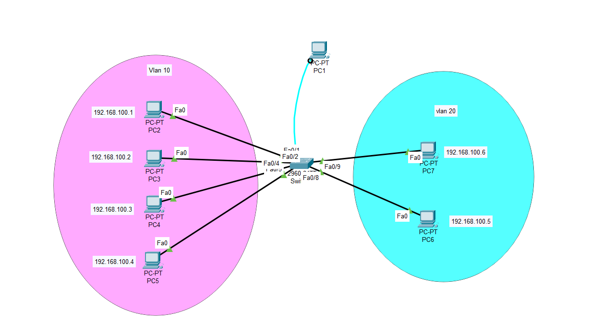
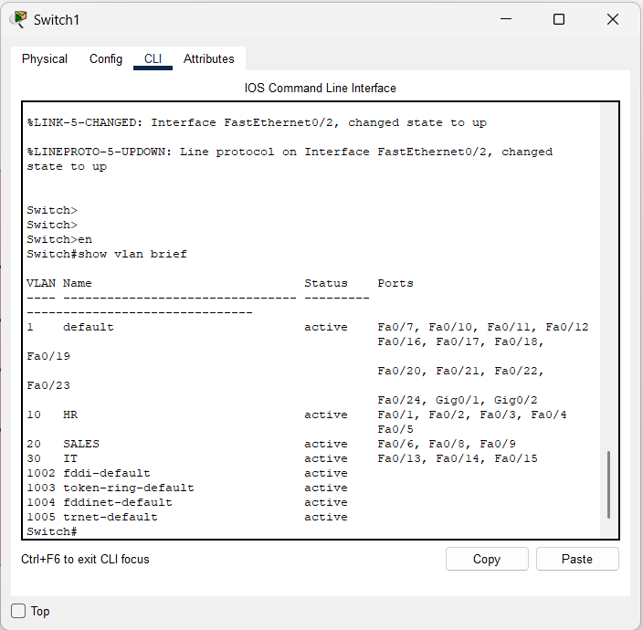
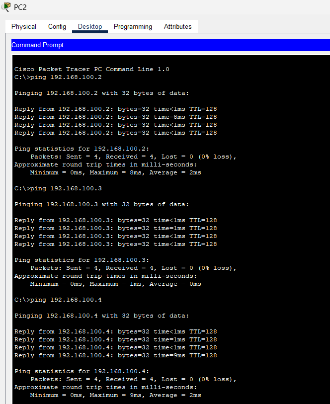
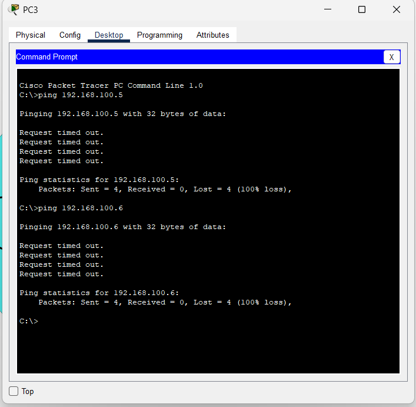

# 📡 Lab: VLAN Segmentation and Basic Connectivity

## 🎯 Objective
This lab demonstrates the configuration of **Virtual Local Area Networks (VLANs)** to logically segment a single physical switch into multiple broadcast domains — **HR**, **SALES**, and **FINANCE** — improving security, reducing congestion, and laying the foundation for Inter-VLAN Routing.

---

## 🧠 Concepts Covered
- **VLAN Creation & Naming** — Organising network traffic by department using the VLAN database.
- **Access Port Configuration** — Assigning physical switch interfaces to a specific VLAN.
- **Interface Range Command** — Bulk configuration of multiple ports simultaneously for efficiency.
- **Broadcast Domain Isolation** — Understanding why VLANs restrict Layer 2 flooding.
- **IOS CLI Navigation** — Transitioning between Global Config, VLAN config, and Interface config modes.

---

## 🛠️ Devices Used

| Device | Model | Role |
| :--- | :--- | :--- |
| **Switch** | Cisco Catalyst 2960 | Central switching point for all departmental PCs |
| **PC0 – PC11** | Generic End Devices | Simulated departmental hosts (HR, Sales, Finance) |

> All PCs are assigned IPs in the `192.168.100.x / 24` subnet. Even though they share the same IP range, VLAN segmentation prevents any cross-department Layer 2 communication without a router.

---

## ⚙️ Configuration Steps

### 📐 Step 1 — High-Level Network Plan (HLD)

The strategy is to divide the **single physical switch** into **three logical broadcast domains**. Each department gets its own VLAN ID and a dedicated range of switch ports.

> ℹ️ Even though all PCs are physically connected to the same switch and share the same subnet, they **cannot communicate with each other across VLANs** at Layer 2. A Layer 3 device (Router or L3 Switch) would be required to route between them.

#### 🗺️ VLAN Segmentation Plan

| Department | VLAN ID | Interface Range | IP Range (Example) | Purpose |
| :--- | :---: | :--- | :--- | :--- |
| **HR** | `10` | `Fa0/1 – Fa0/5` | `192.168.100.1 – .5` | Human Resources Data |
| **SALES** | `20` | `Fa0/6, Fa0/8, Fa0/9` | `192.168.100.6, .8, .9` | Sales & Technical Operations |
| **FINANCE** | `30` | `Fa0/13 – Fa0/15` | `192.168.100.13 – .15` | Financial Records & Support |

#### 🖼️ Topology Diagram


---

### 🔧 Step 2 — Low-Level Configuration (LLD)

This is the full interface-level and device-level configuration applied to the **Cisco 2960 Switch**.

---

#### 2A. Enter Global Configuration Mode

```
Switch> enable
Switch# configure terminal
Switch(config)#
```

> This moves from **User EXEC** (`>`) to **Privileged EXEC** (`#`) and then into **Global Configuration** mode where all system-wide changes are made.

---

#### 2B. Create the VLAN Database

Define all three VLANs and give them meaningful names. Without names, engineers have to memorise VLAN IDs, which leads to misconfiguration in large environments.

```
Switch(config)# vlan 10
Switch(config-vlan)# name HR
Switch(config-vlan)# exit

Switch(config)# vlan 20
Switch(config-vlan)# name SALES
Switch(config-vlan)# exit

Switch(config)# vlan 30
Switch(config-vlan)# name FINANCE
Switch(config-vlan)# exit
```

> ✅ After this step, VLANs 10, 20, and 30 exist in the switch's **VLAN database** but no ports are assigned yet.

---

#### 2C. Assign Ports — HR Department (VLAN 10)

Ports `Fa0/1` through `Fa0/5` are reserved for HR workstations.

```
Switch(config)# interface range fa0/1 - 5
Switch(config-if-range)# switchport mode access
Switch(config-if-range)# switchport access vlan 10
Switch(config-if-range)# exit
```

| Command | Explanation |
| :--- | :--- |
| `interface range fa0/1 - 5` | Selects ports Fa0/1 to Fa0/5 simultaneously |
| `switchport mode access` | Sets the port as an **access port** (carries only one VLAN) |
| `switchport access vlan 10` | Assigns the port to **VLAN 10 (HR)** |

---

#### 2D. Assign Ports — SALES Department (VLAN 20)

Ports `Fa0/6`, `Fa0/8`, and `Fa0/9` are assigned to the Sales team. Note that `Fa0/7` is intentionally skipped.

```
Switch(config)# interface range fa0/6, fa0/8 - 9
Switch(config-if-range)# switchport mode access
Switch(config-if-range)# switchport access vlan 20
Switch(config-if-range)# exit
```

> 💡 The `interface range` command supports comma-separated port lists. This is a powerful tool when port assignments are non-contiguous.

---

#### 2E. Assign Ports — FINANCE Department (VLAN 30)

Ports `Fa0/13` through `Fa0/15` are assigned to Finance.

```
Switch(config)# interface range fa0/13 - 15
Switch(config-if-range)# switchport mode access
Switch(config-if-range)# switchport access vlan 30
Switch(config-if-range)# exit
```

---

#### 2F. Save the Configuration

Always write the running configuration to NVRAM so it survives a reboot.

```
Switch(config)# end
Switch# write memory
```

Or equivalently:
```
Switch# copy running-config startup-config
```

---

## ✅ Verification

### Step 1 — Check the VLAN Database

Run the following command to confirm:
- VLANs 10, 20, and 30 exist with their correct names.
- All assigned ports have moved out of the default VLAN 1.

```
Switch# show vlan brief
```

#### Expected Output:

| VLAN | Name | Status | Ports |
| :--- | :--- | :--- | :--- |
| 1 | default | active | (remaining unassigned ports) |
| 10 | HR | active | Fa0/1, Fa0/2, Fa0/3, Fa0/4, Fa0/5 |
| 20 | SALES | active | Fa0/6, Fa0/8, Fa0/9 |
| 30 | FINANCE | active | Fa0/13, Fa0/14, Fa0/15 |

#### 📸 Screenshot — `show vlan brief` Output



---

### Step 2 — Intra-VLAN Ping (Should Succeed ✅)

PCs within the **same VLAN** share the same broadcast domain and can communicate at Layer 2.

**Test:** From a PC in VLAN 10 (HR), ping another PC also in VLAN 10.

```
PC> ping 192.168.100.4
```

> ✅ **Expected Result:** Successful — 4 packets sent, 4 received, 0% packet loss.

#### 📸 Screenshot — Successful Intra-VLAN Ping



---

### Step 3 — Inter-VLAN Ping (Should Fail ❌)

PCs in **different VLANs** are in isolated broadcast domains. Without a router, they cannot communicate.

**Test:** From a PC in VLAN 10 (HR), ping a PC in VLAN 20 (Sales).

```
PC> ping 192.168.100.6
```

> ❌ **Expected Result:** Request timeout — confirms that VLAN segmentation is working correctly.

#### 📸 Screenshot — Failed Inter-VLAN Ping (Segmentation Confirmed)



---

### Step 4 — Additional Verification Screenshots

#### 📸 Screenshot — Full Configuration View



---

### Verification Checklist

- [x] **VLAN Database:** `show vlan brief` confirms VLANs 10, 20, 30 are active with correct port assignments.
- [x] **Intra-VLAN Ping:** PC in VLAN 10 → PC in VLAN 10 = ✅ Success.
- [x] **Inter-VLAN Isolation:** PC in VLAN 10 → PC in VLAN 20 = ❌ Timeout (segmentation working).
- [x] **Configuration Saved:** `write memory` executed successfully.

---

## ❗ Common Issues

| Issue | Symptom | Fix |
| :--- | :--- | :--- |
| **Wrong VLAN Assignment** | PC cannot reach others in same department | Re-run `switchport access vlan X` on the correct port |
| **Port left in VLAN 1** | PC appears connected but isolated from its VLAN group | Check `show vlan brief` — reassign the port |
| **Forgot `switchport mode access`** | Port may negotiate as trunk and behave unpredictably | Always set `switchport mode access` before assigning VLAN |
| **Wrong prompt level** | Commands rejected or applied to wrong context | Check your prompt: `(config)#`, `(config-vlan)#`, `(config-if-range)#` |
| **Unsaved config** | VLAN assignments lost after reboot | Always run `write memory` before powering off |

---

## 📁 Lab File

> 💾 **Try it yourself** — Download [`Creating and Configuring VLANs on a Managed Switch.pkt`](Creating%20and%20Configuring%20VLANs%20on%20a%20Managed%20Switch.pkt) and open in **Cisco Packet Tracer 8.1+**. Try pinging between VLANs to confirm isolation, then add a fourth VLAN and assign a spare port to it.

- `Creating and Configuring VLANs on a Managed Switch.pkt` — Cisco Packet Tracer project file.

---

## 🚀 What I Learned

- **Logical vs. Physical Separation:** Physical proximity does not equal network reachability. VLANs give granular control over who can communicate with whom, regardless of the physical cabling.
- **CLI Efficiency with `interface range`:** Configuring multiple ports at once dramatically reduces manual error and speeds up large deployments.
- **The Importance of VLAN Naming:** Using `name HR` instead of just remembering VLAN ID 10 is a professional habit that makes networks far easier to troubleshoot and hand over to other engineers.
- **VLAN 1 is a Security Risk:** Leaving ports in the default VLAN 1 is considered bad practice. Always explicitly assign every port to a named VLAN.
- **Layer 2 Boundaries:** This lab reinforced that VLANs are a Layer 2 construct — routing between them requires a Layer 3 device (router or Layer 3 switch).

---


