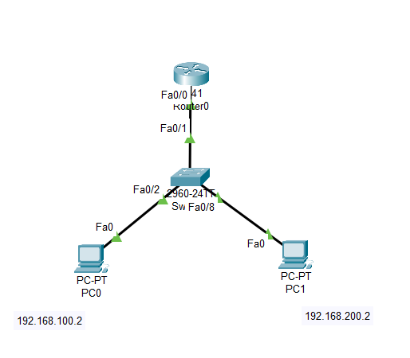
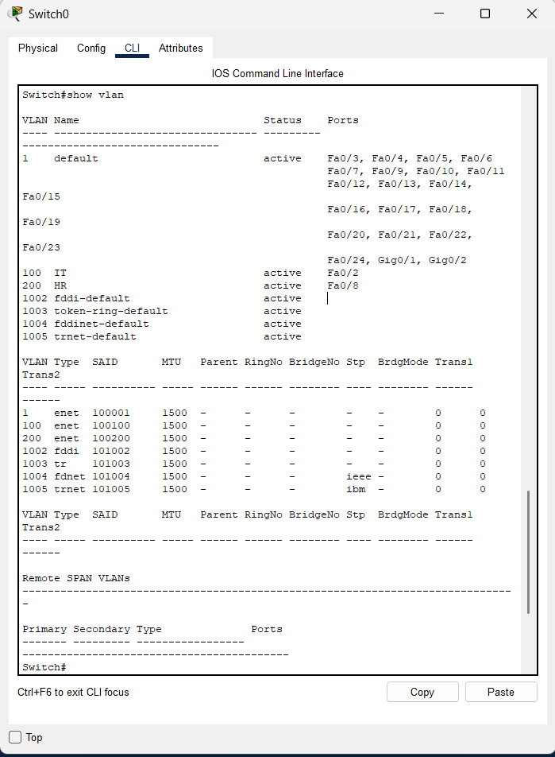
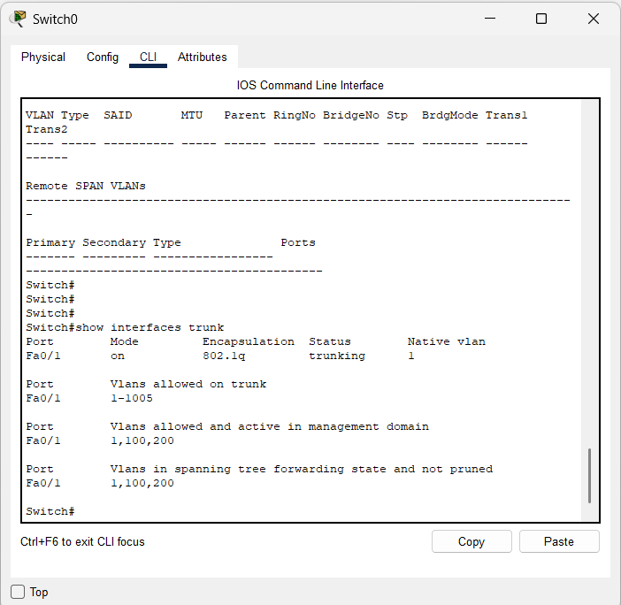
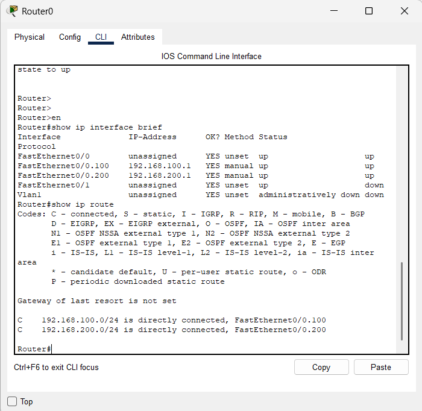
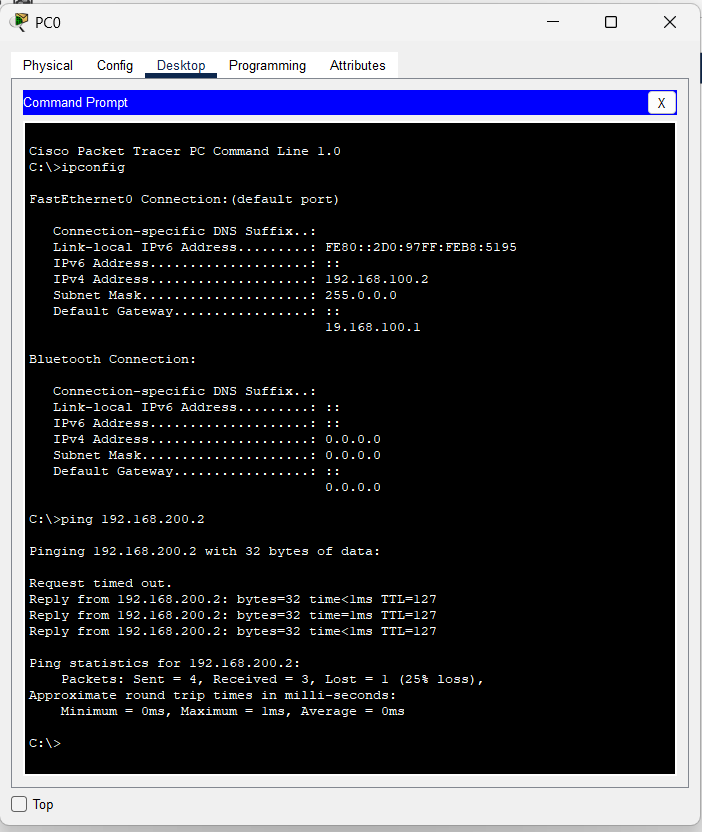

# 📡 Lab: Inter-VLAN Routing (Router-on-a-Stick)

## 🎯 Objective
This lab demonstrates how to configure **Router-on-a-Stick** to enable communication between two logically isolated networks — **VLAN 100 (IT)** and **VLAN 200 (HR)** — using a single physical router interface divided into sub-interfaces. This is a cost-effective method for inter-VLAN routing that avoids dedicating one physical router port per VLAN.

---

## 🧠 Concepts Covered
- **VLAN Segmentation** — Creating separate broadcast domains for different departments (IT and HR) on a single switch.
- **802.1Q Trunking** — Configuring a single link to carry tagged traffic from multiple VLANs between the switch and the router.
- **Router Sub-Interfaces** — Splitting one physical router interface into multiple logical interfaces, each acting as the default gateway for a VLAN.
- **Inter-VLAN Routing** — Using a Layer 3 device (router) to forward packets between Layer 2 broadcast domains that cannot communicate natively.
- **Encapsulation & Tagging** — Understanding how `dot1Q` tags identify which VLAN a frame belongs to as it traverses the trunk.

---

## 🛠️ Devices Used

| Device | Model | Role |
| :--- | :--- | :--- |
| **Router0** | Cisco 1841 | Default gateway for both VLANs via sub-interfaces |
| **Switch0** | Cisco Catalyst 2960-24TT | Central switch hosting VLANs 100 & 200, trunk uplink to router |
| **PC0 (IT)** | Generic End Device | IT department host — VLAN 100 |
| **PC1 (HR)** | Generic End Device | HR department host — VLAN 200 |

> All inter-VLAN traffic flows through a **single physical link** (trunk) between the switch and the router. The router inspects the 802.1Q tag on each incoming frame, routes it to the correct sub-interface, and sends it back down the same trunk with a new tag.

---

## ⚙️ Configuration Steps

### 📐 Step 1 — High-Level Network Plan (HLD)

The strategy is to use a **single router interface** connected to the switch via a **trunk link**. The router creates **two sub-interfaces** — one for each VLAN — each acting as the default gateway for its respective department. Traffic between VLANs is routed at Layer 3 by the router.

> ℹ️ This design is called **"Router-on-a-Stick"** because the router is connected to the switch with just one cable (one "stick"), yet it serves as the gateway for multiple VLANs.

#### 🗺️ Network Addressing Plan

| Department | VLAN ID | Network | Gateway (Router Sub-Interface) | PC IP Address | Switch Port |
| :--- | :---: | :--- | :--- | :--- | :--- |
| **IT** | `100` | `192.168.100.0/24` | `192.168.100.1` (Fa0/0.100) | `192.168.100.2` | `Fa0/2` |
| **HR** | `200` | `192.168.200.0/24` | `192.168.200.1` (Fa0/0.200) | `192.168.200.2` | `Fa0/8` |

#### 🔗 Link Roles

| Link | From → To | Type | Purpose |
| :--- | :--- | :---: | :--- |
| **Trunk** | Switch `Fa0/1` → Router `Fa0/0` | 802.1Q Trunk | Carries tagged traffic for VLANs 100 & 200 |
| **Access** | Switch `Fa0/2` → PC0 | Access (VLAN 100) | IT department host connection |
| **Access** | Switch `Fa0/8` → PC1 | Access (VLAN 200) | HR department host connection |

#### 🖼️ Topology Diagram



#### 📊 Traffic Flow Diagram

```
PC0 (IT - VLAN 100)                                       PC1 (HR - VLAN 200)
192.168.100.2                                              192.168.200.2
      |                                                          |
      | (Untagged)                                    (Untagged) |
      |                                                          |
  [Fa0/2]                                                   [Fa0/8]
  Access Port                                            Access Port
  VLAN 100                                                VLAN 200
      |                                                          |
      +------- Switch0 (2960) ---- Fa0/1 (Trunk 802.1Q) --------+
                                       |
                                       | (Tagged: VLAN 100 & 200)
                                       |
                                    [Fa0/0]
                                   Router0
                                  /        \
                         Fa0/0.100        Fa0/0.200
                       192.168.100.1    192.168.200.1
                        (GW: IT)         (GW: HR)
```

> 🔑 **Key Insight:** When PC0 pings PC1, the frame travels **UP** the trunk to the router (tagged as VLAN 100), the router **routes** it, and sends it back **DOWN** the same trunk (now tagged as VLAN 200) to reach PC1.

---

### 🔧 Step 2 — Low-Level Configuration (LLD)

This is the full interface-level and device-level configuration applied to each device.

---

#### 2A. Switch0 — Enter Global Configuration Mode

```
Switch> enable
Switch# configure terminal
Switch(config)#
```

> This moves from **User EXEC** (`>`) to **Privileged EXEC** (`#`) and then into **Global Configuration** mode where all system-wide changes are made.

---

#### 2B. Switch0 — Create VLANs

Define both VLANs and give them meaningful department names.

```
Switch(config)# vlan 100
Switch(config-vlan)# name IT
Switch(config-vlan)# exit

Switch(config)# vlan 200
Switch(config-vlan)# name HR
Switch(config-vlan)# exit
```

| Command | Explanation |
| :--- | :--- |
| `vlan 100` | Creates VLAN 100 and enters VLAN configuration mode |
| `name IT` | Assigns a human-readable name — makes `show vlan` output much easier to audit |
| `exit` | Returns to Global Configuration mode |

> ✅ After this step, VLANs 100 and 200 exist in the switch's **VLAN database** but no ports are assigned yet.

---

#### 2C. Switch0 — Assign Access Ports

Assign each PC's switch port to its respective VLAN.

**PC0 (IT Department) — Port Fa0/2 → VLAN 100:**

```
Switch(config)# interface fa0/2
Switch(config-if)# switchport mode access
Switch(config-if)# switchport access vlan 100
Switch(config-if)# exit
```

**PC1 (HR Department) — Port Fa0/8 → VLAN 200:**

```
Switch(config)# interface fa0/8
Switch(config-if)# switchport mode access
Switch(config-if)# switchport access vlan 200
Switch(config-if)# exit
```

| Command | Explanation |
| :--- | :--- |
| `switchport mode access` | Configures the port as an **access port** — it carries traffic for only one VLAN |
| `switchport access vlan 100` | Associates untagged frames on this port with **VLAN 100** |

> 💡 **Why Access Mode?** End devices (PCs) do not understand VLAN tags. Access ports strip the tag before delivering the frame to the host and add it back when receiving.

---

#### 2D. Switch0 — Configure the Trunk Port

The link from the switch (`Fa0/1`) to the router (`Fa0/0`) must carry traffic for **both** VLANs simultaneously. This requires a **trunk** link.

```
Switch(config)# interface fa0/1
Switch(config-if)# switchport mode trunk
Switch(config-if)# exit
```

| Command | Explanation |
| :--- | :--- |
| `switchport mode trunk` | Forces the port into **trunk mode**, allowing it to carry multiple VLANs using 802.1Q tagging |

> ⚠️ **Critical:** If you forget this step, the router will only receive **untagged** frames belonging to the native VLAN (VLAN 1 by default). The sub-interfaces for VLANs 100 and 200 will never receive any traffic, and inter-VLAN routing will fail silently.

---

#### 2E. Router0 — Enable the Physical Interface

Before creating sub-interfaces, the parent physical interface must be brought up.

```
Router> enable
Router# configure terminal
Router(config)# interface fa0/0
Router(config-if)# no shutdown
Router(config-if)# exit
```

> ℹ️ The physical interface `Fa0/0` itself does **not** receive an IP address. The IP addresses are assigned to the sub-interfaces instead. The `no shutdown` command activates the physical link so the sub-interfaces can function.

---

#### 2F. Router0 — Create Sub-Interface for VLAN 100 (IT)

```
Router(config)# interface fa0/0.100
Router(config-subif)# encapsulation dot1Q 100
Router(config-subif)# ip address 192.168.100.1 255.255.255.0
Router(config-subif)# exit
```

| Command | Explanation |
| :--- | :--- |
| `interface fa0/0.100` | Creates sub-interface `.100` — the `.100` is just a logical identifier (best practice: match the VLAN ID) |
| `encapsulation dot1Q 100` | Tells the router to **tag/untag** frames on this sub-interface with **VLAN 100** using the IEEE 802.1Q standard |
| `ip address 192.168.100.1 255.255.255.0` | Assigns the **default gateway** IP for all devices in VLAN 100 |

> ⚠️ **Order Matters:** You **must** set `encapsulation dot1Q` **before** assigning the IP address. Attempting to assign an IP first will result in an error.

---

#### 2G. Router0 — Create Sub-Interface for VLAN 200 (HR)

```
Router(config)# interface fa0/0.200
Router(config-subif)# encapsulation dot1Q 200
Router(config-subif)# ip address 192.168.200.1 255.255.255.0
Router(config-subif)# exit
```

> ✅ After this step, the router has **two logical gateways** — one for each VLAN — both operating over the **same physical cable** connected to `Fa0/0`.

---

#### 2H. PC Configuration

Each PC must have its **Default Gateway** set to the router's sub-interface IP for its VLAN.

**PC0 (IT Department):**

| Setting | Value |
| :--- | :--- |
| IP Address | `192.168.100.2` |
| Subnet Mask | `255.255.255.0` (`/24`) |
| Default Gateway | `192.168.100.1` |

**PC1 (HR Department):**

| Setting | Value |
| :--- | :--- |
| IP Address | `192.168.200.2` |
| Subnet Mask | `255.255.255.0` (`/24`) |
| Default Gateway | `192.168.200.1` |

> 💡 **Troubleshooting Tip:** If a PC has the wrong default gateway (or `0.0.0.0`), it will be able to communicate within its own VLAN but **not** across VLANs. This is the most common cause of inter-VLAN routing failure.

---

## ✅ Verification

### Step 1 — Verify VLAN Database (`show vlan`)

Run the following command on the switch to confirm VLANs are created and ports are correctly assigned:

```
Switch# show vlan
```

#### Expected Output:

| VLAN | Name | Status | Ports |
| :--- | :--- | :--- | :--- |
| 1 | default | active | (all unassigned ports) |
| 100 | IT | active | Fa0/2 |
| 200 | HR | active | Fa0/8 |

> ✅ Confirm that `Fa0/2` appears under VLAN 100 and `Fa0/8` appears under VLAN 200. If they are still under VLAN 1, the access port configuration was not applied.

#### 📸 Screenshot — `show vlan` Output



---

### Step 2 — Verify Trunk Status (`show interfaces trunk`)

Confirm the trunk link between the switch and router is active and carrying the correct VLANs:

```
Switch# show interfaces trunk
```

#### Expected Output:

| Port | Mode | Encapsulation | Status | Native VLAN |
| :--- | :--- | :--- | :--- | :--- |
| Fa0/1 | on | 802.1q | trunking | 1 |

**VLANs allowed and active:** `1, 100, 200`

> ✅ Confirm that `Fa0/1` shows status **"trunking"** with **802.1q** encapsulation, and that VLANs 100 and 200 appear in the "allowed and active" list.

#### 📸 Screenshot — `show interfaces trunk` Output



---

### Step 3 — Verify Router Interface Status and Routing Table

Check that both sub-interfaces are **up** and the routing table has entries for both networks:

```
Router# show ip interface brief
```

#### Expected Output:

| Interface | IP Address | Status | Protocol |
| :--- | :--- | :--- | :--- |
| FastEthernet0/0 | unassigned | up | up |
| FastEthernet0/0.100 | 192.168.100.1 | up | up |
| FastEthernet0/0.200 | 192.168.200.1 | up | up |

```
Router# show ip route
```

#### Expected Routing Table:

```
C    192.168.100.0/24 is directly connected, FastEthernet0/0.100
C    192.168.200.0/24 is directly connected, FastEthernet0/0.200
```

> ✅ Both networks appear as **"C" (Directly Connected)** routes. The router automatically knows how to reach each VLAN's subnet because the sub-interfaces are in those networks. No static or dynamic routing is needed.

#### 📸 Screenshot — Router Interface Status & Routing Table



---

### Step 4 — End-to-End Connectivity Test (Ping)

From **PC0** (IT, `192.168.100.2`), ping **PC1** (HR, `192.168.200.2`):

```
C:\> ping 192.168.200.2
```

#### Expected Result:

```
Pinging 192.168.200.2 with 32 bytes of data:

Request timed out.
Reply from 192.168.200.2: bytes=32 time<1ms TTL=127
Reply from 192.168.200.2: bytes=32 time=1ms TTL=127
Reply from 192.168.200.2: bytes=32 time<1ms TTL=127

Ping statistics for 192.168.200.2:
    Packets: Sent = 4, Received = 3, Lost = 1 (25% loss)
```

> ℹ️ The **first packet timing out** is normal behaviour. This happens because the **ARP process** must resolve MAC addresses for both the gateway and the destination host before data can flow. Subsequent packets succeed because ARP entries are now cached.

#### 📸 Screenshot — Successful Inter-VLAN Ping



---

### Verification Checklist

- [x] **VLAN Database:** `show vlan` confirms VLANs 100 (IT) and 200 (HR) are active with correct port assignments.
- [x] **Trunk Link:** `show interfaces trunk` confirms `Fa0/1` is trunking with `802.1q` encapsulation, carrying VLANs 1, 100, and 200.
- [x] **Sub-Interfaces Up:** `show ip interface brief` shows `Fa0/0.100` and `Fa0/0.200` both in **up/up** state.
- [x] **Routing Table:** `show ip route` shows both `192.168.100.0/24` and `192.168.200.0/24` as directly connected via sub-interfaces.
- [x] **End-to-End Ping:** PC0 (VLAN 100) successfully pinged PC1 (VLAN 200) — inter-VLAN routing is working.

---

## ❗ Common Issues

| Issue | Symptom | Fix |
| :--- | :--- | :--- |
| **Trunk not configured** | Pings between VLANs fail; router sub-interfaces show no traffic | Run `switchport mode trunk` on the switch port facing the router |
| **Encapsulation set after IP** | Error when assigning IP to sub-interface | Always run `encapsulation dot1Q <vlan>` **before** `ip address` |
| **Physical interface not enabled** | Sub-interfaces remain in **down/down** state | Run `no shutdown` on the parent interface (`Fa0/0`) |
| **Wrong default gateway on PC** | PC can ping its own gateway but not the other VLAN | Set the PC's gateway to the router sub-interface IP for its VLAN |
| **VLAN mismatch** | Sub-interface VLAN tag doesn't match switch VLAN assignment | Ensure `encapsulation dot1Q 100` matches `switchport access vlan 100` |
| **Port left in VLAN 1** | PC is connected but cannot reach other devices in its department | Verify port assignment with `show vlan` and re-assign if needed |

---

## 📁 Lab File

> 💾 **Try it yourself** — Download [`Inter Vlan Routing.pkt`](Inter%20Vlan%20Routing.pkt) and open in **Cisco Packet Tracer 8.1+**. Use Simulation Mode to trace a ping from PC0 (VLAN 100) all the way to PC1 (VLAN 200) and watch it travel up the trunk, through the router, and back down.

- `Inter Vlan Routing.pkt` — Cisco Packet Tracer project file with the completed Router-on-a-Stick configuration.

---

## 🚀 What I Learned

- **Cost-Effective Routing:** Router-on-a-Stick allows routing between multiple VLANs using just **one physical router port** and **one cable**, making it ideal for small-to-medium networks where buying a Layer 3 switch is not justified.
- **Sub-Interface Logic:** A single physical interface can be logically divided into multiple sub-interfaces, each behaving as an independent gateway for a different network. The `.100` and `.200` naming convention ties them visually to their VLAN IDs.
- **802.1Q is the Backbone:** The entire design depends on **802.1Q tagging**. Without it, the router cannot distinguish which VLAN a frame belongs to, and the switch cannot deliver frames to the correct sub-interface.
- **CLI Fluency:** Gained confidence using `show ip interface brief`, `show ip route`, `show vlan`, and `show interfaces trunk` to verify that logical configurations match physical realities.
- **Traffic Flow Understanding:** For a frame to travel from PC0 to PC1, it must go **UP** the trunk to the router (tagged VLAN 100), get **ROUTED** at Layer 3, and come back **DOWN** the same trunk (re-tagged as VLAN 200). This "hairpin" path is the defining characteristic of Router-on-a-Stick.
- **ARP and First-Packet Loss:** The first ICMP packet often times out because the router must perform ARP resolution for both the source and destination — this is expected, not an error.

---
