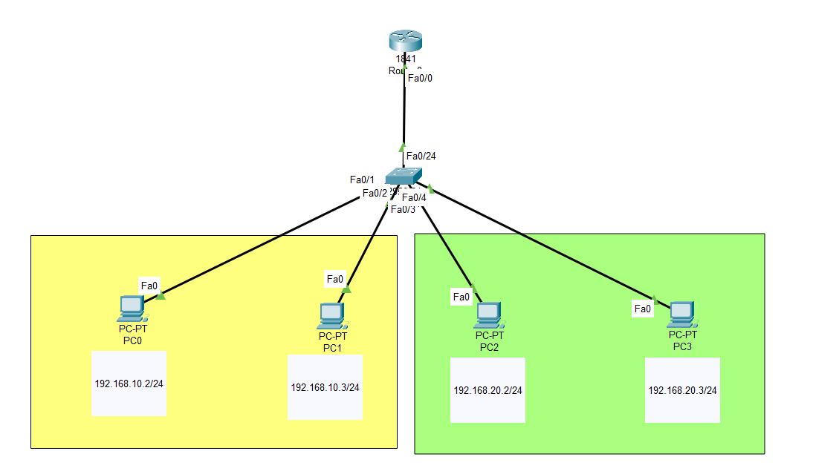
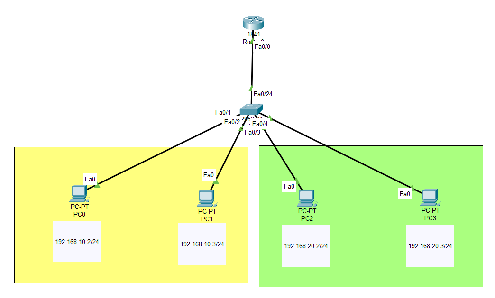
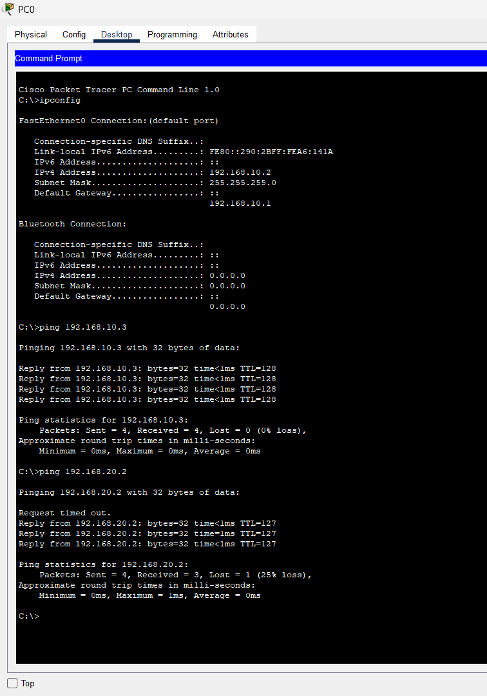
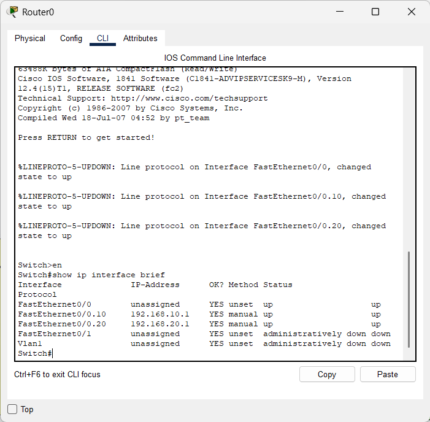

# 📡 Lab: Inter-VLAN Routing (Router-on-a-Stick)

## 🎯 Objective
This lab demonstrates the configuration and verification of **Inter-VLAN routing** using the **Router-on-a-Stick (RoaS)** method. The goal is to allow communication between two different VLANs (HR and IT) using a single physical link between the switch and the router.

## 🧠 Concepts Covered
* **VLAN Segmentation:** Creating logical boundaries (VLAN 10 and VLAN 20) to reduce broadcast domains and isolate traffic between departments.
* **Access vs. Trunk Ports:** Configuring host-facing ports as `access` (carrying a single VLAN) and the router-facing port as `trunk` (carrying multiple VLANs).
* **Sub-interfaces:** Creating virtual interfaces on a router's single physical port, each handling traffic for a specific VLAN. This eliminates the need for multiple physical router interfaces.
* **802.1Q Encapsulation:** The industry-standard protocol for VLAN tagging on trunk links. Each frame is tagged with a VLAN ID so the router knows which sub-interface should process it.

## 🛠️ Devices Used
| Device | Model | Qty | Role |
|--------|-------|-----|------|
| Router | 1841 Series | 1 | Default gateway for both VLANs via sub-interfaces |
| Switch | 2960 Series (24-port) | 1 | VLAN segmentation and trunk uplink to router |
| PCs | PC-PT | 4 | End hosts divided across two subnets |

## ⚙️ Configuration Steps

### 1. High-Level Network Plan

The network is divided into two logical segments (VLANs). Since hosts in different VLANs cannot communicate at Layer 2, a router is required to route traffic between them. Instead of dedicating a separate physical interface per VLAN, we use a **single trunk link** from the switch to the router. The router creates **sub-interfaces** on that link — one per VLAN — each acting as the default gateway for its respective subnet.

**Addressing Plan:**

| VLAN | Name | Subnet | Gateway (Router Sub-interface) |
|------|------|--------|-------------------------------|
| 10 | HR | `192.168.10.0/24` | `192.168.10.1` |
| 20 | IT | `192.168.20.0/24` | `192.168.20.1` |

**PC Addressing:**

| PC | IP Address | Subnet Mask | Default Gateway | VLAN | Switch Port |
|----|-----------|-------------|-----------------|------|-------------|
| PC0 | `192.168.10.2` | `255.255.255.0` | `192.168.10.1` | 10 (HR) | Fa0/1 |
| PC1 | `192.168.10.3` | `255.255.255.0` | `192.168.10.1` | 10 (HR) | Fa0/2 |
| PC2 | `192.168.20.2` | `255.255.255.0` | `192.168.20.1` | 20 (IT) | Fa0/3 |
| PC3 | `192.168.20.3` | `255.255.255.0` | `192.168.20.1` | 20 (IT) | Fa0/4 |

**Physical Cabling:**

| From | Port | To | Port | Link Type |
|------|------|----|------|-----------|
| Switch0 | Fa0/1 | PC0 | Fa0 | Straight-through (Access – VLAN 10) |
| Switch0 | Fa0/2 | PC1 | Fa0 | Straight-through (Access – VLAN 10) |
| Switch0 | Fa0/3 | PC2 | Fa0 | Straight-through (Access – VLAN 20) |
| Switch0 | Fa0/4 | PC3 | Fa0 | Straight-through (Access – VLAN 20) |
| Switch0 | Fa0/24 | Router0 | Fa0/0 | Straight-through (Trunk – All VLANs) |

**Traffic Flow (Inter-VLAN Ping from PC0 → PC2):**
1. PC0 (`192.168.10.2`) wants to reach PC2 (`192.168.20.2`). Since `192.168.20.2` is on a different subnet, PC0 sends the frame to its **default gateway** (`192.168.10.1`).
2. The frame exits PC0 untagged and arrives at Switch0 port `Fa0/1` (access port, VLAN 10). The switch internally tags it as **VLAN 10**.
3. The switch forwards the frame out the **trunk port** `Fa0/24` with an **802.1Q VLAN 10 tag**.
4. Router0 receives the tagged frame on physical interface `Fa0/0`. It strips the tag and processes it on **sub-interface `Fa0/0.10`** (which matches VLAN 10).
5. The router performs a routing lookup: destination `192.168.20.2` matches the `192.168.20.0/24` network, which is directly connected via **sub-interface `Fa0/0.20`**.
6. The router sends the frame back out `Fa0/0` with an **802.1Q VLAN 20 tag**.
7. Switch0 receives the tagged frame on `Fa0/24`, sees it belongs to VLAN 20, and forwards it out the **access port** `Fa0/3` (untagged) to PC2.
8. PC2 receives the packet and sends a reply back through the same process in reverse.

---

### 2. Low-Level Device Configurations

#### **Switch0 Configuration**

The switch handles VLAN creation, port-to-VLAN assignment, and the trunk uplink to the router.

**Step 1 — Create VLANs:**
> Define the VLAN IDs and give them descriptive names. This creates the logical broadcast domains inside the switch.

```bash
Switch> enable
Switch# configure terminal

Switch(config)# vlan 10
Switch(config-vlan)# name HR
Switch(config-vlan)# exit

Switch(config)# vlan 20
Switch(config-vlan)# name IT
Switch(config-vlan)# exit
```

**Step 2 — Assign Access Ports to VLANs:**
> Access ports carry traffic for only one VLAN. Frames leaving an access port are untagged, so the connected PC doesn't need any VLAN awareness.

```bash
# Assign Fa0/1 and Fa0/2 to VLAN 10 (HR Department)
Switch(config)# interface range fa0/1-2
Switch(config-if-range)# switchport mode access
Switch(config-if-range)# switchport access vlan 10
Switch(config-if-range)# exit

# Assign Fa0/3 and Fa0/4 to VLAN 20 (IT Department)
Switch(config)# interface range fa0/3-4
Switch(config-if-range)# switchport mode access
Switch(config-if-range)# switchport access vlan 20
Switch(config-if-range)# exit
```

**Step 3 — Configure the Trunk Port:**
> The trunk port carries tagged traffic for **all** VLANs to the router. This is the critical link that enables the Router-on-a-Stick method.

```bash
# Configure Fa0/24 as a trunk link to Router0
Switch(config)# interface fa0/24
Switch(config-if)# switchport mode trunk
Switch(config-if)# exit
```

---

#### **Router0 Configuration**

The router uses **sub-interfaces** on a single physical port (`Fa0/0`) to act as the default gateway for each VLAN. Each sub-interface is configured with 802.1Q encapsulation matching a specific VLAN ID.

**Step 1 — Activate the Physical Interface:**
> The physical interface must be brought up with `no shutdown`. It does **not** receive an IP address itself — the sub-interfaces handle that.

```bash
Router> enable
Router# configure terminal

Router(config)# interface FastEthernet0/0
Router(config-if)# no shutdown
Router(config-if)# exit
```

**Step 2 — Create Sub-interface for VLAN 10 (HR):**
> The sub-interface number `.10` is a convention matching the VLAN ID for clarity. The `encapsulation dot1Q 10` command tells the router to accept and send frames tagged with VLAN 10 on this sub-interface.

```bash
Router(config)# interface FastEthernet0/0.10
Router(config-subif)# encapsulation dot1Q 10
Router(config-subif)# ip address 192.168.10.1 255.255.255.0
Router(config-subif)# exit
```

**Step 3 — Create Sub-interface for VLAN 20 (IT):**
> Same logic as VLAN 10 but for the IT department's subnet. This sub-interface becomes the default gateway for all PCs in VLAN 20.

```bash
Router(config)# interface FastEthernet0/0.20
Router(config-subif)# encapsulation dot1Q 20
Router(config-subif)# ip address 192.168.20.1 255.255.255.0
Router(config-subif)# exit
```

---

#### **PC Configuration (Static IP)**

Each PC is configured with a static IP address, subnet mask, and the default gateway pointing to the router's sub-interface IP for its VLAN.

| PC | IP Address | Subnet Mask | Default Gateway |
|----|-----------|-------------|-----------------|
| PC0 | `192.168.10.2` | `255.255.255.0` | `192.168.10.1` |
| PC1 | `192.168.10.3` | `255.255.255.0` | `192.168.10.1` |
| PC2 | `192.168.20.2` | `255.255.255.0` | `192.168.20.1` |
| PC3 | `192.168.20.3` | `255.255.255.0` | `192.168.20.1` |

> **How to configure:** On each PC in Packet Tracer, go to **Desktop → IP Configuration** and enter the IP Address, Subnet Mask, and Default Gateway values from the table above.

## ✅ Verification

- [x] **VLAN Status:** `show vlan brief` confirms ports `Fa0/1-2` are in VLAN 10 (HR) and `Fa0/3-4` are in VLAN 20 (IT).
- [x] **Trunk Status:** `show interfaces trunk` confirms `Fa0/24` is operating as a trunk and allows VLANs 1, 10, and 20.
- [x] **Router Sub-interfaces:** `show ip interface brief` on Router0 confirms `Fa0/0.10` (192.168.10.1) and `Fa0/0.20` (192.168.20.1) are both **Up/Up**.
- [x] **Intra-VLAN Connectivity:** Ping from PC0 (`192.168.10.2`) → PC1 (`192.168.10.3`) — **Successful** (same VLAN, switched locally).
- [x] **Inter-VLAN Connectivity:** Ping from PC0 (`192.168.10.2`) → PC2 (`192.168.20.2`) — **Successful** (routed through Router0). First packet may time out due to ARP resolution; subsequent packets succeed with TTL=127 (decremented by the router hop).

## 📸 Screenshots

> **Network Topology** — Full topology showing the Router-on-a-Stick layout with VLAN color coding (yellow = VLAN 10/HR, green = VLAN 20/IT).



> **Topology with Active Links** — All links are up (green triangles) confirming physical connectivity is established.



> **Ping Test Results** — PC0 successfully pings PC1 (intra-VLAN, TTL=128) and PC2 (inter-VLAN, TTL=127), proving both Layer 2 switching and Layer 3 routing are working.



> **Router `show ip interface brief`** — Sub-interfaces `Fa0/0.10` and `Fa0/0.20` are both Up/Up with correct IP addresses assigned.



## ❗ Common Issues

| Issue | Cause | Fix |
|-------|-------|-----|
| **Encapsulation Mismatch** | Forgetting `encapsulation dot1Q <vlan_id>` on the router sub-interface | Add the encapsulation command before assigning the IP address |
| **Trunk Not Formed** | Switch port to router left in `access` mode | Set it to `switchport mode trunk` |
| **Inter-VLAN Ping Fails** | PCs missing or incorrect Default Gateway | Set each PC's gateway to the router sub-interface IP for its VLAN |
| **Sub-interface Down** | Physical interface `Fa0/0` not activated | Run `no shutdown` on the physical interface |
| **First Ping Times Out** | ARP table not yet populated (normal behavior) | This is expected — subsequent pings succeed. Retry the ping |

## 📁 Lab File

> 💾 **Try it yourself** — Download [`Router on Stick.pkt`](Router%20on%20Stick.pkt) and open in **Cisco Packet Tracer 8.1+**. Add a third VLAN, create a new sub-interface on the router, and verify end-to-end reachability across all three VLANs.

- `Router on Stick.pkt` — Packet Tracer project file with the completed configuration.

## 🚀 What I Learned
* Understood how **logical separation** works through VLANs even on the same physical hardware — hosts in different VLANs cannot communicate without a Layer 3 device.
* Learned the **Router-on-a-Stick** method as a cost-effective way to perform inter-VLAN routing using a single physical router interface with multiple sub-interfaces.
* Gained hands-on experience with **802.1Q trunk encapsulation** and how tagged frames travel between the switch and router.
* Observed the **TTL difference** between intra-VLAN pings (TTL=128, switched) and inter-VLAN pings (TTL=127, routed through one hop), confirming the router is actively forwarding packets.
* Mastered the **Cisco IOS CLI** syntax for VLAN creation, access/trunk port assignment, and sub-interface configuration.
