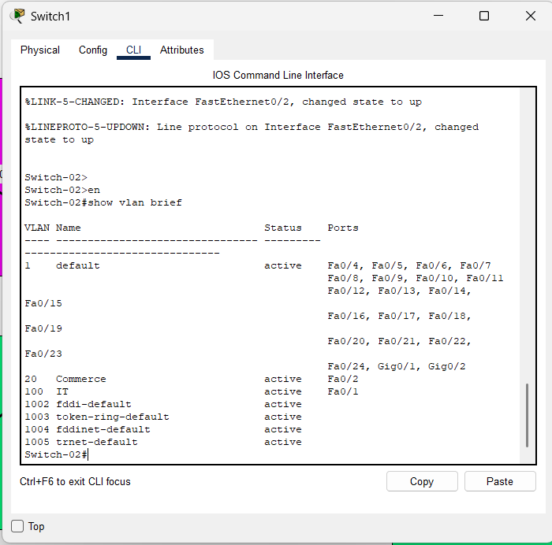
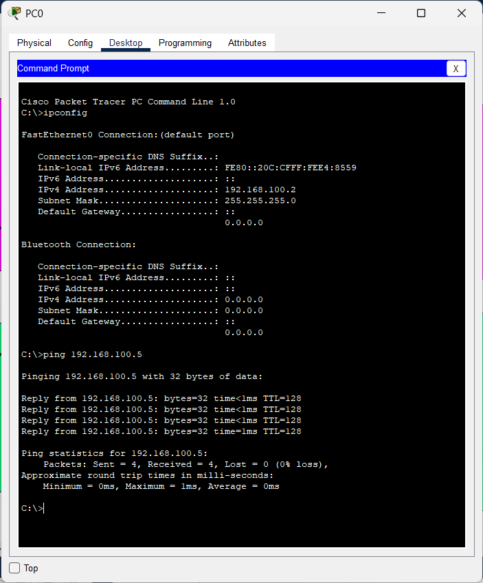

# 📡 Lab: VLAN Segmentation & 802.1Q Trunking (Multi-Switch)

## 🎯 Objective
This lab demonstrates the configuration and verification of a **multi-switch network** using **VLANs** to segment traffic between two departments — **IT** (VLAN 100) and **Commerce** (VLAN 20) — and an **802.1Q Trunk link** to carry tagged VLAN traffic between the two switches. This is a critical prerequisite for implementing Inter-VLAN Routing in a production environment.

---

## 🧠 Concepts Covered
- **VLAN Creation & Naming** — Defining logical broadcast domains (VLAN 100 for IT, VLAN 20 for Commerce) on each switch.
- **Access Port Configuration** — Assigning end-device ports to a specific VLAN so they only participate in one broadcast domain.
- **802.1Q Trunking** — Configuring the inter-switch link to carry traffic for **multiple VLANs** simultaneously by tagging frames with their VLAN ID.
- **Multi-Switch VLAN Consistency** — Ensuring VLAN IDs and names match on both switches so that trunk-carried traffic is correctly delivered.
- **VLAN Isolation Verification** — Confirming that devices in different VLANs cannot communicate without a Layer 3 device.

---

## 🛠️ Devices Used

| Device | Model | Hostname | Role |
| :--- | :--- | :--- | :--- |
| **Switch 1** | Cisco Catalyst 2960-24TT | `Switch-01` | Left-side switch — connects PC0 (IT) and PC1 (Commerce) |
| **Switch 2** | Cisco Catalyst 2960-24TT | `Switch-02` | Right-side switch — connects PC2 (IT) and PC3 (Commerce) |
| **PC0** | Generic End Device | — | IT Department workstation (left) |
| **PC1** | Generic End Device | — | Commerce Department workstation (left) |
| **PC2** | Generic End Device | — | IT Department workstation (right) |
| **PC3** | Generic End Device | — | Commerce Department workstation (right) |

---

## ⚙️ Configuration Steps

### 📐 Step 1 — High-Level Network Plan (HLD)

The strategy is to create **two VLANs across two switches**, connected by a single **802.1Q trunk link**. Each switch has one PC per VLAN, and the trunk ensures that VLAN traffic can traverse between the switches.

> ℹ️ Without the trunk link, PCs on the same VLAN but on different switches would **not** be able to communicate because each switch's VLAN database is local. The trunk carries tagged frames so Switch-02 knows which VLAN a frame from Switch-01 belongs to.

#### 🗺️ VLAN & Addressing Plan

| Department | VLAN ID | Subnet | PC | IP Address | Subnet Mask | Connected To |
| :--- | :---: | :--- | :--- | :--- | :--- | :--- |
| **IT** | `100` | `192.168.100.0/24` | PC0 | `192.168.100.2` | `255.255.255.0` | Switch-01 `Fa0/1` |
| **IT** | `100` | `192.168.100.0/24` | PC2 | `192.168.100.5` | `255.255.255.0` | Switch-02 `Fa0/1` |
| **Commerce** | `20` | `192.168.20.0/24` | PC1 | `192.168.20.10` | `255.255.255.0` | Switch-01 `Fa0/2` |
| **Commerce** | `20` | `192.168.20.0/24` | PC3 | `192.168.20.11` | `255.255.255.0` | Switch-02 `Fa0/2` |

#### 🔗 Inter-Switch Link Plan

| Link | Switch-01 Port | Switch-02 Port | Mode | Encapsulation |
| :--- | :---: | :---: | :--- | :--- |
| **Trunk** | `Fa0/3` | `Fa0/3` | Trunk | 802.1Q (dot1q) |

> 💡 The trunk link carries **both VLAN 100 and VLAN 20** traffic. Each frame is tagged with its VLAN ID as it enters the trunk, and the tag is stripped when the frame exits to an access port on the other side.

#### 🖼️ Topology Diagram


> The **magenta zones** represent VLAN 100 (IT) and the **green zones** represent VLAN 20 (Commerce). The **dashed line** between the switches indicates the trunk link on `Fa0/3`.

---

### 🔧 Step 2 — Low-Level Configuration (LLD)

This section provides the full interface-level and device-level configuration applied to **both switches**.

---

#### 🖥️ Switch-01 (Left Switch)

##### 2A. Set Hostname & Enter Configuration Mode

```
Switch> enable
Switch# configure terminal
Switch(config)# hostname Switch-01
Switch-01(config)#
```

> This moves from **User EXEC** (`>`) → **Privileged EXEC** (`#`) → **Global Configuration** mode, then assigns a meaningful hostname to identify this switch on the network.

---

##### 2B. Create the VLAN Database

Define both VLANs with descriptive names. Naming VLANs is a professional best practice — it makes `show vlan brief` output immediately understandable.

```
Switch-01(config)# vlan 100
Switch-01(config-vlan)# name IT
Switch-01(config-vlan)# exit

Switch-01(config)# vlan 20
Switch-01(config-vlan)# name Commerce
Switch-01(config-vlan)# exit
```

| Command | Explanation |
| :--- | :--- |
| `vlan 100` | Creates VLAN 100 and enters VLAN configuration sub-mode |
| `name IT` | Assigns the human-readable name "IT" to VLAN 100 |
| `vlan 20` | Creates VLAN 20 |
| `name Commerce` | Assigns the name "Commerce" to VLAN 20 |

> ✅ After this step, VLANs 100 and 20 exist in the switch's VLAN database, but no ports are assigned yet — all ports remain in the default VLAN 1.

---

##### 2C. Assign Access Port — IT Department (VLAN 100)

Port `Fa0/1` connects to **PC0** (192.168.100.2). It must be set as an **access port** carrying only VLAN 100 traffic.

```
Switch-01(config)# interface FastEthernet0/1
Switch-01(config-if)# switchport mode access
Switch-01(config-if)# switchport access vlan 100
Switch-01(config-if)# exit
```

| Command | Explanation |
| :--- | :--- |
| `interface FastEthernet0/1` | Selects the physical port connected to PC0 |
| `switchport mode access` | Forces the port into **access mode** (carries only one VLAN, no tagging) |
| `switchport access vlan 100` | Assigns this port to **VLAN 100 (IT)** |

---

##### 2D. Assign Access Port — Commerce Department (VLAN 20)

Port `Fa0/2` connects to **PC1** (192.168.20.10). It is assigned to VLAN 20.

```
Switch-01(config)# interface FastEthernet0/2
Switch-01(config-if)# switchport mode access
Switch-01(config-if)# switchport access vlan 20
Switch-01(config-if)# exit
```

---

##### 2E. Configure Trunk Link to Switch-02

Port `Fa0/3` connects **Switch-01 to Switch-02**. This link must carry traffic for **both VLANs**, so it is configured as a **trunk**.

```
Switch-01(config)# interface FastEthernet0/3
Switch-01(config-if)# switchport mode trunk
Switch-01(config-if)# exit
```

| Command | Explanation |
| :--- | :--- |
| `interface FastEthernet0/3` | Selects the inter-switch link port |
| `switchport mode trunk` | Forces the port into **trunk mode** — it will tag every frame with its VLAN ID using 802.1Q encapsulation |

> 💡 On the **Cisco 2960**, the default trunk encapsulation is **802.1Q (dot1q)**, so the `switchport trunk encapsulation dot1q` command is not needed. On older switches (e.g., 3560), you must set the encapsulation explicitly before enabling trunk mode.

---

#### 🖥️ Switch-02 (Right Switch)

The configuration for Switch-02 **mirrors Switch-01** exactly. Both switches must have **identical VLAN IDs and names** for the trunk to carry traffic correctly.

##### 2F. Set Hostname & Enter Configuration Mode

```
Switch> enable
Switch# configure terminal
Switch(config)# hostname Switch-02
Switch-02(config)#
```

---

##### 2G. Create the VLAN Database

```
Switch-02(config)# vlan 100
Switch-02(config-vlan)# name IT
Switch-02(config-vlan)# exit

Switch-02(config)# vlan 20
Switch-02(config-vlan)# name Commerce
Switch-02(config-vlan)# exit
```

> ⚠️ **Critical:** The VLAN IDs on Switch-02 must **exactly match** those on Switch-01. If you accidentally create VLAN 200 instead of VLAN 100 on Switch-02, the trunk will carry the tagged frames, but Switch-02 will have no matching VLAN to deliver them to — and traffic will be silently dropped.

---

##### 2H. Assign Access Port — IT Department (VLAN 100)

Port `Fa0/1` connects to **PC2** (192.168.100.5).

```
Switch-02(config)# interface FastEthernet0/1
Switch-02(config-if)# switchport mode access
Switch-02(config-if)# switchport access vlan 100
Switch-02(config-if)# exit
```

---

##### 2I. Assign Access Port — Commerce Department (VLAN 20)

Port `Fa0/2` connects to **PC3** (192.168.20.11).

```
Switch-02(config)# interface FastEthernet0/2
Switch-02(config-if)# switchport mode access
Switch-02(config-if)# switchport access vlan 20
Switch-02(config-if)# exit
```

---

##### 2J. Configure Trunk Link to Switch-01

Port `Fa0/3` is the other end of the inter-switch trunk link.

```
Switch-02(config)# interface FastEthernet0/3
Switch-02(config-if)# switchport mode trunk
Switch-02(config-if)# exit
```

> ✅ Both ends of the trunk link are now configured. VLAN-tagged frames can flow freely between the two switches over `Fa0/3`.

---

## ✅ Verification

### Step 1 — Check the VLAN Database (`show vlan brief`)

Run this command on **both switches** to confirm:
- VLANs 100 (IT) and 20 (Commerce) exist with their correct names.
- Access ports `Fa0/1` and `Fa0/2` are assigned to the correct VLANs.
- `Fa0/3` does **not** appear in the VLAN table (trunk ports are excluded from the `show vlan brief` output).

```
Switch-02# show vlan brief
```

#### Expected Output:

| VLAN | Name | Status | Ports |
| :--- | :--- | :--- | :--- |
| 1 | default | active | Fa0/4, Fa0/5, Fa0/6 … (remaining ports) |
| 20 | Commerce | active | Fa0/2 |
| 100 | IT | active | Fa0/1 |

> 💡 Notice that `Fa0/3` is **absent** from the port list. This is expected — trunk ports are managed separately and are only visible in `show interfaces trunk`.

#### 📸 Screenshot — `show vlan brief` on Switch-02



---

### Step 2 — Verify Trunk Status (`show interfaces trunk`)

Run this command to confirm the trunk link is operational:

```
Switch-01# show interfaces trunk
```

#### Expected Output:

| Port | Mode | Encapsulation | Status | Native VLAN |
| :--- | :--- | :--- | :--- | :--- |
| Fa0/3 | on | 802.1q | trunking | 1 |

> ✅ If `Fa0/3` appears with status **"trunking"**, the link is correctly carrying tagged VLAN traffic. If it shows "not-trunking", check that **both** ends are configured with `switchport mode trunk`.

---

### Step 3 — Intra-VLAN Ping Across Switches (Should Succeed ✅)

This is the key test. PC0 (VLAN 100, Switch-01) pings PC2 (VLAN 100, Switch-02). The ping traffic must:
1. Leave PC0 on Switch-01's `Fa0/1` (access port, VLAN 100).
2. Be **tagged with VLAN 100** as it enters the trunk on `Fa0/3`.
3. Cross the trunk link to Switch-02's `Fa0/3`.
4. Be **untagged** and delivered to `Fa0/1` on Switch-02 (access port, VLAN 100).
5. Arrive at PC2.

```
C:\> ping 192.168.100.5
```

> ✅ **Expected Result:** Successful — 4 packets sent, 4 received, **0% packet loss**. This confirms the trunk link is working and VLAN 100 spans both switches.

#### 📸 Screenshot — Successful Intra-VLAN Ping (PC0 → PC2)



---

### Step 4 — Inter-VLAN Ping (Should Fail ❌)

PC0 (VLAN 100, `192.168.100.2`) pings PC1 (VLAN 20, `192.168.20.10`). These PCs are on **different VLANs and different subnets**, so no Layer 2 or Layer 3 path exists between them.

```
C:\> ping 192.168.20.10
```

> ❌ **Expected Result:** Request timed out — confirms that **VLAN isolation is working correctly**. To enable communication between VLAN 100 and VLAN 20, a Layer 3 device (router or L3 switch) must be configured for **Inter-VLAN Routing** (e.g., Router-on-a-Stick).

---

### Verification Checklist

- [x] **VLAN Database:** `show vlan brief` confirms VLANs 100 (IT) and 20 (Commerce) are active with correct port assignments on both switches.
- [x] **Trunk Status:** `show interfaces trunk` confirms `Fa0/3` is in "trunking" mode with 802.1Q encapsulation.
- [x] **Intra-VLAN Ping (Cross-Switch):** PC0 (`192.168.100.2`) → PC2 (`192.168.100.5`) = ✅ Success (0% loss).
- [x] **VLAN Isolation:** PC0 (VLAN 100) → PC1 (VLAN 20) = ❌ Timeout (segmentation working as intended).

---

## ❗ Common Issues

| Issue | Symptom | Fix |
| :--- | :--- | :--- |
| **VLAN ID Mismatch** | PCs on "same VLAN" across switches cannot ping | Ensure the VLAN ID (e.g., 100) is **identical** on both Switch-01 and Switch-02 |
| **Trunk Not Configured on Both Ends** | Cross-switch ping fails; `show interfaces trunk` shows nothing | Run `switchport mode trunk` on **both** `Fa0/3` ports |
| **Port Left in VLAN 1** | PC appears connected but cannot reach its VLAN peers | Check `show vlan brief` — reassign the port with `switchport access vlan X` |
| **Forgot `switchport mode access`** | Port may auto-negotiate as trunk and behave unpredictably | Always explicitly set `switchport mode access` on end-device ports |
| **Trunk Encapsulation Error** | `switchport mode trunk` rejected on older switches (e.g., 3560) | First run `switchport trunk encapsulation dot1q`, then `switchport mode trunk` |
| **Different Subnets on Same VLAN** | Ping fails even within the same VLAN | Ensure all PCs in VLAN 100 use `192.168.100.x/24` and VLAN 20 use `192.168.20.x/24` |
| **Unsaved Configuration** | VLAN and trunk settings lost after switch reboot | Run `write memory` or `copy running-config startup-config` |

---

## 📁 Lab File

> 💾 **Try it yourself** — Download [`Inter Vlan configuration Practical 2.pkt`](Inter%20Vlan%20configuration%20Practical%202.pkt) and open in **Cisco Packet Tracer 8.1+**. Remove the trunk link between the two switches and observe how cross-switch VLAN communication instantly breaks — then put it back.

- `Inter Vlan configuration Practical 2.pkt` — Cisco Packet Tracer project file.

---

## 🚀 What I Learned

- **Trunking is Essential for Multi-Switch VLANs:** Without a trunk link, a VLAN exists only locally on one switch. The 802.1Q trunk extends VLANs across the entire switched network by tagging each frame with its VLAN ID.
- **VLAN Consistency Across Switches:** Both switches must have matching VLAN IDs. A VLAN 100 frame arriving on a trunk is useless if the receiving switch doesn't have VLAN 100 in its database.
- **Access vs. Trunk Ports:** Access ports carry traffic for a **single VLAN** (untagged). Trunk ports carry traffic for **multiple VLANs** (tagged). Understanding this distinction is fundamental to enterprise switching.
- **Trunk Ports Don't Appear in `show vlan brief`:** This is a common source of confusion. Use `show interfaces trunk` to verify trunk port configuration.
- **Layer 2 Isolation is by Design:** The fact that VLAN 100 and VLAN 20 cannot communicate is a **feature, not a bug**. To enable cross-VLAN communication, Inter-VLAN Routing must be configured on a Layer 3 device — which is the next step in this lab series.
- **Systematic Verification Workflow:** Developed a repeatable troubleshooting process: check VLAN database → verify trunk status → test intra-VLAN → test inter-VLAN isolation.

