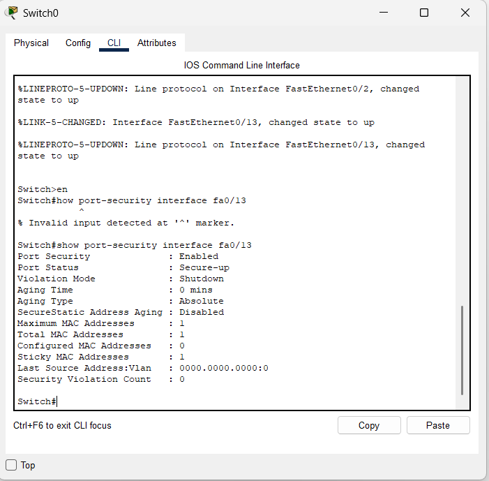
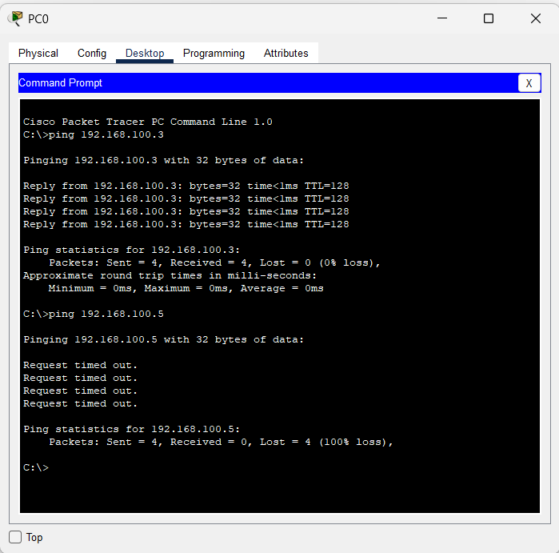

# 📡 Lab: Port Security & Interface Management

## 🎯 Objective
This lab demonstrates the implementation of **Layer 2 port security** on a Cisco Catalyst Switch. The goal is to restrict network access on a specific switch port to exactly **one authorized device** by locking down its MAC address. If an unauthorized device is connected, the switch must **automatically disable the port** (err-disabled state), preventing any rogue access.

## 🧠 Concepts Covered
- **Port Security** — Controlling access by limiting the number of allowed MAC addresses on a switchport.
- **MAC Address Sticky** — Dynamically learning a MAC address from the first connected device and permanently saving it to the running configuration.
- **Violation Mode: Shutdown** — Configuring the switch to physically disable a port and place it in `err-disabled` state upon detecting a security breach.
- **Interface Recovery** — Using the `shutdown` / `no shutdown` sequence to manually restore an err-disabled port after the authorized device is reconnected.

## 🛠️ Devices Used
| Device | Model | Role | IP Address |
|--------|-------|------|------------|
| Switch0 | Cisco 2950-24 | Central Layer 2 Switch | N/A (Layer 2) |
| PC0 | PC-PT | Management Station | `192.168.100.2/24` |
| PC1 | PC-PT | Authorized Device | `192.168.100.3/24` |
| PC2 | PC-PT | Unauthorized (Rogue) Device | `192.168.100.5/24` |

---

## ⚙️ Configuration Steps

### 1. High-Level Network Plan

#### 🔷 Topology
- **Type**: Star Topology — all end devices connect directly to a single central switch (`Switch0`).
- **Subnet**: `192.168.100.0/24` — a single flat Layer 2 network, no routing required.

#### 🔷 Addressing Plan
| Device | Interface | IP Address | Subnet Mask | Default Gateway |
|--------|-----------|------------|-------------|-----------------|
| PC0 | Fa0 | `192.168.100.2` | `255.255.255.0` | N/A |
| PC1 | Fa0 | `192.168.100.3` | `255.255.255.0` | N/A |
| PC2 | Fa0 | `192.168.100.5` | `255.255.255.0` | N/A |

#### 🔷 Cabling Plan
| Connection | Switch Port | Device Port | Cable Type |
|------------|------------|-------------|------------|
| Switch0 ↔ PC0 | `Fa0/2` | `Fa0` | Straight-Through |
| Switch0 ↔ PC1 | `Fa0/13` | `Fa0` | Straight-Through |
| Switch0 ↔ PC2 | `Fa0/13` *(after swap)* | `Fa0` | Straight-Through |

#### 🔷 Security Policy
- **Target Port**: `FastEthernet0/13` is the secured port.
- **Rule**: Only **one** MAC address is allowed on `Fa0/13` at any time.
- **Learning Method**: The switch will **automatically learn** the MAC address of the first device that sends traffic (sticky learning).
- **Violation Action**: If a second (different) MAC address is detected, the port will be **immediately shut down** (`err-disabled`).

---

### 2. Low-Level Device / Interface Configuration

#### 🔧 Step 1 — Assign IP Addresses to End Devices

> Since this is a Layer 2 lab, there is no router. Each PC is statically configured with an IP in the `192.168.100.0/24` range.

**On PC0** *(Desktop → IP Configuration)*:
| Field | Value |
|-------|-------|
| IP Address | `192.168.100.2` |
| Subnet Mask | `255.255.255.0` |

**On PC1** *(Desktop → IP Configuration)*:
| Field | Value |
|-------|-------|
| IP Address | `192.168.100.3` |
| Subnet Mask | `255.255.255.0` |

**On PC2** *(Desktop → IP Configuration)*:
| Field | Value |
|-------|-------|
| IP Address | `192.168.100.5` |
| Subnet Mask | `255.255.255.0` |

---

#### 🔧 Step 2 — Configure Port Security on Switch0 (Interface Fa0/13)

Enter the Switch CLI and execute the following commands:

```
Switch> enable
Switch# configure terminal
```
> **Explanation**: Enter privileged EXEC mode, then enter global configuration mode.

```
Switch(config)# interface fa0/13
```
> **Explanation**: Select interface `FastEthernet0/13` — the port where the authorized device (PC1) will be connected.

```
Switch(config-if)# switchport mode access
```
> **Explanation**: Set the port to **access mode**. This is **mandatory** before enabling port security. Port security cannot be applied on a port in `dynamic auto` (trunking negotiation) mode.

```
Switch(config-if)# switchport port-security
```
> **Explanation**: **Enable port security** on this interface. Without this command, none of the security sub-commands will take effect.

```
Switch(config-if)# switchport port-security maximum 1
```
> **Explanation**: Limit the port to learn and allow only **1 MAC address**. Any frame from a second MAC address will trigger a violation.

```
Switch(config-if)# switchport port-security violation shutdown
```
> **Explanation**: Set the violation action to **shutdown**. When a violation occurs, the switch will:
> 1. Place the port in `err-disabled` state.
> 2. Turn off the link LED (red indicator in Packet Tracer).
> 3. Log a `%PM-4-ERR_DISABLE` syslog message.

```
Switch(config-if)# switchport port-security mac-address sticky
```
> **Explanation**: Enable **sticky MAC learning**. The switch will dynamically learn the MAC address of the first device that sends traffic on this port and add it to the running configuration as a static entry. This means the MAC is remembered even if the device is temporarily disconnected (until the switch is reloaded or the config is cleared).

```
Switch(config-if)# end
```
> **Explanation**: Return to privileged EXEC mode.

##### 📋 Full Command Block (Copy-Paste Ready)
```
enable
configure terminal
interface fa0/13
switchport mode access
switchport port-security
switchport port-security maximum 1
switchport port-security violation shutdown
switchport port-security mac-address sticky
end
```

---

#### 🔧 Step 3 — Authorize PC1 (Generate Traffic to Stick the MAC)

1. Ensure **PC1** is physically connected to `Fa0/13` on Switch0.
2. From **PC0**, open Command Prompt and ping PC1:
   ```
   C:\> ping 192.168.100.3
   ```
3. The ping generates traffic, causing the switch to **learn PC1's MAC address** on `Fa0/13` via sticky learning.
4. Verify the MAC was learned:
   ```
   Switch# show port-security interface fa0/13
   ```
   **Expected Output**:
   ```
   Port Security              : Enabled
   Port Status                : Secure-up
   Violation Mode             : Shutdown
   Aging Time                 : 0 mins
   Aging Type                 : Absolute
   SecureStatic Address Aging : Disabled
   Maximum MAC Addresses      : 1
   Total MAC Addresses        : 1
   Configured MAC Addresses   : 0
   Sticky MAC Addresses       : 1
   Last Source Address:Vlan   : 0000.0000.0000:0
   Security Violation Count   : 0
   ```

> **Key Indicators**:
> - `Port Status: Secure-up` — The port is active and secured.
> - `Sticky MAC Addresses: 1` — One MAC has been dynamically learned and stuck.
> - `Security Violation Count: 0` — No violations have occurred yet.

---

#### 🔧 Step 4 — Simulate a Security Violation (Connect Unauthorized PC2)

1. **Disconnect PC1** from `Fa0/13`.
2. **Connect PC2** (the unauthorized device) to the same port `Fa0/13`.
3. From **PC0**, attempt to ping PC2:
   ```
   C:\> ping 192.168.100.5
   ```
4. **Result**: The ping will show `Request timed out` for all 4 packets (100% loss).

> **What happens behind the scenes**:
> - PC2 sends a frame with its own MAC address (different from PC1's stuck MAC).
> - The switch detects a MAC address mismatch — violation triggered.
> - The port transitions to `err-disabled` state.
> - The link indicator turns **red** in Packet Tracer, confirming the port is shut down.

---

#### 🔧 Step 5 — Recover the Err-Disabled Port *(Optional — Post-Violation Recovery)*

Once the authorized device (PC1) is reconnected, the port must be manually recovered:

```
Switch# configure terminal
Switch(config)# interface fa0/13
Switch(config-if)# shutdown
Switch(config-if)# no shutdown
Switch(config-if)# end
```

> **Explanation**: The `shutdown` / `no shutdown` sequence clears the `err-disabled` state and re-activates the port. The switch will not auto-recover by default — this must be done manually by an administrator.

---

## ✅ Verification

- [x] **Authorized Ping Successful**: Ping from PC0 (`192.168.100.2`) to PC1 (`192.168.100.3`) — 4/4 replies received, 0% loss.
- [x] **Port Security Active**: `show port-security interface fa0/13` confirms `Port Status: Secure-up`, `Violation Mode: Shutdown`, `Sticky MAC Addresses: 1`.
- [x] **Violation Triggered**: After swapping PC1 for PC2, ping from PC0 to PC2 (`192.168.100.5`) — 4/4 `Request timed out`, 100% loss.
- [x] **Port Disabled**: Red link indicator on `Fa0/13` in the topology confirms the port entered `err-disabled` state.

---

## 📸 Screenshots

### CLI Output — Port Security Status (Secure-Up)
> Switch CLI showing `show port-security interface fa0/13` output: Port Security Enabled, Port Status Secure-up, Violation Mode Shutdown, Maximum MAC 1, Sticky MAC 1, Violation Count 0.



---

### Ping Results — Authorized vs. Unauthorized
> PC0 Command Prompt showing successful ping to `192.168.100.3` (PC1 — 4/4 replies, 0% loss) followed by failed ping to `192.168.100.5` (PC2 — 4/4 timed out, 100% loss).



---

## ❗ Common Issues

| Issue | Cause | Solution |
|-------|-------|----------|
| Port security command rejected | Port is in `dynamic auto` (trunk negotiation) mode | Always run `switchport mode access` before enabling port security |
| Port stays err-disabled after reconnecting PC1 | Err-disabled ports do not auto-recover by default | Manually run `shutdown` then `no shutdown` on the interface |
| Sticky MAC not learned | No traffic was generated after connecting the device | Send a ping or any traffic to trigger MAC learning |
| `show port-security` shows 0 MACs | Port security was enabled but no device has sent traffic yet | Connect the authorized device and generate traffic |

---

## 📁 Lab File

> 💾 **Try it yourself** — Download [`Port Security.pkt`](Port%20Security.pkt) and open in **Cisco Packet Tracer 8.1+**. Swap PC1 for PC2 on port Fa0/13 and watch the link go red as the violation triggers — then recover the port and reconnect the authorised device.

- `Port Security.pkt` — Complete Layer 2 port security lab.

---

## 🚀 What I Learned
- **Hardware-Level Security**: Learned how to prevent "rogue" devices from simply plugging into a wall jack and gaining unauthorized network access — a critical Layer 2 security measure.
- **MAC Address Management**: Understanding the difference between **static** (manually configured), **dynamic** (temporary, lost on reboot), and **sticky** (dynamically learned but saved to config) MAC addresses.
- **Violation Modes**: Understanding the three port-security violation modes — `shutdown` (disables port), `restrict` (drops frames, sends SNMP trap), and `protect` (silently drops frames).
- **Troubleshooting IOS**: Gained experience reading `%LINEPROTO-5-UPDOWN` and `%PM-4-ERR_DISABLE` syslog messages to identify why a port has stopped functioning.
- **Recovery Procedures**: Learned the mandatory `shutdown` / `no shutdown` sequence to recover an err-disabled port, reinforcing that switches do not auto-recover by default.
