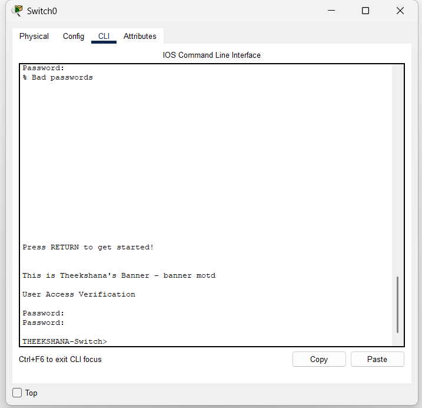
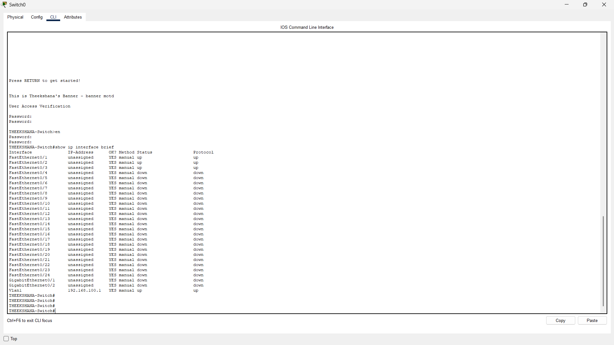
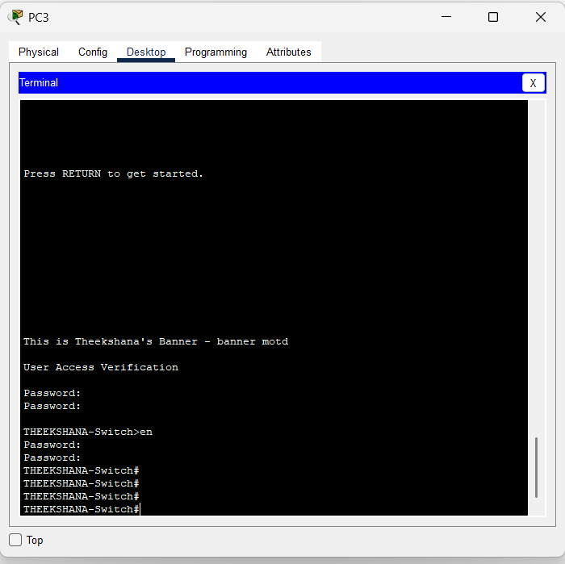
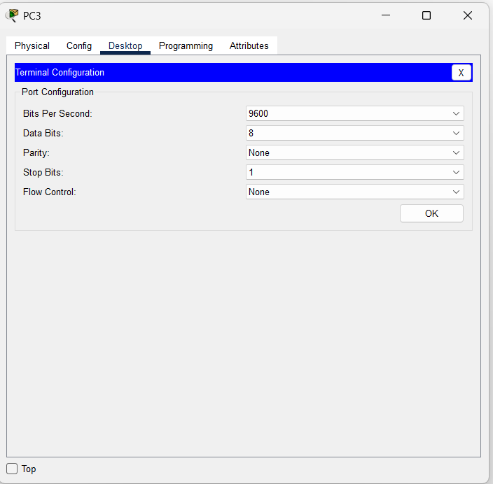

# 📡 Lab: Basic Connectivity & Remote Access (Telnet)

## 🎯 Objective
This lab demonstrates the configuration and verification of a **Basic Connectivity** setup with a focus on securing the management plane and enabling remote access via **Telnet**. The goal is to configure a Layer 2 switch with a management IP address (SVI), secure it with passwords and a banner, and then remotely access its CLI from an end device using the Telnet protocol.

## 🧠 Concepts Covered
- **Switch Virtual Interface (SVI):** Assigning an IP address to the management VLAN (`Vlan1`) to allow remote access to the switch's CLI.
- **Remote Management (Telnet):** Configuring Virtual Terminal (VTY) lines to accept incoming Telnet connections for remote CLI access.
- **IOS Security:** Implementing multiple layers of security including Console passwords, Enable secrets, and a Message-of-the-Day (MOTD) Banner.
- **Management Plane Verification:** Using `show` commands to verify IP configuration, interface status, and running configuration.

## 🛠️ Devices Used
- **Switch:** 1 x Cisco Catalyst 2960-24TT (Hostname: `THEEKSHANA-Switch`)
- **End Devices:** 4 x PCs (PC0, PC1, PC2, PC3)
- **Cabling:** Copper Straight-Through cables for all PC-to-Switch connections. A Console cable from PC3 to the Switch for initial configuration.

---

## ⚙️ Configuration Steps

### 1. High-Level Network Plan

The network uses a single, flat Layer 2 topology. All devices reside on the default `VLAN 1` within the `192.168.100.0/24` management subnet. The switch is assigned an IP via its SVI (`Vlan1`) to serve as the Telnet target, allowing any PC on the network to remotely manage it.

**Network Topology:**

```
                    [ PC3 ] 192.168.100.10
                       | (Console Cable for initial config)
                       | (Fa0 - Copper Straight-Through)
                       |
    +---------+--------+---------+---------+
    |          Fa0/1   Fa0/2    Fa0/3      |
    |     THEEKSHANA-Switch (2960-24TT)    |
    |         SVI: 192.168.100.1 /24       |
    +---------+--------+---------+---------+
              |        |         |
              |        |         |
           [ PC0 ]  [ PC1 ]  [ PC2 ]
       192.168.100.20  192.168.100.21  192.168.100.23
```

**IP Addressing Table:**

| Device | Interface | IP Address | Subnet Mask | Default Gateway | Purpose |
| :--- | :--- | :--- | :--- | :--- | :--- |
| THEEKSHANA-Switch | Vlan1 (SVI) | `192.168.100.1` | `255.255.255.0` | N/A | Management IP for remote access |
| PC3 | Fa0 | `192.168.100.10` | `255.255.255.0` | `192.168.100.1` | Admin Host (Console + Telnet) |
| PC0 | Fa0 | `192.168.100.20` | `255.255.255.0` | `192.168.100.1` | User Host |
| PC1 | Fa0 | `192.168.100.21` | `255.255.255.0` | `192.168.100.1` | User Host |
| PC2 | Fa0 | `192.168.100.23` | `255.255.255.0` | `192.168.100.1` | User Host |

**Password & Security Plan:**

| Security Layer | Password | Purpose |
| :--- | :--- | :--- |
| Console Line (`line con 0`) | `class` | Secures physical access via the console port |
| Enable Secret | `class` | Secures access to Privileged EXEC mode (`enable`) |
| VTY Lines (`line vty 0 4`) | `telnetclass` | Secures remote Telnet sessions |

---

### 2. Device-Level Configurations (Low Level)

> All commands below are executed on the **THEEKSHANA-Switch** via the console connection from **PC3**.

#### **Step A: Access the Switch CLI via Console**
1.  Connect **PC3** to the **Switch's Console port** using a **Console (RS-232) cable**.
2.  On PC3, go to **Desktop > Terminal**. Use the default settings (9600 Baud, 8 Data Bits, None Parity, 1 Stop Bit, No Flow Control) and click **OK**.
3.  Press **Enter** to get the initial `Switch>` prompt.

#### **Step B: Set Hostname & MOTD Banner**
Enter Global Configuration mode and set the switch's identity and a warning banner.

```
Switch> enable
Switch# configure terminal
Switch(config)# hostname THEEKSHANA-Switch
THEEKSHANA-Switch(config)# banner motd ^C This is Theekshana's Banner - banner motd ^C
```

> **💡 Why?** The `hostname` identifies the device in the CLI prompt. The `banner motd` (Message of the Day) displays a warning message to anyone accessing the device, which is a security best practice and often a legal requirement.

#### **Step C: Configure Enable Secret**
Set a password required to enter Privileged EXEC mode (`enable`).

```
THEEKSHANA-Switch(config)# enable secret class
```

> **💡 Why?** The `enable secret` is an MD5-hashed password that protects access to the `#` (privileged) mode. This is a critical security layer, especially for remote users who connect via Telnet—without it, they cannot execute any privileged commands.

#### **Step D: Configure Console Line Security**
Secure the physical console port with a password.

```
THEEKSHANA-Switch(config)# line con 0
THEEKSHANA-Switch(config-line)# password class
THEEKSHANA-Switch(config-line)# login
THEEKSHANA-Switch(config-line)# exit
```

> **💡 Why?** The `login` command tells the switch to require the configured `password` before granting CLI access through the console. Without `login`, the password is ignored.

#### **Step E: Configure the SVI (Management IP)**
Assign an IP address to the logical `Vlan1` interface so the switch can be reached over the network.

```
THEEKSHANA-Switch(config)# interface Vlan1
THEEKSHANA-Switch(config-if)# ip address 192.168.100.1 255.255.255.0
THEEKSHANA-Switch(config-if)# no shutdown
THEEKSHANA-Switch(config-if)# exit
```

> **💡 Why?** A Layer 2 switch does not route traffic, so its physical ports don't have IP addresses. The **SVI (Switch Virtual Interface)** on `Vlan1` acts as the switch's "virtual NIC," giving it an IP address on the network. The `no shutdown` command is essential to bring this logical interface up.

#### **Step F: Configure Remote Access (Telnet) on VTY Lines**
Enable the VTY (Virtual Terminal) lines to accept incoming Telnet connections.

```
THEEKSHANA-Switch(config)# line vty 0 4
THEEKSHANA-Switch(config-line)# password telnetclass
THEEKSHANA-Switch(config-line)# login
THEEKSHANA-Switch(config-line)# transport input telnet
THEEKSHANA-Switch(config-line)# exit
```

> **💡 Why?**
> - `line vty 0 4` — Configures all 5 virtual terminal lines (allowing up to 5 simultaneous remote sessions).
> - `password telnetclass` — Sets the password a remote user must enter to connect.
> - `login` — Enforces that the password is checked. **This is the most commonly forgotten step.**
> - `transport input telnet` — Explicitly allows only Telnet as the remote access protocol (as opposed to SSH or both).

#### **Step G: Configure End-Device IP Addresses**
On each PC, go to **Desktop > IP Configuration** and set the following:

| PC | IP Address | Subnet Mask | Default Gateway |
| :--- | :--- | :--- | :--- |
| PC3 | `192.168.100.10` | `255.255.255.0` | `192.168.100.1` |
| PC0 | `192.168.100.20` | `255.255.255.0` | `192.168.100.1` |
| PC1 | `192.168.100.21` | `255.255.255.0` | `192.168.100.1` |
| PC2 | `192.168.100.23` | `255.255.255.0` | `192.168.100.1` |

---

## ✅ Verification

### 1. Verify Interface Status
Run `show ip interface brief` on the switch to confirm the SVI is active.

```
THEEKSHANA-Switch# show ip interface brief
```

**Expected Output (Key Lines):**

| Interface | IP-Address | OK? | Method | Status | Protocol |
| :--- | :--- | :--- | :--- | :--- | :--- |
| FastEthernet0/1 | unassigned | YES | manual | up | up |
| FastEthernet0/2 | unassigned | YES | manual | up | up |
| FastEthernet0/3 | unassigned | YES | manual | up | up |
| Vlan1 | 192.168.100.1 | YES | manual | **up** | **up** |

> ✅ **Key Check:** `Vlan1` must show `up/up`. If it shows `up/down`, it means no physical port in VLAN 1 has an active link.

### 2. Verify Running Configuration
Run `show running-config` to audit the security settings.

```
THEEKSHANA-Switch# show running-config
```

**Look for these sections:**
- `hostname THEEKSHANA-Switch`
- `enable secret 5 $1$...` (the hashed password)
- `banner motd ^C This is Theekshana's Banner - banner motd ^C`
- Under `line con 0`: `password class` and `login`
- Under `line vty 0 4`: `password telnetclass`, `login`, and `transport input telnet`

### 3. Test End-to-End Connectivity (Ping)
From any PC's **Command Prompt**, ping the switch's management IP:

```
C:\> ping 192.168.100.1
```

> ✅ **Expected:** 4 replies from `192.168.100.1`.

### 4. Test Remote Access (Telnet Session)
From **PC3's Command Prompt**, initiate a Telnet session to the switch:

```
C:\> telnet 192.168.100.1
```

**Expected Sequence:**
1.  The **MOTD banner** appears: `This is Theekshana's Banner - banner motd`
2.  A `User Access Verification` prompt with `Password:` appears — enter `telnetclass`.
3.  You land on `THEEKSHANA-Switch>` (User EXEC mode).
4.  Type `enable`, enter the enable secret `class`, and you reach `THEEKSHANA-Switch#` (Privileged EXEC mode).

> ✅ **Success:** If you see the `THEEKSHANA-Switch#` prompt, you have full remote management access.

---

## 📸 Screenshots

> The following screenshots document the practical implementation in Cisco Packet Tracer.

### 1. Console Access & CLI Verification
> Shows the Switch CLI after console login, displaying the MOTD banner, User Access Verification password prompt, and the `show ip interface brief` output confirming `Vlan1` is `up/up` with IP `192.168.100.1`.





### 3. Remote Telnet Session from PC3
> Shows PC3 successfully establishing a Telnet session to `192.168.100.1`. The MOTD banner is displayed, the VTY password is accepted, and the user reaches Privileged EXEC mode (`THEEKSHANA-Switch#`).



### 4. Terminal Configuration on PC3
> Shows the terminal emulator settings on PC3 used for the console connection (9600 Baud, 8-N-1).



---

## ❗ Common Issues

| Issue | Cause | Solution |
| :--- | :--- | :--- |
| Telnet connection refused | `login` command missing on VTY lines | Add `login` under `line vty 0 4` |
| Cannot enter Privileged mode remotely | `enable secret` not configured | Set `enable secret <password>` in global config |
| VTY password rejected | Incorrect password typed | Verify with `show running-config`; re-set password if needed |
| `Vlan1` shows `up/down` | No physical port in VLAN 1 has an active connection | Connect a PC and ensure the link light is green |
| `Vlan1` shows `administratively down` | Interface was not activated | Run `no shutdown` on the `interface Vlan1` |
| Ping to switch fails | PC and Switch are on different subnets | Verify IP addressing on both the PC and the SVI |

---

## 📁 Lab File

> 💾 **Try it yourself** — Download [`telnet practical 01.pkt`](telnet%20practical%2001.pkt) and open in **Cisco Packet Tracer 8.1+**. Telnet into the switch from PC3, escalate to privileged mode, then try changing the VTY password and reconnecting to verify the change took effect.

- `telnet practical 01.pkt` — Complete working Telnet + SVI management lab.

---

## 🚀 What I Learned
- **Remote Management via SVI:** Understood that a Layer 2 switch requires a logical IP address on its SVI (`Vlan1`), not a physical port IP, to be managed remotely over the network.
- **Multi-Layer Security:** Learned the distinct roles of three security layers — **Console password** (physical access), **Enable secret** (privileged mode), and **VTY password** (remote access) — and how they work together to secure a device.
- **The `login` Keyword:** Discovered that configuring a password alone is not enough; the `login` command must be present to enforce password checking on both console and VTY lines.
- **Telnet Workflow:** Practiced the full remote access workflow: connecting to the switch IP via `telnet`, authenticating with the VTY password, and then escalating to privileged mode with `enable`.
- **Verification Skills:** Mastered the use of `show ip interface brief` and `show running-config` to audit the device state against the intended configuration plan.
