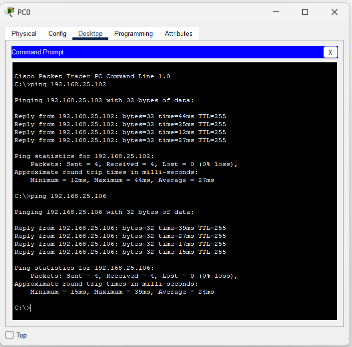
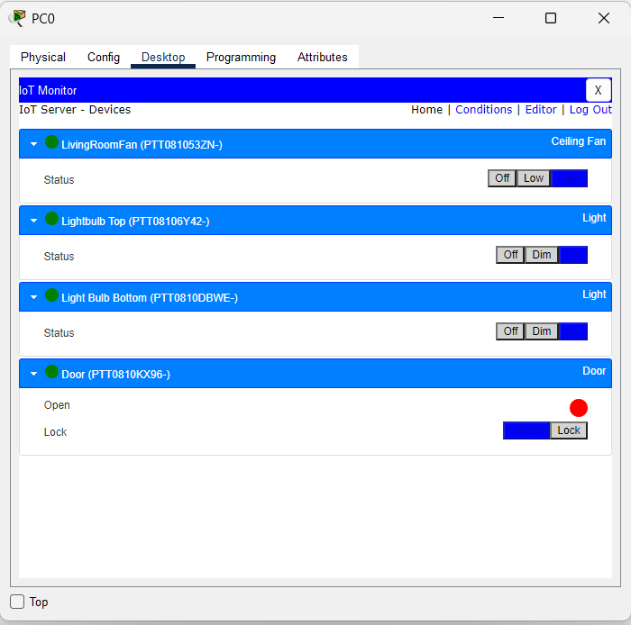

# 📡 Lab: Basic IoT Connectivity

## 🎯 Objective
This lab demonstrates the configuration and verification of a **Basic IoT Smart Home** network using Cisco Packet Tracer. It focuses on establishing wireless connectivity between IoT actuators (smart lights, a ceiling fan, and a smart door) and a central Home Gateway, then managing them through the IoT Monitor application on a networked PC.

## 🧠 Concepts Covered
- **IoT Architecture:** Understanding the role of a Home Gateway (DLC100) as both a wireless access point and an IoT registration server.
- **Wireless Handshaking (802.11n):** Configuring SSIDs and WPA2-PSK security to allow IoT devices to associate with the WLAN.
- **DHCP Addressing:** The Gateway automatically assigns IP addresses to all connected devices from a single subnet.
- **Service Registration:** Pointing each IoT device to the Home Gateway's local server so it appears in the centralized IoT Monitor.
- **Network Troubleshooting:** Using `ping` to verify Layer 3 (IP) connectivity before testing Layer 7 (IoT application) services.

## 🛠️ Devices Used

| Device | Type | Hostname | Connection |
|---|---|---|---|
| Home Gateway | DLC100 | SmartHome | Central Hub (Wired + Wireless) |
| PC | PC-PT | PC0 | Wired (FastEthernet to Gateway Fa0/1) |
| Tablet | TabletPC-PT | Tablet PC0 | Wireless (802.11n) |
| Ceiling Fan | Fan | LivingRoomFan | Wireless (802.11n) |
| Smart Light 1 | Light | Lightbulb Top | Wireless (802.11n) |
| Smart Light 2 | Light | Light Bulb Bottom | Wireless (802.11n) |
| Smart Door | Door | Door | Wireless (802.11n) |

---

## ⚙️ Configuration Steps

### 1. High-Level Network Plan

The network is designed as a **single Local Area Network (LAN)** where the Home Gateway (DLC100) acts as the central hub, providing three core functions:

```
┌─────────────────────────────────────────────────────────────────┐
│                   SmartHome Network (192.168.25.0/24)           │
│                                                                 │
│                      ┌──────────────┐                           │
│          Fa0/1       │  DLC100      │        802.11n WLAN       │
│   PC0 ◄────────────►│  SmartHome   │◄ ─ ─ ─ ─ ─ ─ ─ ─ ─ ►    │
│  (Wired)             │  Gateway     │    SSID: SmartHome        │
│                      │  (DHCP +     │    Auth: WPA2-PSK         │
│                      │   IoT Server)│                           │
│                      └──────────────┘                           │
│                         ▲  ▲  ▲  ▲                              │
│                  Wireless│  │  │  │Wireless                     │
│                         │  │  │  │                              │
│              ┌──────────┘  │  │  └──────────┐                   │
│              │      ┌──────┘  └──────┐      │                   │
│           ┌──┴──┐┌──┴──┐      ┌──┴──┐┌──┴──────┐               │
│           │Fan  ││Light│      │Light││  Door   │               │
│           │     ││ Top │      │Btm  ││         │               │
│           └─────┘└─────┘      └─────┘└─────────┘               │
│           Tablet PC0 also connects wirelessly                   │
└─────────────────────────────────────────────────────────────────┘
```

**Design Rationale:**
- **Wired Segment:** `PC0` connects via a FastEthernet cable to the Gateway's `Fa0/1` port. This provides a stable, always-on management console for the IoT Monitor.
- **Wireless Segment:** All IoT actuators (Fan, 2 Lights, Door) and the Tablet connect via the Gateway's built-in 802.11n wireless radio.
- **IP Addressing:** The Gateway runs a built-in **DHCP server** and assigns addresses in the `192.168.25.0/24` subnet to all devices automatically.
- **IoT Registration:** The Gateway also runs a built-in **Local IoT Server**. Each device must be explicitly pointed to this server to appear in the IoT Monitor dashboard.

---

### 2. Low-Level Configuration (Device-Level / Interface-Level)

#### 📌 Step 1: Configure the Home Gateway (DLC100 – "SmartHome")

The Home Gateway is the most critical device. It must be configured for both wireless access and IoT services.

**A. Internet / LAN Settings (Config > Internet / LAN)**
> The Gateway's LAN interface acts as the default gateway for the entire `192.168.25.0/24` subnet.

| Setting | Value |
|---|---|
| LAN IP Address | `192.168.25.1` |
| Subnet Mask | `255.255.255.0` |
| DHCP | Enabled (assigns IPs from the 192.168.25.x pool) |

**B. Wireless Settings (Config > Wireless)**
> This is where you define the wireless network name and security that all IoT devices and the Tablet will use to connect.

| Setting | Value |
|---|---|
| SSID | `SmartHome` |
| Authentication | `WPA2-PSK` |
| PSK Pass Phrase | *(your chosen password, e.g., `cisco123`)* |
| Channel | Auto |
| Mode | 802.11n |

**How to configure:**
1. Click on the **DLC100 (SmartHome)** device in the topology.
2. Go to the **Config** tab.
3. Under **Wireless**, set the **SSID** to `SmartHome`.
4. Change the **Authentication** drop-down to `WPA2-PSK`.
5. Enter your **PSK Pass Phrase** (e.g., `cisco123`).
6. The IoT **Local Server** is enabled by default under **Config > Settings** — verify it shows as active.

---

#### 📌 Step 2: Connect PC0 (Wired Management Console)

`PC0` connects to the Gateway via a **wired FastEthernet** cable and receives its IP via DHCP.

**A. Physical Connection**
> Connect a **Copper Straight-Through** cable from `PC0`'s `FastEthernet0` port to the Gateway's `Ethernet 0/1` (Fa0/1) port.

**B. IP Configuration (Config > FastEthernet0 / Desktop > IP Configuration)**

| Setting | Value |
|---|---|
| IP Configuration | DHCP |
| Assigned IP (example) | `192.168.25.100` (auto-assigned by Gateway) |
| Subnet Mask | `255.255.255.0` |
| Default Gateway | `192.168.25.1` |

**How to configure:**
1. Click on **PC0** in the topology.
2. Go to **Desktop** tab → **IP Configuration**.
3. Select **DHCP** — the PC will automatically receive an IP address from the Gateway.

---

#### 📌 Step 3: Connect Tablet PC0 (Wireless Management Console)

The Tablet connects wirelessly to the SmartHome network.

**A. Wireless Configuration (Config > Wireless0)**

| Setting | Value |
|---|---|
| SSID | `SmartHome` |
| Authentication | `WPA2-PSK` |
| PSK Pass Phrase | *(same password as Gateway, e.g., `cisco123`)* |
| IP Configuration | DHCP |

**How to configure:**
1. Click on **Tablet PC0** in the topology.
2. Go to **Config** tab → **Wireless0**.
3. Enter the **SSID**: `SmartHome`.
4. Set **Authentication** to `WPA2-PSK` and enter the matching **Pass Phrase**.
5. The Tablet will associate with the Gateway and receive an IP via DHCP.

---

#### 📌 Step 4: Configure IoT Actuators (Fan, Lights, Door)

Each IoT device requires **two** configurations: **wireless association** (to join the network) and **IoT server registration** (to appear in the monitor).

> ⚠️ **Important:** If you skip the IoT Server registration step, the device will have network connectivity but will NOT appear in the IoT Monitor dashboard.

**Repeat the following for each IoT device (LivingRoomFan, Lightbulb Top, Light Bulb Bottom, Door):**

**A. Verify Hardware Module**
1. Click on the IoT device → **Physical** tab.
2. Ensure the **PT-IOT-NM-1W** wireless network module is installed. If not, power off the device, drag the module into an empty slot, and power it back on.

**B. IoT Server Registration (Config > Settings)**

| Setting | Value |
|---|---|
| IoT Server | `Home Gateway` *(select from dropdown)* |
| Display Name | *(auto-populated, e.g., LivingRoomFan)* |

> 🔑 **Key Step:** By default, the "IoT Server" field is set to **None**. You must manually change it to **Home Gateway** for each device. This is the most common source of registration failure.

**C. Wireless Association (Config > Wireless0)**

| Setting | Value |
|---|---|
| SSID | `SmartHome` |
| Authentication | `WPA2-PSK` |
| PSK Pass Phrase | *(same password as Gateway, e.g., `cisco123`)* |

**How to configure (per device):**
1. Click on the IoT device (e.g., **LivingRoomFan**).
2. Go to **Config** tab → **Settings**.
3. Change **IoT Server** from `None` to `Home Gateway`.
4. Go to **Config** tab → **Wireless0**.
5. Enter **SSID**: `SmartHome`.
6. Set **Authentication** to `WPA2-PSK`.
7. Enter the **PSK Pass Phrase** matching the Gateway.
8. Wait a few seconds for the dashed wireless link to appear in the topology, indicating a successful association.

**Device-Specific Summary:**

| Device | Display Name | IoT Server | SSID | Auth |
|---|---|---|---|---|
| Ceiling Fan | LivingRoomFan | Home Gateway | SmartHome | WPA2-PSK |
| Light 1 | Lightbulb Top | Home Gateway | SmartHome | WPA2-PSK |
| Light 2 | Light Bulb Bottom | Home Gateway | SmartHome | WPA2-PSK |
| Smart Door | Door | Home Gateway | SmartHome | WPA2-PSK |

---

## ✅ Verification

### Test 1: Layer 3 Connectivity (Ping Tests from PC0)

Open `PC0` → **Desktop** → **Command Prompt** and run ping tests to verify IP connectivity:

```
C:\> ping 192.168.25.102
```
**Expected Result:** 4 replies, 0% loss.

```
C:\> ping 192.168.25.106
```
**Expected Result:** 4 replies, 0% loss.

> These results confirm that the wired PC can reach the wireless IoT devices through the Gateway, proving that Layer 3 routing and DHCP are functioning correctly.

- [x] **Ping to 192.168.25.102** — 4/4 replies, 0% loss (Avg: 27ms)
- [x] **Ping to 192.168.25.106** — 4/4 replies, 0% loss (Avg: 24ms)

### Test 2: IoT Service Registration (IoT Monitor)

Open `PC0` → **Desktop** → **IoT Monitor** and log in to the Home Gateway's IoT Server.

**Expected Result:** All 4 devices appear with **green status indicators (●)**:

| Device | ID | Type | Status |
|---|---|---|---|
| LivingRoomFan | PTT081053ZN- | Ceiling Fan | 🟢 Online |
| Lightbulb Top | PTT08106Y42- | Light | 🟢 Online |
| Light Bulb Bottom | PTT0810DBWE- | Light | 🟢 Online |
| Door | PTT0810KX96- | Door | 🟢 Online |

- [x] All 4 actuators registered and showing green status.
- [x] Fan controls (Off / Low) are functional.
- [x] Light controls (Off / Dim / On) are functional.
- [x] Door controls (Open / Lock) are functional.

### Test 3: Functional Control

Click the control buttons in the IoT Monitor (e.g., "Dim" for a light, "Low" for the fan) and observe the corresponding visual change on the device in the Packet Tracer workspace topology.

- [x] Clicking **"On"** on a Light turns the bulb yellow in the topology.
- [x] Clicking **"Low"** on the Fan starts the fan animation in the topology.
- [x] Clicking **"Open"** on the Door changes the door graphic in the topology.

---

## 📸 Screenshots

> **Layer 3 Connectivity — Successful ping tests from PC0:**



> **IoT Monitor Dashboard — All 4 actuators registered with green status:**



---

## ❗ Common Issues

| Problem | Cause | Solution |
|---|---|---|
| Device connected to Wi-Fi but missing from IoT Monitor | IoT Server set to `None` | Go to **Config > Settings** and change IoT Server to **Home Gateway** |
| Ping to IoT device times out | Wireless handshake not yet complete | Wait for the dashed link to appear in topology; verify WPA2 password matches |
| IoT Monitor shows no devices | PC not on the same subnet | Ensure PC0 is set to DHCP and has received a `192.168.25.x` address |
| Device has no wireless option | Missing hardware module | Go to **Physical** tab, power off, install **PT-IOT-NM-1W** module, power on |
| Tablet cannot connect to Wi-Fi | SSID or passphrase mismatch | Double-check that the SSID is `SmartHome` and the passphrase matches exactly |

---

## 📁 Lab File

> 💾 **Try it yourself** — Download [`IOT Practical.pkt`](IOT%20Practical.pkt) and open in **Cisco Packet Tracer 8.1+**. Control the lights, fan, and door from the IoT Monitor dashboard, then try adding a new IoT device and registering it to the gateway yourself.

- `IOT Practical.pkt` — Complete working IoT smart home lab.

---

## 🚀 What I Learned
- **Network Integration:** Physical wireless connectivity is only half the setup; software-level registration (pointing each device to the IoT Server) is required for centralized management.
- **Troubleshooting Workflow:** I practiced a systematic approach — verify **Layer 3 (ping)** first, then move up to **Layer 7 (IoT application)** — mirroring the OSI model troubleshooting methodology.
- **Wireless Security:** Configured WPA2-PSK authentication across all devices, understanding that every device must share the exact same SSID and passphrase to associate.
- **IoT System Logic:** Gained experience in how a central gateway can bridge various household appliances (lights, fans, doors) into a single, remotely manageable interface.
- **DHCP in Action:** Observed how the Gateway's built-in DHCP server automatically assigns unique IPs to each device, eliminating the need for manual static addressing in a home IoT environment.
