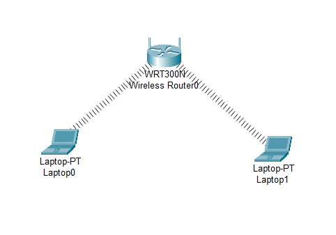
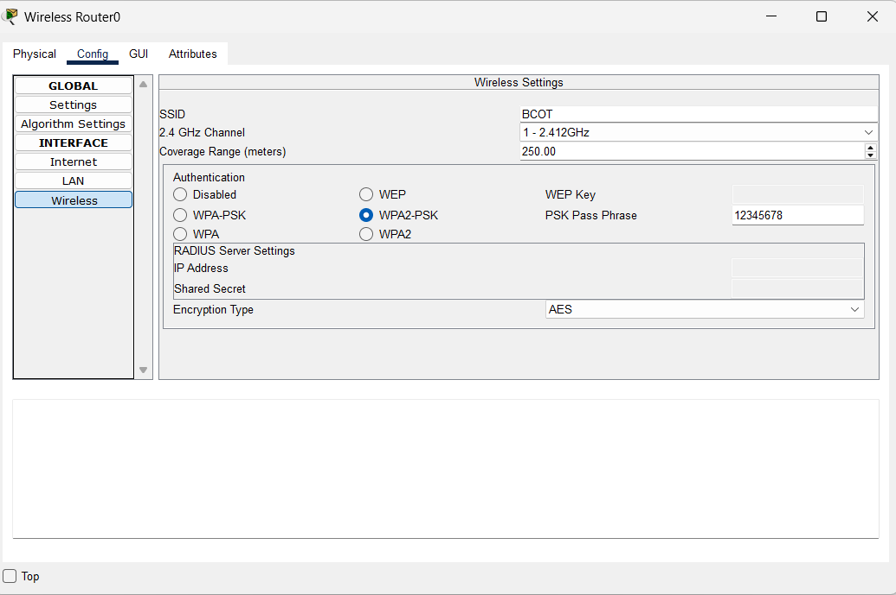
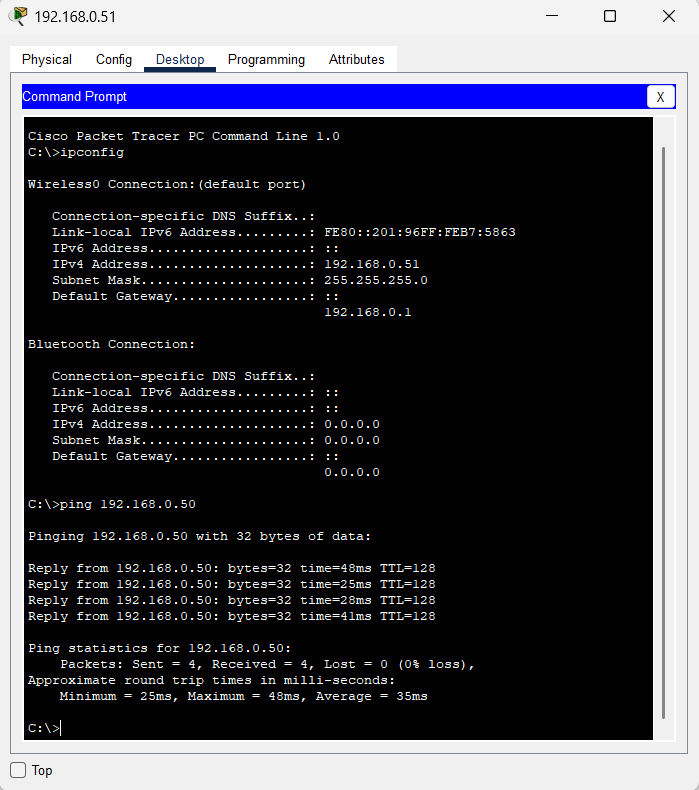

# 📡 Lab: Basic Wireless Connectivity

## 🎯 Objective
This lab demonstrates the configuration of a **Wireless Local Area Network (WLAN)** using a **WRT300N** home wireless router in Cisco Packet Tracer. The goal is to establish secure wireless connectivity between two laptops via **WPA2-PSK** authentication and verify end-to-end communication using ICMP ping tests.

## 🧠 Concepts Covered
- **WLAN Configuration:** Setting up an SSID and wireless security on a home router.
- **WPA2-PSK Security:** Implementing Pre-Shared Key (PSK) encryption with AES for secure wireless access.
- **DHCP Addressing:** Automatic IP assignment from the router's built-in DHCP server to wireless clients.
- **ICMP Testing:** Using the `ping` command to verify Layer 3 connectivity between wireless devices.

## 🛠️ Devices Used
| Device | Model | Qty | Role |
|--------|-------|-----|------|
| Wireless Router | WRT300N | 1 | Central access point & DHCP server |
| Laptop | Laptop-PT | 2 | Wireless end devices (Laptop0, Laptop1) |

## ⚙️ Configuration Steps

### 1. High-Level Network Plan

The network uses a **wireless star topology** where the **WRT300N Wireless Router** acts as the central hub, gateway, and DHCP server. Both laptops connect wirelessly to the router and receive IP addresses automatically.

```
┌─────────────────────────────────────────────────┐
│              WIRELESS NETWORK (WLAN)            │
│                                                 │
│              ┌──────────────┐                   │
│              │  WRT300N     │                   │
│              │  Router0     │                   │
│              │ 192.168.0.1  │                   │
│              └──────┬───────┘                   │
│                     │                           │
│            ┌────────┴────────┐                  │
│            │  Wireless (RF)  │                  │
│            │  SSID: BCOT     │                  │
│            │  WPA2-PSK/AES   │                  │
│            ├────────┬────────┤                  │
│       ┌────┘        └────┐                      │
│  ┌────┴─────┐     ┌─────┴────┐                  │
│  │ Laptop0  │     │ Laptop1  │                  │
│  │  .0.50   │     │  .0.51   │                  │
│  │ (DHCP)   │     │ (DHCP)   │                  │
│  └──────────┘     └──────────┘                  │
└─────────────────────────────────────────────────┘
```

**Addressing Table:**

| Device | Interface | IP Address | Subnet Mask | Default Gateway | Method |
|--------|-----------|------------|-------------|-----------------|--------|
| Wireless Router0 | LAN | 192.168.0.1 | 255.255.255.0 | — | Static |
| Laptop0 | Wireless0 | 192.168.0.50 | 255.255.255.0 | 192.168.0.1 | DHCP |
| Laptop1 | Wireless0 | 192.168.0.51 | 255.255.255.0 | 192.168.0.1 | DHCP |

**Wireless Settings Summary:**

| Parameter | Value |
|-----------|-------|
| SSID | `BCOT` |
| Channel | 1 – 2.412GHz |
| Coverage Range | 250.00 meters |
| Authentication | WPA2-PSK |
| Encryption Type | AES |
| PSK Passphrase | `12345678` |

---

### 2. Low-Level Configuration (Device Level)

#### 📶 Wireless Router0 (WRT300N) — Wireless & LAN Configuration

The WRT300N is configured entirely through its **GUI/Config** tab (it does not use Cisco IOS CLI).

**Step 1: Access the Wireless Settings**
1. Click on **Wireless Router0** in the topology.
2. Navigate to the **Config** tab.
3. In the left sidebar, under **INTERFACE**, click **Wireless**.

**Step 2: Configure the SSID**
- Set the **SSID** field to: `BCOT`
  - *This is the network name that laptops will see when scanning for wireless networks.*
- Set the **2.4 GHz Channel** to: `1 - 2.412GHz`
  - *Channel 1 is selected to avoid interference. In a real environment, you would perform a site survey to choose the least congested channel.*
- Set the **Coverage Range (meters)** to: `250.00`
  - *This defines the maximum wireless signal reach. Ensure both laptops are within this range in the topology view.*

**Step 3: Configure Wireless Security (Authentication)**
- Under **Authentication**, select: **WPA2-PSK**
  - *WPA2-PSK (Wi-Fi Protected Access 2 with Pre-Shared Key) is the recommended security mode for home and small office networks. It provides strong AES-based encryption without requiring a RADIUS server.*
- Enter the **PSK Pass Phrase**: `12345678`
  - *This is the password that all wireless clients must enter to connect to the network. In production, use a strong passphrase (12+ characters with mixed types).*
- Set the **Encryption Type** to: `AES`
  - *AES (Advanced Encryption Standard) is the strongest encryption option available. Avoid TKIP as it has known vulnerabilities.*

**Step 4: Verify LAN Settings**
1. In the left sidebar, click **LAN**.
2. Confirm the **IP Address** is: `192.168.0.1`
3. Confirm the **Subnet Mask** is: `255.255.255.0`
4. Ensure the **DHCP Server** is enabled (this is on by default).
   - *The built-in DHCP server will automatically assign IP addresses to connected clients from the 192.168.0.x pool.*

---

#### 💻 Laptop0 & Laptop1 — Wireless Client Configuration

Both laptops follow the same configuration steps.

**Step 1: Install the Wireless NIC Module**
1. Click on the **Laptop** in the topology.
2. Navigate to the **Physical** tab.
3. **Power off** the laptop by clicking the power button.
4. Remove the default **Ethernet module** by dragging it out of the slot.
5. From the **Modules** list on the left, drag the **WMP300N** (Wireless-N PCI adapter) into the empty slot.
6. **Power on** the laptop.
   - *The WMP300N module provides 802.11n wireless capability, allowing the laptop to connect to the WRT300N router.*

**Step 2: Connect to the Wireless Network**
1. Navigate to the **Desktop** tab.
2. Click **PC Wireless**.
3. Under the **Connect** tab, click **Refresh** to scan for available networks.
4. Select the **BCOT** network from the list.
5. Click **Connect**.
6. When prompted, enter the **PSK Passphrase**: `12345678`
7. Click **Connect** to authenticate.
   - *After successful authentication, the laptop will associate with the router and a dashed line will appear in the topology view indicating the wireless connection.*

**Step 3: Verify IP Address Assignment (DHCP)**
1. Navigate to the **Desktop** tab.
2. Open **Command Prompt**.
3. Type `ipconfig` and press Enter.
4. Verify the following output:
   - **Wireless0 Connection:**
     - **IPv4 Address:** `192.168.0.50` (Laptop0) / `192.168.0.51` (Laptop1)
     - **Subnet Mask:** `255.255.255.0`
     - **Default Gateway:** `192.168.0.1`
   - *If the IP shows `0.0.0.0`, the laptop has not successfully connected. Re-check the SSID and passphrase.*

## ✅ Verification

- [x] **Wireless Association:** Both laptops show dashed-line connections to the router in the topology view, confirming successful wireless association.
- [x] **IP Assignment:** Running `ipconfig` on both laptops confirms they received valid IPs in the `192.168.0.x` range via DHCP.
- [x] **End-to-End Connectivity:** From **Laptop1** (`192.168.0.51`), a ping to **Laptop0** (`192.168.0.50`) was successful:

```
C:\>ping 192.168.0.50

Pinging 192.168.0.50 with 32 bytes of data:

Reply from 192.168.0.50: bytes=32 time=48ms TTL=128
Reply from 192.168.0.50: bytes=32 time=25ms TTL=128
Reply from 192.168.0.50: bytes=32 time=28ms TTL=128
Reply from 192.168.0.50: bytes=32 time=41ms TTL=128

Ping statistics for 192.168.0.50:
    Packets: Sent = 4, Received = 4, Lost = 0 (0% loss),
Approximate round trip times in milli-seconds:
    Minimum = 25ms, Maximum = 48ms, Average = 35ms
```

## 📸 Screenshots

> **Network Topology** — Wireless Router0 connected to Laptop0 and Laptop1 via wireless signals (dashed lines).



> **Router Wireless Configuration** — Config tab showing SSID `BCOT`, WPA2-PSK authentication, passphrase `12345678`, and AES encryption.



> **Ping Verification** — Laptop1 (`192.168.0.51`) running `ipconfig` and successfully pinging Laptop0 (`192.168.0.50`) with 0% loss.



## ❗ Common Issues
- **Mismatched SSID:** The SSID on the laptop must exactly match the router's SSID (`BCOT`). It is case-sensitive — `bcot` or `Bcot` will fail.
- **Wrong Authentication Mode:** Selecting `WPA-PSK` instead of `WPA2-PSK` will cause authentication failures, even with the correct passphrase.
- **Laptop Not Powering On:** After swapping the NIC module in the Physical tab, you **must** power the laptop back on. Forgetting this is a common mistake.
- **No IP Address (0.0.0.0):** If the laptop shows `0.0.0.0`, it has not associated with the router. Verify the wireless connection in **Desktop > PC Wireless**.
- **Missing Wireless Module:** If the laptop has no wireless option, ensure the **WMP300N** module was installed and the laptop was restarted.

## 📁 Lab File

> 💾 **Try it yourself** — Download [`Wireless Networking.pkt`](Wireless%20Networking.pkt) and open in **Cisco Packet Tracer 8.1+**. Try connecting a third laptop, change the WPA2 passphrase on the router and observe the existing laptops drop off the network, then reconnect them with the new password.

- `Wireless Networking.pkt` — Complete working wireless LAN lab.

## 🚀 What I Learned
- **Wireless Security Protocols:** Understanding the hierarchy of wireless security — WEP (weak, deprecated) → WPA (improved) → **WPA2-PSK (current standard)** — and why AES encryption is preferred over TKIP.
- **GUI-Based Configuration:** The WRT300N uses a web-style GUI interface (similar to real home routers like Linksys/TP-Link), which contrasts with the CLI-based configuration used on Cisco enterprise switches and routers.
- **DHCP in Wireless Networks:** The wireless router's built-in DHCP server seamlessly assigns IP addresses to connected clients, eliminating manual IP configuration on each device.
- **Physical Layer Awareness:** Learned that wireless NICs (like the WMP300N) must be physically installed in Packet Tracer before wireless connectivity is possible — a step that simulates real-world hardware installation.
- **Troubleshooting Wireless:** Even in a wireless environment, standard tools like `ipconfig` and `ping` remain the primary diagnostic tools for verifying Layer 3 connectivity.
