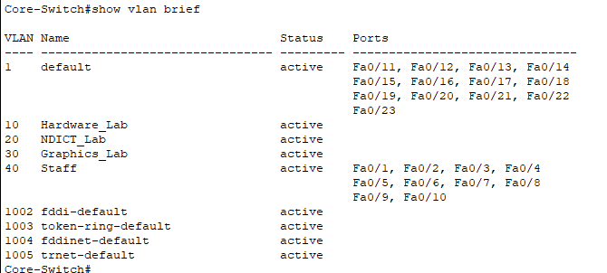
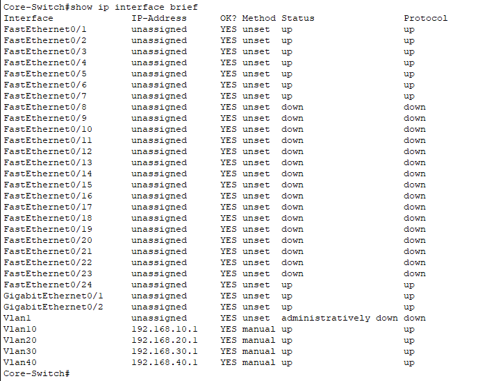
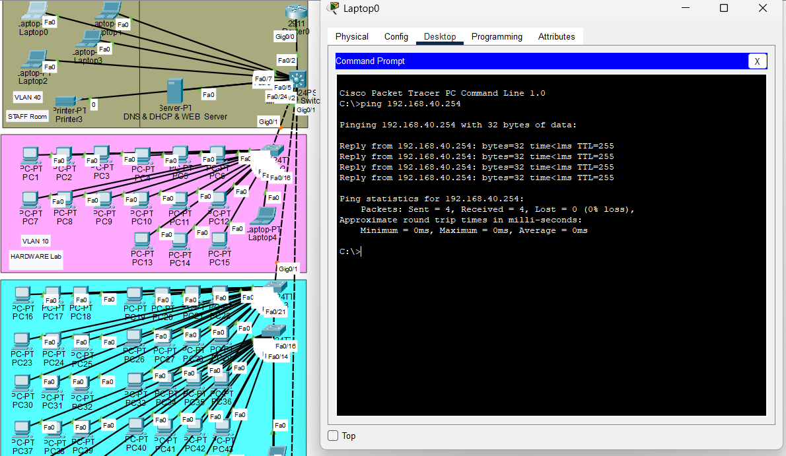
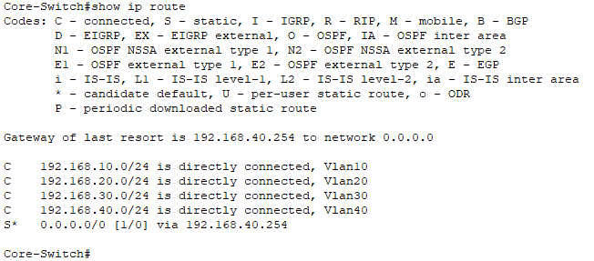
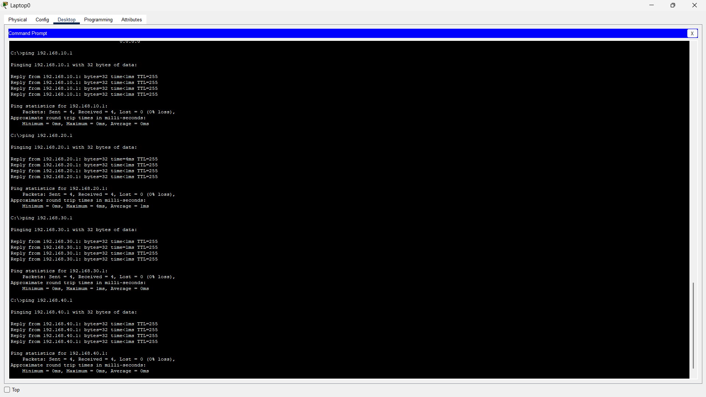

# Step 01: Core Layer 3 Switch — Configuration Journey

> A full record of what was configured, what went wrong, how it was fixed, and the golden rules learned along the way.

---

## 🎯 Objective

Configure a **Cisco 3560 Multilayer Switch** as the Core of a hierarchical campus network to:
1. Create VLANs for four zones (Hardware Lab, NDICT Lab, Graphics Lab, Staff).
2. Enable **inter-VLAN routing** via SVIs.
3. Relay DHCP requests to a dedicated server.
4. Establish **trunk links** to downstream lab switches.
5. Set a **default route** for internet reachability.

---

# 🏆 Golden Rules of Layer 3 Switch Configuration

> **Read these FIRST. Every rule below was learned the hard way during this lab.**

---

### ⚡ Rule 1: `ip routing` First — Or Nothing Works

Without `ip routing`, a multilayer switch is just an expensive Layer 2 switch. Always enable it **before** configuring SVIs or routes, and verify with `show ip route`.

```
conf t
ip routing       ← This single command activates the Layer 3 brain
exit
show ip route    ← Must show "C" connected routes, not an empty table
```

---

### ⚡ Rule 2: Never Put Comments in Cisco IOS CLI

```
❌  ip routing # Enable Layer 3
✅  ip routing
```

IOS does **not** support `#` comments. The switch silently rejects the entire command if it sees trailing text it can't parse. This is the **#1 copy-paste trap**.

---

### ⚡ Rule 3: Trunks Are for Switches, Access Ports Are for Endpoints

| Connection Type                              | Port Mode                                                           |
| -------------------------------------------- | ------------------------------------------------------------------- |
| Core Switch ↔ Lab Switch                     | **Trunk** (`switchport mode trunk`)                                 |
| Core Switch ↔ Router (plain interface)       | **Access** (`switchport mode access`, assigned to the correct VLAN) |
| Core Switch ↔ PC / Server / Printer          | **Access**                                                          |
| Core Switch ↔ Router (sub-interfaces / RoaS) | **Trunk**                                                           |
![[GUIDE TO NETWORKING BEST PRACTICES - PORT MODE SELECTION.png]]
 

> If the router doesn't have sub-interfaces, it doesn't speak 802.1Q tags. Sending it trunk frames = **packet black hole**.

---

### ⚡ Rule 4: Always Prune Your Trunks

A trunk carries **all 1005 VLANs** by default. Restrict it to only the VLANs that actually need to cross:

```
switchport trunk allowed vlan 10,40
```

**Why?** Unnecessary broadcast traffic from VLAN 30 has no business flooding the Hardware Lab switch. Prune = security + performance.

---

### ⚡ Rule 5: Routing Is a Two-Way Street

Setting a default route on the Core Switch gets traffic **out**. But the upstream Router also needs static routes **back** to every internal subnet:

```
! On the Router
ip route 192.168.10.0 255.255.255.0 192.168.40.1
ip route 192.168.20.0 255.255.255.0 192.168.40.1
ip route 192.168.30.0 255.255.255.0 192.168.40.1
```

Without these return routes, reply packets get lost at the router — the request goes out, but the answer never comes back.

---

### ⚡ Rule 6: An SVI Won't Come Up Without a Live Port

`interface vlan 10` stays **down/down** unless at least one physical port assigned to VLAN 10 has a **powered-on device** connected. No live port → no route in the table → no reachability.

---

### ⚡ Rule 7: Turn On Your Services Before Testing Them

If you're relying on DHCP for IP assignment, **make sure the DHCP server is actually running** before you try to ping anything. No DHCP = no IP on the PC = ping sends from `0.0.0.0` = guaranteed failure.

```
Checklist before first ping:
  ✅ DHCP Server powered on
  ✅ DHCP pools configured for each VLAN
  ✅ ip helper-address set on each SVI
  ✅ PC set to "DHCP" (not static)
  ✅ Wait 10-15 seconds for lease
```

> **Real example from this lab:** First ping test failed entirely — not because of routing or VLAN issues, but because the DHCP server wasn't turned on yet. The PCs had no IP addresses. Always check the basics first. 😅

---

### ⚡ Rule 8: 80% Ping Success on First Attempt Is Normal

The first ICMP packet in a sequence almost always fails because of **ARP resolution** — the switch must discover the destination's MAC address before forwarding. A 4/5 (80%) result on a first ping is **expected and healthy**. Don't panic.

---

### ⚡ Rule 9: Always Verify Before Moving On

Run this checklist after every major configuration change:

| # | Command | Pass Criteria |
|---|---|---|
| 1 | `show vlan brief` | All VLANs exist and are active |
| 2 | `show ip interface brief` | All SVI interfaces show `up / up` |
| 3 | `show ip route` | `C` routes for all VLANs + `S*` default route |
| 4 | `show interfaces trunk` | Correct ports trunking with pruned VLAN lists |
| 5 | `ping <router IP>` | 80–100% success |
| 6 | `ping <remote VLAN gateway>` | Confirms inter-VLAN routing works |

> 📸 See the **[Verification Screenshots](#-verification-screenshots)** section below for proof of each check passing.

---

### ⚡ Rule 10: Don't Repurpose Ports Without Checking Their Role

Before changing any port's mode (`access` ↔ `trunk`), always run:

```
show interfaces trunk
show running-config interface <interface-id>
```

Blindly changing a trunk port to access will silently disconnect every VLAN that was flowing through it.

---

### ⚡ Rule 11: Clean Copy-Paste — Strip Formatting

When copying commands from documentation (Markdown, Word, web pages):
- Remove backticks (`` ` ``), smart quotes (`" "`), and em-dashes (`—`).
- Ensure no trailing spaces or invisible Unicode characters.
- Paste one command at a time when debugging.

---
---

## ✅ What Went Right (Successes)

### 1. VLAN Creation — Clean and Correct

```
conf t
hostname Core-Switch
ip routing

vlan 10
 name Hardware_Lab
vlan 20
 name NDICT_Lab
vlan 30
 name Graphics_Lab
vlan 40
 name Staff
exit
```

**Verified with `show vlan brief`** — all four VLANs appeared as **active**. No issues here.



---

### 2. SVIs (Virtual Gateways) — All Came Up

```
interface vlan 10
 ip address 192.168.10.1 255.255.255.0
 no shut

interface vlan 20
 ip address 192.168.20.1 255.255.255.0
 no shut

interface vlan 30
 ip address 192.168.30.1 255.255.255.0
 no shut

interface vlan 40
 ip address 192.168.40.1 255.255.255.0
 no shut
```

**Verified with `show ip interface brief`** — all four `Vlan` interfaces showed **up / up** because physical ports had active devices connected.



---

### 3. DHCP Relay — Configured Without Issues

```
interface vlan 10
 ip helper-address 192.168.40.5
interface vlan 20
 ip helper-address 192.168.40.5
interface vlan 30
 ip helper-address 192.168.40.5
interface vlan 40
 ip helper-address 192.168.40.5
```

> **Note:** The helper on VLAN 40 is technically redundant since the DHCP server (`192.168.40.5`) lives inside VLAN 40 and hears broadcasts natively. It doesn't hurt, but it's unnecessary.

---

### 4. Trunk Configuration — Successfully Established

After switching from access ports to trunks, `show interfaces trunk` confirmed:

| Port   | Allowed VLANs | Status    |
|--------|---------------|-----------|
| Fa0/24 | 10, 40        | Trunking  |
| Gi0/1  | 20, 40        | Trunking  |
| Gi0/2  | 30, 40        | Trunking  |

The `switchport trunk allowed vlan` command was correctly applied to limit VLAN leakage.

---

### 5. Default Route + Router Ping — Eventually Successful

After fixing the physical path (see mistakes below), the ping to `192.168.40.254` returned:

```
Core-Switch#ping 192.168.40.254
Success rate is 80 percent (4/5), round-trip min/avg/max = 0/0/0 ms
```

> **80% (4/5) is a perfect first-ping result.** The first packet always fails due to ARP resolution — the switch needs to discover the router's MAC address before it can forward.



---

## ❌ What Went Wrong (Mistakes & Fixes)

### Mistake 1: Tested Ping Before Turning On DHCP Server 😅

**The Problem:**
Ran `ping` tests from Lab PCs immediately after configuring everything — and got 0% success across the board.

**Root Cause:**
The DHCP server wasn't powered on. The PCs were set to obtain IP addresses via DHCP, so they had **no IP address at all** (or were stuck on `0.0.0.0`). A ping from a device with no IP will always fail — it's not a routing problem, it's a "the PC doesn't even have an address" problem.

**The Fix:**
1. Power on the DHCP server.
2. Ensure the DHCP pools are configured for each VLAN subnet.
3. Wait 10–15 seconds for PCs to obtain leases.
4. Verify with `ipconfig` on the PC — confirm it received an IP in the correct VLAN range.

> **Lesson:** Always verify the **basics** (power, DHCP, IP assignment) before debugging the **advanced** (routing, trunks, ACLs). The simplest explanation is usually the right one.

---

### Mistake 2: `ip routing` Was Not Actually Enabled

**The Problem:**
After running all configurations, `show ip route` showed:

```
Default gateway is not set
Host  Gateway  Last Use  Total Uses  Interface
ICMP redirect cache is empty
```

No connected routes (`C`), no static routes (`S`). The switch was behaving as a **Layer 2 bridge**, not a router.

**Root Cause:**
The `ip routing` command was entered with trailing comment text that Cisco rejected:

```
Core-Switch(config)#ip routing # This is the "On" switch for Layer 3
                               ^
% Invalid input detected at '^' marker.
```

Cisco IOS does **NOT** support inline comments with `#`. The entire line was rejected silently.

**The Fix:**

```
conf t
ip routing
exit
```

**After the fix, `show ip route` displayed:**

```
C    192.168.10.0/24 is directly connected, Vlan10
C    192.168.20.0/24 is directly connected, Vlan20
C    192.168.30.0/24 is directly connected, Vlan30
C    192.168.40.0/24 is directly connected, Vlan40
S*   0.0.0.0/0 [1/0] via 192.168.40.254
```

> **Lesson:** Never put comments on the same line as a Cisco IOS command. IOS treats everything after the command as arguments, not comments.

---

### Mistake 3: `show ip route` With Inline Comment Also Failed

```
Core-Switch#show ip route # You should now see 'C' routes
                          ^
% Invalid input detected at '^' marker.
```

Same issue — the `#` was interpreted as part of the command string.

**The Fix:** Just type the command cleanly:

```
show ip route
```

---

### Mistake 4: Backtick Characters in Commands

```
Core-Switch#`show vlan brief`
             ^
% Invalid input detected at '^' marker.
```

**Root Cause:** Copy-pasting from a formatted document (Markdown) brought backtick characters (`` ` ``) into the CLI. Cisco IOS has no concept of backticks.

**The Fix:** Always strip formatting marks before pasting into the CLI.

---

### Mistake 5: Router Ping Failed — Physical Path Wasn't in VLAN 40

**The Problem:**
After setting `ip route 0.0.0.0 0.0.0.0 192.168.40.254`, pinging the router failed:

```
Core-Switch#ping 192.168.40.254
Success rate is 0 percent (0/5)
```

**Root Cause:**
The port connecting the Core Switch to the Router (`Fa0/2`) was configured as a **trunk** carrying all VLANs. But the Router's interface was set to `192.168.40.254` — a plain access-mode IP in VLAN 40. The router wasn't sending or expecting 802.1Q tags, so the tagged frames from the trunk were **unintelligible** to it.

**The Fix:**
Changed `Fa0/2` from a trunk back to an **access port in VLAN 40**:

```
conf t
interface FastEthernet0/2
 switchport mode access
 switchport access vlan 40
 no shutdown
exit
```

**After the fix:**

```
Core-Switch#ping 192.168.40.254
Success rate is 80 percent (4/5)  ✅
```

> **Lesson:** A trunk is for **switch-to-switch** links. A connection to a **router's plain interface** must be an access port (unless the router is doing Router-on-a-Stick with sub-interfaces).

---

### Mistake 6: Missing Return Routes on the Router

**The Problem:**
Even after the Core Switch could reach the Router, traffic from Lab PCs to the internet would get **replies stuck at the router**. The router knew about `192.168.40.0/24` (its connected network) but had no idea how to send packets back to `192.168.10.0`, `.20.0`, or `.30.0`.

**The Fix (on Router0):**

```
conf t
ip route 192.168.10.0 255.255.255.0 192.168.40.1
ip route 192.168.20.0 255.255.255.0 192.168.40.1
ip route 192.168.30.0 255.255.255.0 192.168.40.1
exit
```

This tells the Router: *"To reach the lab networks, forward packets to the Core Switch at 192.168.40.1."*

> **Lesson:** Routing is a **two-way street**. The Core Switch needs a default route *out*, and the Router needs static routes *back* for every lab subnet.

---

### Mistake 7: Fa0/2 Changed from Trunk to Access — Lost Trunk to Lab Switch

**The Context:**
`Fa0/2` was initially configured as a trunk link to a lab switch. When it was changed to an access port (to fix the router connection), that lab switch lost its trunk.

**The Lesson:**
Before repurposing a port, always check what it's currently doing with `show interfaces trunk` and plan accordingly. The router should ideally be connected to a **dedicated port** that was never part of the trunk plan.

---

## 📋 Final Verified Configuration (Core Switch)

### Routing Table (`show ip route`)

```
C    192.168.10.0/24  is directly connected, Vlan10
C    192.168.20.0/24  is directly connected, Vlan20
C    192.168.30.0/24  is directly connected, Vlan30
C    192.168.40.0/24  is directly connected, Vlan40
S*   0.0.0.0/0 [1/0] via 192.168.40.254
```

### Trunk Summary (`show interfaces trunk`)

```
Port    Mode  Encapsulation  Status    Native VLAN
Fa0/24  on    802.1q         trunking  1
Gig0/1  on    802.1q         trunking  1
Gig0/2  on    802.1q         trunking  1
```

### Interface Summary (`show ip interface brief`)

```
Vlan10   192.168.10.1   up   up
Vlan20   192.168.20.1   up   up
Vlan30   192.168.30.1   up   up
Vlan40   192.168.40.1   up   up
```

---

## 📸 Verification Screenshots

Proof that every check from the verification checklist passed after all fixes were applied.

### 1. `show vlan brief` — All VLANs Active


### 2. `show ip interface brief` — All SVIs Up


### 3. `show ip route` — Connected Routes + Default Route



### 4. `ping` Router from Topology — 100% Success


### 5. `ping` All VLAN Gateways — Inter-VLAN Routing Confirmed

Pinging all four gateways (192.168.10.1, .20.1, .30.1, .40.1) from a single PC proves the Core Switch is routing between all VLANs successfully.



---

## 🔄 End-to-End Traffic Flow (After All Fixes)

```
  Graphics PC (192.168.30.10)
       │
       ▼
  Graphics Lab Switch
       │  ← Trunk (tagged VLAN 30)
       ▼
  ┌──────────────────────┐
  │    CORE SWITCH       │
  │                      │
  │  SVI Vlan30 receives │
  │  → checks route table│
  │  → no match for dest │
  │  → follows S* default│
  │  → forwards via      │
  │    Fa0/2 (VLAN 40)   │
  └──────────┬───────────┘
             │  ← Access port (VLAN 40)
             ▼
  ┌──────────────────────┐
  │     ROUTER0          │
  │  192.168.40.254      │
  │                      │
  │  → NATs traffic      │
  │  → sends to Internet │
  │  → reply comes back  │
  │  → checks routes:    │
  │    192.168.30.0/24   │
  │    via 192.168.40.1  │
  │  → sends to Core SW  │
  └──────────┬───────────┘
             │
             ▼
  Core Switch → Trunk → Graphics Lab Switch → PC
```

---

## 📝 Summary Table

| Phase | Task | Status | Key Gotcha |
|---|---|---|---|
| — | DHCP Server Power | ✅ Success (after fix) | Forgot to turn it on before first test 😅 |
| Phase 1 | VLAN Creation | ✅ Success | None |
| Phase 2 | SVI Configuration | ✅ Success | Needs live port to come `up` |
| Phase 3 | DHCP Relay | ✅ Success | Helper on VLAN 40 is redundant |
| Phase 4 | Trunk Links | ✅ Success (after fix) | Must prune allowed VLANs |
| Phase 5 | Default Route | ✅ Success (after fix) | `ip routing` must be enabled first |
| — | Router Return Routes | ✅ Success | Routing is two-way |
| — | Router Port Assignment | ✅ Success (after fix) | Router plain interface needs access port, not trunk |
