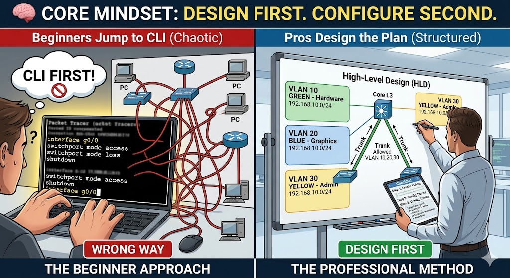
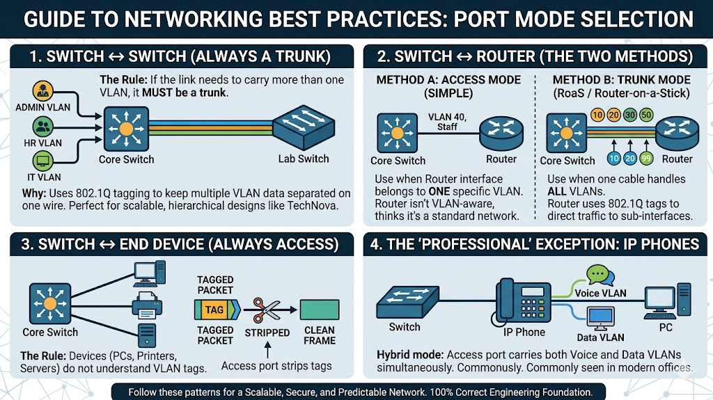
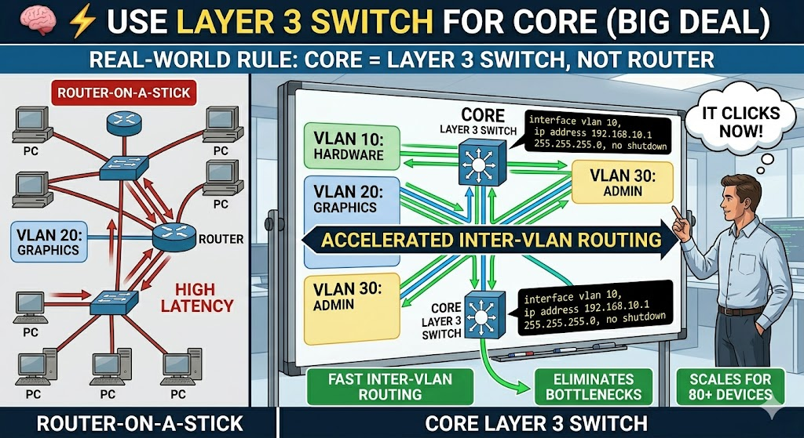
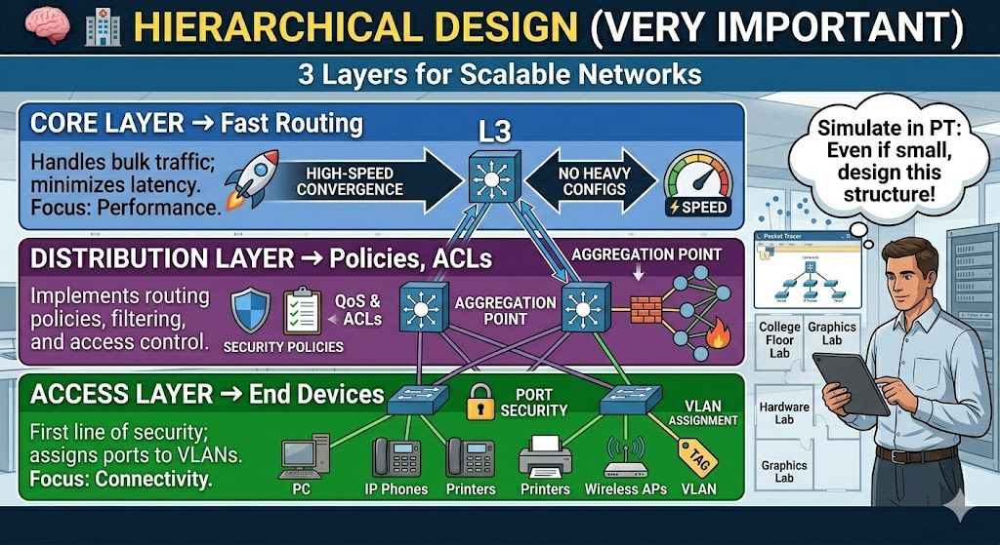

---

# 🧠 Core Mindset (Most Important)

Before configs, remember this:

> **“Design first. Configure second.”**

Most beginners jump straight into CLI. Pros don’t.

---

# 🔥 1. VLAN & Port Mode Rules (Your Image = GOLD)


### ✅ Switch ↔ Switch → **TRUNK**

- Always trunk if multiple VLANs pass
    
- Use:
    

```bash
switchport mode trunk
```

👉 Real-world tip:

- Always **restrict allowed VLANs**
    

```bash
switchport trunk allowed vlan 10,20,30
```

(Not doing this = security + broadcast problems)

---

### ✅ Switch ↔ End Device → **ACCESS**

- PCs, printers = no VLAN tagging
    

```bash
switchport mode access
switchport access vlan 10
```

👉 Why?  
Devices don’t understand VLAN tags → switch removes them.

---

### ✅ Switch ↔ Router → Two Options

#### Option A: Access (simple, small networks)

- One VLAN per interface
    

#### Option B: Trunk (Router-on-a-Stick)

- One cable, multiple VLANs
    

```bash
interface g0/0.10
encapsulation dot1Q 10
ip address 192.168.10.1 255.255.255.0
```

👉 In real life:

- Router-on-a-stick = OK for small setups
    
- ❗ Large networks → use **Layer 3 Switch (SVI)** instead
    

---

# ⚡ 2. Use Layer 3 Switch for Core (BIG DEAL)

You asked this before — now it clicks.

👉 Why L3 switch?

- Handles inter-VLAN routing **faster than router**
    
- Reduces bottlenecks
    
- Scales for 80+ devices (like your project)
    

```bash
interface vlan 10
ip address 192.168.10.1 255.255.255.0
no shutdown
```

👉 Real-world rule:

> **Core = Layer 3 Switch, not router**



---

# 🧱 3. Follow Hierarchical Design (VERY IMPORTANT)

### 🏢 3 Layers:

- **Core** → Fast routing (no heavy configs)
    
- **Distribution** → Policies, ACLs
    
- **Access** → End devices
    

👉 In Packet Tracer:  
Even if small, try to simulate this.


---

# 🔐 4. Security Best Practices (Examiners LOVE this)

### 🔒 Port Security

```bash
switchport port-security
switchport port-security maximum 2
switchport port-security violation shutdown
```

### 🔒 Disable unused ports

```bash
interface range fa0/10-24
shutdown
```

### 🔒 Use VLANs for segmentation

- Admin VLAN
    
- Student VLAN
    
- Server VLAN
    

👉 Real-world thinking:

> “If one VLAN is hacked, others are safe”

---

# 📡 5. IP Addressing Discipline

Don’t randomly assign IPs.

### ✅ Plan like this:

|VLAN|Network|
|---|---|
|10|192.168.10.0/24|
|20|192.168.20.0/24|

👉 Use:

- `.1` = Gateway
    
- `.10+` = Devices
    
- `.100+` = DHCP pool
    

---

# ⚙️ 6. Always Verify (Most ignored skill)

After config, ALWAYS:

```bash
show vlan brief
show ip interface brief
show interfaces trunk
show mac address-table
```

👉 Real-world truth:

> Engineers spend more time verifying than configuring.

---

# 🧪 7. Packet Tracer-Specific Tips

### 💡 Do this to stand out:

- Use **labels & notes**
    
- Name devices properly:
    
    - Core-SW
        
    - Lab1-SW
        
- Color VLANs (visual clarity)
    

### 💡 Test properly:

- Ping across VLANs
    
- Break something → fix it (best learning)
    

---

# 🚫 Common Mistakes (Avoid these like a pro)

- ❌ Using access instead of trunk between switches
    
- ❌ Forgetting `no shutdown`
    
- ❌ Not assigning VLAN to ports
    
- ❌ Wrong subnet masks
    
- ❌ No default gateway on PCs
    
- ❌ Allowing ALL VLANs on trunk (lazy config)
    

---

# 🧠 Real Engineer Thinking

When you design, always ask:

- “Will this scale to 200 users?”
    
- “What happens if this link fails?”
    
- “Is traffic optimized?”
    
- “Is this secure?”
    

---

## 🧭 HLD (High-Level Design)

👉 Big picture

Includes:

- Topology diagram
- Number of switches/routers
- VLAN strategy
- IP addressing plan

Example:

> “Core L3 switch, 3 access switches, VLAN 10/20/30”

---

## 🔧 LLD (Low-Level Design)

👉 Exact configuration

Includes:

- Interface configs
- VLAN IDs
- Routing protocols
- CLI commands

Example:

interface fa0/1  
switchport mode access  
switchport access vlan 10