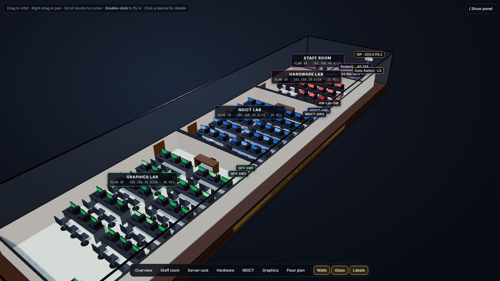
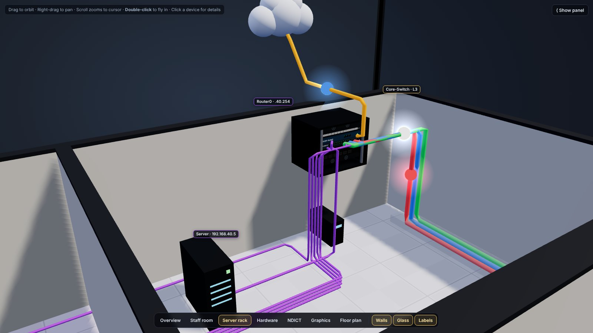
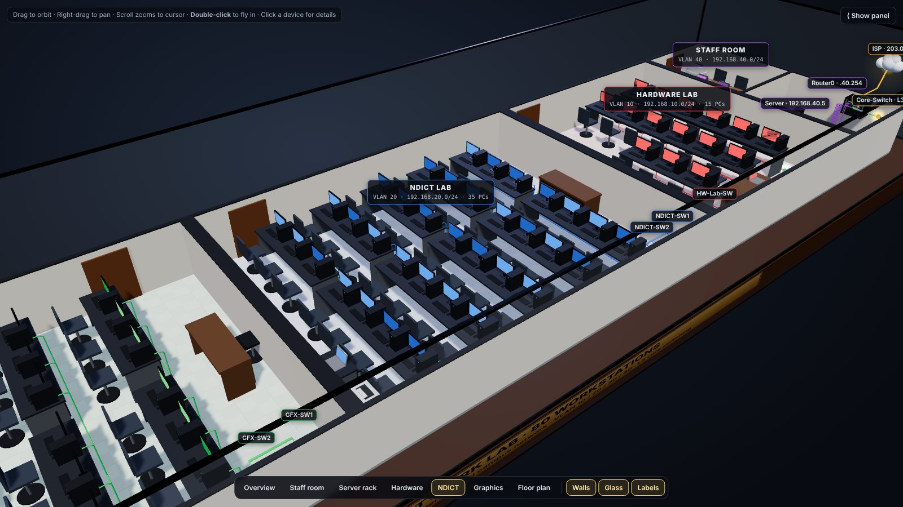
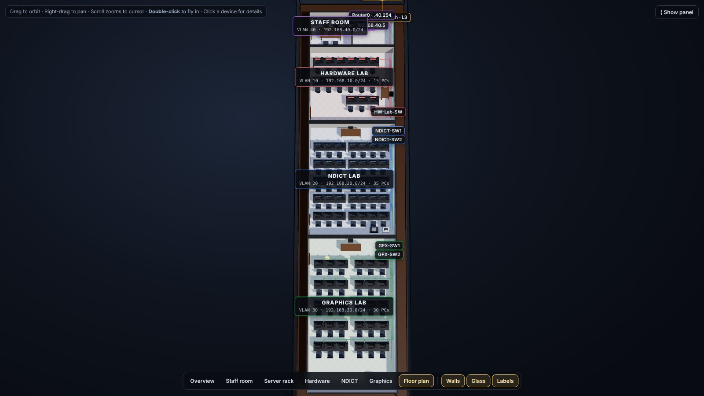
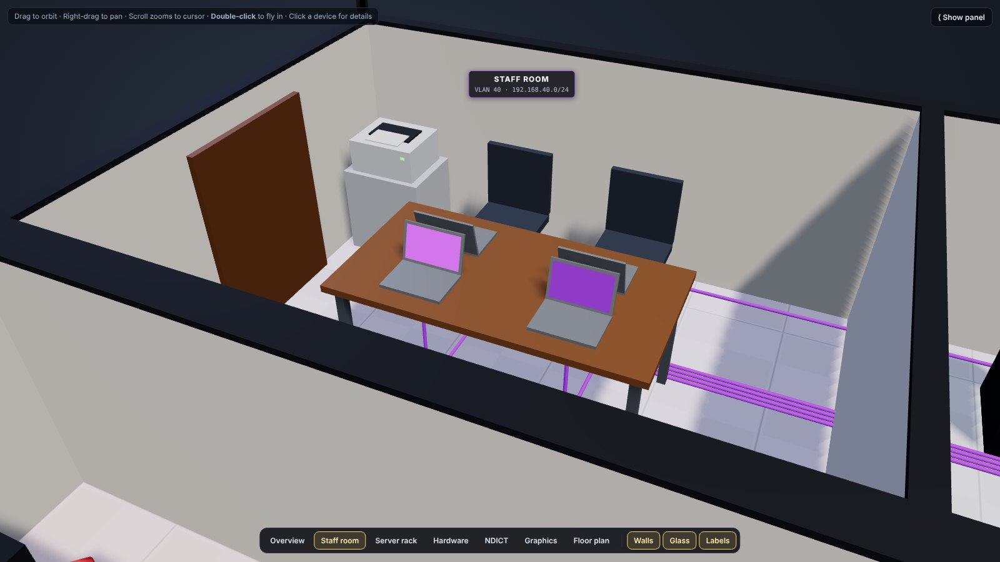
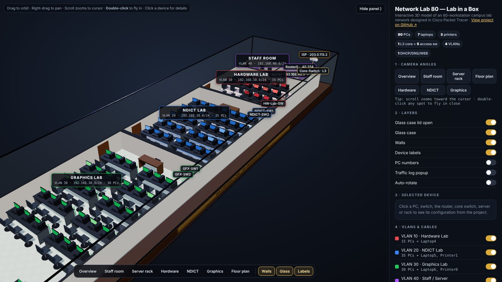

# 🏫 Network Lab 80 Workstations — Cisco Packet Tracer

> **A fully configured hierarchical campus network for a 3-lab educational institution, simulating enterprise-grade networking concepts including VLAN segmentation, Layer 3 inter-VLAN routing, DHCP, NAT/PAT, port security, ACL-based isolation, and SSH management.**


## 🧊 Interactive 3D Model — Lab in a Box

[](https://homemadeict.github.io/networking-packet-tracer-labs/)

The whole lab, built to the floor-plan dimensions as a 3D diorama in a glass display case: all 80 PCs, 7 laptops, 3 printers, the 6U wall rack (Router0 + Core-Switch), the DHCP/DNS/WEB server, 5 access switches and every cable colour-coded by VLAN. Runs in any modern browser — nothing to install.

| How to explore | |
|---|---|
| **Camera angles** | One-click views in the bottom bar: Overview · Staff room · Server rack · Hardware · NDICT · Graphics · Floor plan |
| **Layers** | Toggle walls, glass case, labels, PC numbers and each VLAN's cabling |
| **Navigate** | Drag to orbit · right-drag to pan · scroll zooms toward the cursor · double-click any spot to fly in |
| **Inspect** | Click any device to see its real config from this project — SVIs, trunks, allowed VLANs, ports, DHCP pools, NAT |
| **Simulate** | Animated DHCP relay, inter-VLAN routing and NAT traffic, plus an ACL preview that drops lab-to-lab packets |

<table>
<tr>
<td><a href="https://homemadeict.github.io/networking-packet-tracer-labs/"></a><br><sub>Overview — the full building in its glass case</sub></td>
<td><a href="https://homemadeict.github.io/networking-packet-tracer-labs/"></a><br><sub>Server rack — Router0, Core-Switch, server, UPS, VLAN-coloured trunks</sub></td>
</tr>
<tr>
<td><a href="https://homemadeict.github.io/networking-packet-tracer-labs/"></a><br><sub>NDICT &amp; Hardware labs with their access switches</sub></td>
<td><a href="https://homemadeict.github.io/networking-packet-tracer-labs/"></a><br><sub>Floor plan view — matches the wiring plan</sub></td>
</tr>
<tr>
<td><a href="https://homemadeict.github.io/networking-packet-tracer-labs/"></a><br><sub>Staff room — VLAN 40 laptops and printer</sub></td>
<td><a href="https://homemadeict.github.io/networking-packet-tracer-labs/"></a><br><sub>Control panel — camera angles, layers, device details</sub></td>
</tr>
</table>


---

## 📑 Table of Contents

1. [Project Overview](#-project-overview)
2. [High-Level Design (HLD)](#-high-level-design-hld)
   - [Network Topology](#network-topology)
   - [Why Layer 3 Core Switching?](#why-layer-3-core-switching-instead-of-router-on-a-stick)
   - [Understanding SVIs](#understanding-svis--the-key-to-inter-vlan-routing)
   - [VLAN Strategy](#vlan-strategy)
   - [IP Addressing Plan](#ip-addressing-plan)
   - [Security Policy](#security-policy)
   - [Device Inventory](#device-inventory)
3. [Physical Wiring Plan](#-physical-wiring-plan)
4. [Configuration Lifecycle](#-configuration-lifecycle)
5. [Low-Level Design — Device Configurations](#️-low-level-design--device-by-device-configurations)
   - [DHCP Server](#device-1--dhcp--dns--web-server-ip-192168405)
   - [Core Switch](#device-2--core-switch-cisco-3560-multilayer)
   - [Router0](#device-3--router0-cisco-2911)
   - [Switch2 — Hardware Lab](#device-4--switch2--hw-lab-sw-hardware-lab)
   - [Switch3 — NDICT Primary](#device-5--switch3--ndict-sw1-ndict-lab-primary)
   - [Switch4 — NDICT Secondary](#device-6--switch4--ndict-sw2-ndict-lab-secondary)
   - [Switch5 — Graphics Primary](#device-7--switch5--gfx-sw1-graphics-lab-primary)
   - [Switch6 — Graphics Secondary](#device-8--switch6--gfx-sw2-graphics-lab-secondary)
   - [End Devices](#device-9--end-devices-pcs--laptops--printers)
6. [Verification — With Screenshots](#-verification--with-screenshots)
   - [Core Switch Verification](#core-switch-verification)
   - [Access Switch Verification](#access-switch-verification)
   - [End-to-End Connectivity](#end-to-end-connectivity)
   - [DHCP IP Assignment Proof](#dhcp-ip-assignment-proof)
   - [Port Security Verification](#port-security-verification-hw-lab-only)
7. [Traffic Flow — End to End](#-traffic-flow--end-to-end)
8. [Mistakes & Troubleshooting Journal](#-mistakes--troubleshooting-journal)
9. [Golden Rules Learned](#-golden-rules-learned)
10. [Future Enhancements (Planned)](#-future-enhancements-planned--not-yet-applied)
    - [ACL VLAN Isolation](#future-step-a--acls--vlan-isolation)
    - [SSH on All Devices](#future-step-b--ssh-on-all-devices)
    - [Port Security (Full Rollout)](#future-step-c--port-security--full-rollout)
11. [Project Status](#-project-status)

---

## 📌 Project Overview

This project simulates the complete network infrastructure for an educational institution with **80+ workstations** spread across three computer laboratories and a staff room. It was built and configured entirely in **Cisco Packet Tracer** following industry-standard **Hierarchical Network Design** principles.

### What This Project Demonstrates

| Concept | Implementation |
|---|---|
| Hierarchical Network Design | Core L3 Switch + Access Switches (2-tier) |
| VLAN Segmentation | 4 VLANs — one per lab + staff |
| Inter-VLAN Routing | Layer 3 SVIs (Switch Virtual Interfaces) |
| DHCP | Centralised server with relay (ip helper-address) |
| NAT/PAT | Internet simulation via edge router |
| Trunking | IEEE 802.1Q on all switch-to-switch links |
| Trunk Pruning | Each trunk carries only the VLANs it needs |
| Port Security | Sticky MAC + restrict violation (HW Lab tested) |
| ACL Security | VLAN isolation (documented, future rollout) |
| SSH Management | Secure remote management (documented, future rollout) |

### Physical Scale

| Lab | Workstations | Laptops | Printers | VLAN |
|---|---|---|---|---|
| Hardware Lab | 15 PCs | 1 | — | 10 |
| NDICT Lab | 35 PCs | 1 | 1 | 20 |
| Graphics Lab | 30 PCs | 1 | 1 | 30 |
| Staff Room | — | 4 | 1 | 40 |
| **Total** | **80 PCs** | **7** | **3** | — |

---

## 🏗️ High-Level Design (HLD)

### Network Topology

```
                         ┌─────────────────────────────┐
                         │   INTERNET (Simulated ISP)  │
                         └───────────────┬─────────────┘
                                         │ WAN
                                  203.0.113.1/30
                         ┌───────────────────────────┐
                         │        Router0            │
                         │     Cisco 2911            │
                         │  Gi0/1 = WAN (ISP)        │
                         │  Gi0/0 = 192.168.40.254   │
                         │  NAT/PAT enabled           │
                         └─────────────┬─────────────┘
                                       │ Access Port — VLAN 40
                                  Fa0/2 on Core Switch
                         ┌─────────────────────────────┐
                         │        Core-Switch          │
                         │    Cisco 3560 Multilayer    │
                         │                             │
                         │  ip routing (L3 enabled)    │
                         │  SVI VLAN 10 = 192.168.10.1 │
                         │  SVI VLAN 20 = 192.168.20.1 │
                         │  SVI VLAN 30 = 192.168.30.1 │
                         │  SVI VLAN 40 = 192.168.40.1 │
                         │                             │
                         │  Server at 192.168.40.5     │
                         │  (DNS + DHCP + WEB)         │
                         └──────┬──────────┬──────┬───┘
                                │          │      │
                    Fa0/24      │  Gi0/1   │      │ Gi0/2
                    Trunk       │  Trunk   │      │  Trunk
                    VLAN 10,40  │  VLAN    │      │  VLAN 30,40
                                │  20,40   │      │
                    ┌───────────┘          │      └──────────────┐
                    │                      │                     │
          ┌─────────────────┐   ┌──────────────────┐   ┌────────────────┐
          │   Switch2       │   │    Switch3       │   │   Switch5      │
          │  HW-Lab-SW      │   │   NDICT-SW1      │   │   GFX-SW1      │
          │  2960-24TT      │   │   2960-24TT      │   │   2960-24TT    │
          │                 │   │                  │   │                │
          │  Fa0/1-18:      │   │  Fa0/1-21:       │   │  Fa0/1-16:     │
          │  VLAN 10        │   │  VLAN 20         │   │  VLAN 30       │
          │  (PC1-15,       │   │  (PC16-33,       │   │  (PC51-65,     │
          │   Laptop4)      │   │   Laptop5,       │   │   Laptop6)     │
          │                 │   │   Printer1)      │   │                │
          └─────────────────┘   └────────┬─────────┘   └───────┬────────┘
                                          │ Trunk                │ Trunk
                                          │ VLAN 20,40           │ VLAN 30,40
                                          │                      │
                               ┌──────────────────┐   ┌─────────────────┐
                               │    Switch4       │   │    Switch6      │
                               │   NDICT-SW2      │   │    GFX-SW2      │
                               │   2960-24TT      │   │   2960-24TT     │
                               │                  │   │                 │
                               │  Fa0/1-21:       │   │  Fa0/1-16:      │
                               │  VLAN 20         │   │  VLAN 30        │
                               │  (PC34-50        │   │  (PC66-80,      │
                               │   remaining)     │   │   Printer0)     │
                               └──────────────────┘   └─────────────────┘
```

---

### Why Layer 3 Core Switching Instead of Router-on-a-Stick?

> A critical design decision — choosing the right inter-VLAN routing architecture for 80+ devices.

In a Router-on-a-Stick setup, **all** inter-VLAN traffic must travel through a single physical link to the router. For example, if a Hardware Lab PC pings a Graphics Lab PC, the frame goes up to the router via a sub-interface, gets routed, and comes back down the same cable via another sub-interface. That single link becomes a **bottleneck** when 80+ devices are active simultaneously.

A **Layer 3 Core Switch** (Cisco 3560) performs inter-VLAN routing **internally** using dedicated hardware ASICs — traffic between VLANs never leaves the switch. This eliminates the single-link bottleneck entirely and provides wire-speed routing.

| Feature | Router-on-a-Stick | Layer 3 Core Switch (This Project) |
|---|---|---|
| Routing Method | Software (CPU) on router | Hardware (ASICs) on switch |
| Traffic Path | Up to router, back down same link | Internal switching — never leaves the switch |
| Bottleneck | Single trunk link to router | None — wire-speed internal routing |
| Scalability | Poor for 80+ devices | Excellent — designed for campus networks |
| Cost | Lower (basic router) | Higher (multilayer switch) |
| Use Case | Small office, < 20 devices | Campus, enterprise, > 20 devices |


---

### Understanding SVIs — The Key to Inter-VLAN Routing

> An SVI (Switch Virtual Interface) is a logical Layer 3 interface that represents an entire VLAN on a multilayer switch. It acts as the **default gateway** for every device in that VLAN.

Think of it this way: on a traditional router, each physical interface connects to one subnet. On a Layer 3 switch, each **SVI** connects to one VLAN — but it is a virtual interface, not a physical port. The switch can have hundreds of SVIs, all routing traffic simultaneously using hardware.

**How it works in this network:**
- `interface vlan 10` with IP `192.168.10.1` = the default gateway for every device in VLAN 10 (Hardware Lab)
- When PC1 (192.168.10.11) pings PC16 (192.168.20.10), the frame hits SVI VLAN 10, gets routed internally to SVI VLAN 20, and is forwarded out the appropriate trunk port

**Critical rule:** An SVI stays `down/down` until at least one physical port assigned to that VLAN is active with a connected, powered-on device. No live port → no SVI → no routing for that VLAN.


---

### VLAN Strategy

> **Why VLANs?** VLANs divide a single physical network into separate logical broadcast domains. Without VLANs, a broadcast from one PC reaches every device in the building — 80 devices generating simultaneous broadcasts would cause significant congestion. With VLANs, broadcasts are contained within each lab.

| VLAN ID | Name | Zone | Purpose |
|---|---|---|---|
| **10** | Hardware_Lab | Hardware Class | Isolates hardware lab traffic from other student labs |
| **20** | NDICT_Lab | NDICT Class | Isolates ICT/networking lab traffic |
| **30** | Graphics_Lab | Graphics Class | Isolates graphics/design lab traffic |
| **40** | Staff | Staff Room + Server Rack | Management, servers, and staff devices |

---

### IP Addressing Plan

> **Why this scheme?** Using a sequential `192.168.X.0/24` scheme where X matches the VLAN ID makes troubleshooting intuitive — seeing `192.168.20.x` immediately tells you it is a NDICT Lab device.

| VLAN | Subnet | Gateway (SVI) | Server/Static IPs | DHCP Pool Range |
|---|---|---|---|---|
| 10 — Hardware | `192.168.10.0/24` | `192.168.10.1` | — | `.10` → `.255` |
| 20 — NDICT | `192.168.20.0/24` | `192.168.20.1` | — | `.10` → `.255` |
| 30 — Graphics | `192.168.30.0/24` | `192.168.30.1` | — | `.10` → `.255` |
| 40 — Staff | `192.168.40.0/24` | `192.168.40.1` | `192.168.40.5` (Server) `192.168.40.254` (Router) | `.10` → `.255` |

---

### Security Policy

> **Why isolate labs?** In an educational environment, students should not be able to see or access devices in other labs — this prevents cheating, snooping, or accidental disruption. Staff must reach all labs for management.

| Source | Destination | Policy | Method |
|---|---|---|---|
| Hardware Lab (VLAN 10) | NDICT Lab (VLAN 20) | ❌ DENY | ACL (future) |
| Hardware Lab (VLAN 10) | Graphics Lab (VLAN 30) | ❌ DENY | ACL (future) |
| NDICT Lab (VLAN 20) | Hardware Lab (VLAN 10) | ❌ DENY | ACL (future) |
| NDICT Lab (VLAN 20) | Graphics Lab (VLAN 30) | ❌ DENY | ACL (future) |
| Graphics Lab (VLAN 30) | Hardware Lab (VLAN 10) | ❌ DENY | ACL (future) |
| Graphics Lab (VLAN 30) | NDICT Lab (VLAN 20) | ❌ DENY | ACL (future) |
| Any Lab | Staff / Server / Internet | ✅ PERMIT | Default routing |
| Staff (VLAN 40) | Any VLAN | ✅ PERMIT | No restriction |

---

### Device Inventory

| Hostname | Model | Role | Location |
|---|---|---|---|
| Router0 | Cisco 2911 | Edge router / NAT / WAN | Server rack |
| Core-Switch | Cisco 3560 Multilayer | Core L3 routing + DHCP relay | Server rack |
| HW-Lab-SW (Switch2) | Cisco 2960-24TT | Access switch | Hardware Lab |
| NDICT-SW1 (Switch3) | Cisco 2960-24TT | Access switch primary | NDICT Lab |
| NDICT-SW2 (Switch4) | Cisco 2960-24TT | Access switch secondary | NDICT Lab |
| GFX-SW1 (Switch5) | Cisco 2960-24TT | Access switch primary | Graphics Lab |
| GFX-SW2 (Switch6) | Cisco 2960-24TT | Access switch secondary | Graphics Lab |
| Server | Server-PT | DNS + DHCP + WEB | Staff room / VLAN 40 |
| PC1–PC15 | PC-PT | Student workstation | Hardware Lab |
| Laptop4 | Laptop-PT | Student device | Hardware Lab |
| PC16–PC50 | PC-PT | Student workstation | NDICT Lab |
| Laptop5 | Laptop-PT | Student device | NDICT Lab |
| Printer1 | Printer-PT | Lab printer | NDICT Lab |
| PC51–PC80 | PC-PT | Student workstation | Graphics Lab |
| Laptop6 | Laptop-PT | Student device | Graphics Lab |
| Printer0 | Printer-PT | Lab printer | Graphics Lab |
| Laptop0–3 | Laptop-PT | Staff devices | Staff Room |
| Printer3 | Printer-PT | Staff printer | Staff Room |

---

## 🔌 Physical Wiring Plan

Based on the corrected integrated wiring and logical segment plan:

```
Server Rack (Top — Staff Room area)
├── Router0         → Core-Switch Fa0/2  (straight-through)
├── Core-Switch     → Switch2   via Fa0/24 → Gi0/1  TRUNK  (Hardware Lab)
├── Core-Switch     → Switch3   via Gi0/1  → Gi0/1  TRUNK  (NDICT Lab)
├── Core-Switch     → Switch5   via Gi0/2  → Gi0/1  TRUNK  (Graphics Lab)
├── Server          → Core-Switch Fa0/3   ACCESS VLAN 40
├── Laptops0-3      → Core-Switch Fa0/4-7 ACCESS VLAN 40
└── Printer3        → Core-Switch Fa0/8   ACCESS VLAN 40

Hardware Class (6m room)
└── Switch2 (HW-Lab-SW)
    ├── Fa0/1–Fa0/15  → PC1–PC15 (via wall patch panel)
    ├── Fa0/16-18     → Laptop4 + spares
    └── Fa0/19–24     → shutdown (unused)

NDICT Class (8m 80cm room — 2 switches via wall patch panel)
├── Switch3 (NDICT-SW1) — primary
│   ├── Gi0/1         → Core-Switch Gi0/1 (TRUNK uplink)
│   ├── Gi0/2         → Switch4 Gi0/1 (TRUNK inter-switch)
│   ├── Fa0/1–Fa0/21  → PC16–PC33, Laptop5, Printer1
│   └── Fa0/22–24     → shutdown
└── Switch4 (NDICT-SW2) — secondary
    ├── Gi0/1         → Switch3 Gi0/2 (TRUNK uplink)
    ├── Fa0/1–Fa0/21  → PC34–PC50 (remaining)
    └── Fa0/22–24     → shutdown

Graphics Class (11m 80cm room — 2 switches via wall patch panel)
├── Switch5 (GFX-SW1) — primary
│   ├── Gi0/1         → Core-Switch Gi0/2 (TRUNK uplink)
│   ├── Gi0/2         → Switch6 Gi0/1 (TRUNK inter-switch)
│   ├── Fa0/1–Fa0/16  → PC51–PC65, Laptop6
│   └── Fa0/17–24     → shutdown
└── Switch6 (GFX-SW2) — secondary
    ├── Gi0/1         → Switch5 Gi0/2 (TRUNK uplink)
    ├── Fa0/1–Fa0/16  → PC66–PC80, Printer0
    └── Fa0/17–24     → shutdown
```

> **Why distributed access switches (not centralised)?**
> Ethernet (Cat6) has a **100-metre maximum** run. The Graphics Lab is ~12m plus structured cabling overhead — running 30 individual cables back to the server rack would exceed this limit and create cable management chaos. One uplink cable from each lab to the server rack, with a local access switch serving the room, is the correct professional solution.

---

## 🔄 Configuration Lifecycle

> Follow this order to avoid locking yourself out or debugging phantom problems.


```
Step 1  →  DHCP Server — configure pools FIRST (PCs will request IPs immediately)
Step 2  →  Core Switch — verify ip routing, SVIs, DHCP relay, trunks
Step 3  →  HW-Lab-SW (Switch2) — Hardware Lab access switch
Step 4  →  NDICT-SW1 (Switch3) — NDICT Lab primary access switch
Step 5  →  NDICT-SW2 (Switch4) — NDICT Lab secondary access switch
Step 6  →  GFX-SW1 (Switch5) — Graphics Lab primary access switch
Step 7  →  GFX-SW2 (Switch6) — Graphics Lab secondary access switch
Step 8  →  End Devices — set to DHCP, verify IP assignment
Step 9  →  Router0 — WAN interface + NAT/PAT
Step 10 →  ACLs (LAST — verify connectivity BEFORE restricting) ← 🔜 future
Step 11 →  SSH on all devices                                    ← 🔜 future
Step 12 →  Port Security on remaining access switches            ← 🔜 future
Step 13 →  Final end-to-end verification
```

> **Why this exact order?** If you configure ACLs before testing, every failure looks like a routing bug. If you enable port security before connecting the right devices, the wrong MAC gets locked in and the real device gets blocked. The lifecycle above prevents hours of needless debugging.

---

## ⚙️ Low-Level Design — Device-by-Device Configurations

> **Configuration Order (critical):** DHCP Server → Core Switch verify → Access Switches → End Devices → Router NAT → *(ACLs and SSH: future phase)*

### Port Mode Selection Guide

> Before configuring any interface, use this rule to determine the correct port mode:


| Connection Type | Port Mode | Why |
|---|---|---|
| Core Switch ↔ Lab Switch | **Trunk** (`switchport mode trunk`) | Carries multiple VLANs (lab + VLAN 40 for DHCP) |
| Core Switch ↔ Router (plain interface) | **Access** (`switchport access vlan 40`) | Router does not understand 802.1Q tags |
| Core Switch ↔ PC / Server / Printer | **Access** | End devices belong to a single VLAN |
| Switch ↔ Switch (inter-switch) | **Trunk** | Extends VLAN reach to secondary switches |

---

### Device 1 — DHCP / DNS / WEB Server (IP: 192.168.40.5)

**Why configure this first?**
The Core Switch already has `ip helper-address 192.168.40.5` pointing at this server on every SVI. The moment access switches come up and PCs send DHCP Discover broadcasts, those requests get relayed here. If the server is off or pools are not configured, every PC gets `0.0.0.0`.

**Static IP (Desktop → IP Configuration):**
```
IP Address:       192.168.40.5
Subnet Mask:      255.255.255.0
Default Gateway:  192.168.40.1
DNS Server:       192.168.40.5  ← points to itself
```

**DHCP Pools (Services tab → DHCP → toggle Service ON):**

| Pool Name | Default Gateway | DNS | Start IP | Max Users |
|---|---|---|---|---|
| `VLAN10_POOL` | 192.168.10.1 | 192.168.40.5 | 192.168.10.10 | 245 |
| `VLAN20_POOL` | 192.168.20.1 | 192.168.40.5 | 192.168.20.10 | 245 |
| `VLAN30_POOL` | 192.168.30.1 | 192.168.40.5 | 192.168.30.10 | 245 |
| `VLAN40_POOL` | 192.168.40.1 | 192.168.40.5 | 192.168.40.10 | 245 |

> ⚠️ **Pitfall:** Packet Tracer defaults DHCP Service to **OFF**. You must manually toggle it ON before any PC can get an IP address. This was the cause of the first debugging failure in this project — see [Mistakes & Troubleshooting](#-mistakes--troubleshooting-journal).

---

### Device 2 — Core Switch (Cisco 3560 Multilayer)

**Why a Layer 3 switch instead of Router-on-a-Stick?**
A Layer 3 switch performs inter-VLAN routing in dedicated hardware (ASICs), not in software like a router. For 80+ devices generating simultaneous traffic, a single router sub-interface link becomes a bottleneck. The multilayer switch eliminates that bottleneck entirely.

**Phase 1 — Enable L3 brain + create VLANs:**
```
en
conf t
hostname Core-Switch
ip routing
```

> `ip routing` is the single most important command on a multilayer switch. Without it, the switch is just an expensive Layer 2 device. Always verify with `show ip route` — you must see `C` (Connected) routes, not an empty table.

```
vlan 10
 name Hardware_Lab
vlan 20
 name NDICT_Lab
vlan 30
 name Graphics_Lab
vlan 40
 name Staff
exit
```

**Phase 2 — SVIs (Virtual Gateways):**

> An SVI (Switch Virtual Interface) is a logical Layer 3 interface representing a VLAN. It acts as the default gateway for every device in that VLAN — like a virtual router interface, but built into the switch itself.

```
interface vlan 10
 ip address 192.168.10.1 255.255.255.0
 no shutdown
exit

interface vlan 20
 ip address 192.168.20.1 255.255.255.0
 no shutdown
exit

interface vlan 30
 ip address 192.168.30.1 255.255.255.0
 no shutdown
exit

interface vlan 40
 ip address 192.168.40.1 255.255.255.0
 no shutdown
exit
```

> ⚠️ **Pitfall:** An SVI stays `down/down` until at least one physical port assigned to that VLAN is active with a connected device. This is expected — SVIs will come up as you connect access switches.

**Phase 3 — DHCP Relay (ip helper-address):**

> The DHCP server lives in VLAN 40 (`192.168.40.5`). PCs in VLAN 10/20/30 send DHCP broadcasts — but broadcasts cannot cross VLAN boundaries. The `ip helper-address` command converts those broadcasts into unicast packets and forwards them to the server. Without this, only VLAN 40 devices could get DHCP addresses.

```
interface vlan 10
 ip helper-address 192.168.40.5
exit

interface vlan 20
 ip helper-address 192.168.40.5
exit

interface vlan 30
 ip helper-address 192.168.40.5
exit
```

**Phase 4 — Trunk ports to access switches:**

> A trunk port carries **multiple VLANs simultaneously** using 802.1Q tags — a 4-byte label inserted into each Ethernet frame identifying which VLAN it belongs to. This turns a single cable into a multi-lane highway.
>
> **Why prune allowed VLANs?** By default, a trunk carries all 1005 VLANs. Restricting Hardware Lab trunk to only VLANs 10 and 40 means NDICT or Graphics broadcast traffic never floods the Hardware Lab switch — better security and performance.

```
interface FastEthernet0/24
 description TRUNK_TO_HARDWARE_LAB_SW2
 switchport trunk encapsulation dot1q
 switchport mode trunk
 switchport trunk allowed vlan 10,40
 no shutdown
exit

interface GigabitEthernet0/1
 description TRUNK_TO_NDICT_SW3
 switchport trunk encapsulation dot1q
 switchport mode trunk
 switchport trunk allowed vlan 20,40
 no shutdown
exit

interface GigabitEthernet0/2
 description TRUNK_TO_GRAPHICS_SW5
 switchport trunk encapsulation dot1q
 switchport mode trunk
 switchport trunk allowed vlan 30,40
 no shutdown
exit
```

> ⚠️ **Why `switchport trunk encapsulation dot1q` here but not on access switches?** The Cisco 3560 is a multilayer switch that supports **both** ISL and 802.1Q encapsulation — you must explicitly select dot1q. The Cisco 2960 is a Layer 2 switch that **only** supports 802.1Q, so this command does not exist on it and will error if typed.

**Phase 5 — Staff room access ports + Router port:**

```
interface range FastEthernet0/1 - 10
 description STAFF_ROOM_DEVICES_VLAN40
 switchport mode access
 switchport access vlan 40
 no shutdown
exit

interface FastEthernet0/2
 description UPLINK_TO_ROUTER0_Gi0/0
 switchport mode access
 switchport access vlan 40
 no shutdown
exit
```

> ⚠️ **Pitfall:** The router port must be ACCESS (not trunk). Router0's Gi0/0 has a plain IP address — it does not use 802.1Q sub-interfaces. Sending it tagged trunk frames would result in a packet black hole. This mistake was actually made and fixed during the build — see [Mistake 5](#mistake-5-router-ping-failed--physical-path-wasnt-in-vlan-40) below.

**Phase 6 — Default route:**

> The Core Switch knows about its four directly connected networks (10/20/30/40). But when a Graphics Lab PC tries to reach Google, the switch has no route for that. The default route says: *"Send anything you don't know where to go directly to the Router."*

```
ip route 0.0.0.0 0.0.0.0 192.168.40.254
exit
write memory
```

| Part of the Command | Meaning |
|---|---|
| `0.0.0.0` (network) | Matches **any** destination network |
| `0.0.0.0` (mask) | Matches **any** subnet mask — i.e., everything |
| `192.168.40.254` | Next-hop: the Router's LAN IP on VLAN 40 |

**Verification commands:**
```
show vlan brief
show ip interface brief
show ip route
show interfaces trunk
```

---

### Device 3 — Router0 (Cisco 2911)

**Role:** Edge router — connects the internal network to the simulated internet. Performs NAT/PAT so all internal private IPs share one public WAN IP.

**LAN interface (already configured):**
```
interface GigabitEthernet0/0
 description LAN_TO_CORE_SWITCH
 ip address 192.168.40.254 255.255.255.0
 ip nat inside
 no shutdown
exit
```

**Static return routes (already configured):**
> The router knows `192.168.40.0/24` (its own LAN). Without these routes, reply packets for lab devices would be dropped — the router wouldn't know how to reach `192.168.10.x`, `.20.x`, or `.30.x`. Routing is always a **two-way street**.

```
ip route 192.168.10.0 255.255.255.0 192.168.40.1
ip route 192.168.20.0 255.255.255.0 192.168.40.1
ip route 192.168.30.0 255.255.255.0 192.168.40.1
```

**WAN interface + NAT:**
```
interface GigabitEthernet0/1
 description WAN_TO_SIMULATED_ISP
 ip address 203.0.113.1 255.255.255.252
 ip nat outside
 no shutdown
exit

ip access-list standard NAT_INTERNAL
 permit 192.168.10.0 0.0.0.255
 permit 192.168.20.0 0.0.0.255
 permit 192.168.30.0 0.0.0.255
 permit 192.168.40.0 0.0.0.255
exit

ip nat inside source list NAT_INTERNAL interface GigabitEthernet0/1 overload

ip route 0.0.0.0 0.0.0.0 203.0.113.2

write memory
```

> **What is PAT (overload)?** PAT (Port Address Translation) allows many internal devices to share a single public IP address by using different port numbers in the translation table. This is how your home router lets a whole house share one internet IP — the same principle here.

**Interface summary — Router0:**

| Interface | IP Address | Direction | Purpose |
|---|---|---|---|
| Gi0/0 | 192.168.40.254/24 | `ip nat inside` | LAN side — connects to Core Switch VLAN 40 |
| Gi0/1 | 203.0.113.1/30 | `ip nat outside` | WAN side — connects to simulated ISP |

---

### Device 4 — Switch2 / HW-Lab-SW (Hardware Lab)

**Connected to:** Core-Switch Fa0/24 (trunk)
**Serves:** PC1–PC15, Laptop4 (18 ports total)

```
en
conf t
hostname HW-Lab-SW

vlan 10
 name Hardware_Lab
vlan 40
 name Staff
exit

interface GigabitEthernet0/1
 description UPLINK_TO_CORE_SWITCH_Fa0/24
 switchport mode trunk
 switchport trunk allowed vlan 10,40
 no shutdown
exit

interface range FastEthernet0/1 - 18
 description ACCESS_VLAN10_HARDWARE_DEVICES
 switchport mode access
 switchport access vlan 10
 no shutdown
exit

interface range FastEthernet0/19 - 24
 description UNUSED_SHUTDOWN
 shutdown
exit

write memory
```

> **Why create VLANs locally on the access switch?** Although VLANs are defined on the Core Switch, each switch maintains its own VLAN database. By creating VLAN 10 locally, the switch understands what VLAN 10 means when it receives tagged traffic on the trunk. Without it, the VLAN is treated as unknown and traffic is dropped.

> **Why include VLAN 40?** DHCP relay traffic flows through VLAN 40 to reach the DHCP server at `192.168.40.5`. If VLAN 40 is not allowed on the trunk, PCs behind this switch cannot obtain DHCP addresses.

> ⚠️ **Pitfall — 2960 vs 3560:** The 2960 is a Layer 2 switch only. Do NOT type `switchport trunk encapsulation dot1q` — this command does not exist on the 2960 (it only supports 802.1Q anyway). Only the 3560 multilayer switch needs this command.

**Interface map — HW-Lab-SW:**

| Interface | Mode | VLAN | Connected To |
|---|---|---|---|
| Gi0/1 | Trunk | 10, 40 | Core-Switch Fa0/24 |
| Fa0/1–Fa0/15 | Access | 10 | PC1–PC15 |
| Fa0/16–Fa0/18 | Access | 10 | Laptop4 + spares |
| Fa0/19–Fa0/24 | — | — | Shutdown (unused) |

---

### Device 5 — Switch3 / NDICT-SW1 (NDICT Lab Primary)

**Connected to:** Core-Switch Gi0/1 (trunk uplink) + Switch4 Gi0/1 (trunk downlink)
**Serves:** PC16–PC33, Laptop5, Printer1 (21 ports)

```
en
conf t
hostname NDICT-SW1

vlan 20
 name NDICT_Lab
vlan 40
 name Staff
exit

interface GigabitEthernet0/1
 description UPLINK_TO_CORE_SWITCH_Gi0/1
 switchport mode trunk
 switchport trunk allowed vlan 20,40
 no shutdown
exit

interface GigabitEthernet0/2
 description DOWNLINK_TO_NDICT_SW2
 switchport mode trunk
 switchport trunk allowed vlan 20,40
 no shutdown
exit

interface range FastEthernet0/1 - 21
 description ACCESS_VLAN20_NDICT_DEVICES
 switchport mode access
 switchport access vlan 20
 no shutdown
exit

interface range FastEthernet0/22 - 24
 description UNUSED_SHUTDOWN
 shutdown
exit

write memory
```

> **Why include VLAN 40 on the inter-switch trunk (Gi0/2 → Switch4)?** The DHCP relay process uses VLAN 40 to reach the server at `192.168.40.5`. Devices on Switch4 send DHCP Discovers → Switch3 relays them via VLAN 40 upstream → Core Switch forwards to server. If VLAN 40 is pruned from the inter-switch trunk, Switch4 devices cannot get IP addresses.

**Interface map — NDICT-SW1:**

| Interface | Mode | VLAN | Connected To |
|---|---|---|---|
| Gi0/1 | Trunk | 20, 40 | Core-Switch Gi0/1 (uplink) |
| Gi0/2 | Trunk | 20, 40 | NDICT-SW2 Gi0/1 (downlink) |
| Fa0/1–Fa0/18 | Access | 20 | PC16–PC33 |
| Fa0/19 | Access | 20 | Laptop5 |
| Fa0/20 | Access | 20 | Printer1 |
| Fa0/21 | Access | 20 | Spare |
| Fa0/22–Fa0/24 | — | — | Shutdown (unused) |

---

### Device 6 — Switch4 / NDICT-SW2 (NDICT Lab Secondary)

**Connected to:** Switch3 Gi0/2 (trunk uplink)
**Serves:** PC34–PC50 and remaining NDICT devices (21 ports)

```
en
conf t
hostname NDICT-SW2

vlan 20
 name NDICT_Lab
vlan 40
 name Staff
exit

interface GigabitEthernet0/1
 description UPLINK_TO_NDICT_SW1_Gi0/2
 switchport mode trunk
 switchport trunk allowed vlan 20,40
 no shutdown
exit

interface range FastEthernet0/1 - 21
 description ACCESS_VLAN20_NDICT_DEVICES
 switchport mode access
 switchport access vlan 20
 no shutdown
exit

interface range FastEthernet0/22 - 24
 description UNUSED_SHUTDOWN
 shutdown
exit

write memory
```

**Interface map — NDICT-SW2:**

| Interface | Mode | VLAN | Connected To |
|---|---|---|---|
| Gi0/1 | Trunk | 20, 40 | NDICT-SW1 Gi0/2 (uplink) |
| Fa0/1–Fa0/17 | Access | 20 | PC34–PC50 |
| Fa0/18–Fa0/21 | Access | 20 | Spares |
| Fa0/22–Fa0/24 | — | — | Shutdown (unused) |

---

### Device 7 — Switch5 / GFX-SW1 (Graphics Lab Primary)

**Connected to:** Core-Switch Gi0/2 (trunk uplink) + Switch6 Gi0/1 (trunk downlink)
**Serves:** PC51–PC65, Laptop6 (16 ports)

```
en
conf t
hostname GFX-SW1

vlan 30
 name Graphics_Lab
vlan 40
 name Staff
exit

interface GigabitEthernet0/1
 description UPLINK_TO_CORE_SWITCH_Gi0/2
 switchport mode trunk
 switchport trunk allowed vlan 30,40
 no shutdown
exit

interface GigabitEthernet0/2
 description DOWNLINK_TO_GFX_SW2
 switchport mode trunk
 switchport trunk allowed vlan 30,40
 no shutdown
exit

interface range FastEthernet0/1 - 16
 description ACCESS_VLAN30_GRAPHICS_DEVICES
 switchport mode access
 switchport access vlan 30
 no shutdown
exit

interface range FastEthernet0/17 - 24
 description UNUSED_SHUTDOWN
 shutdown
exit

write memory
```

**Interface map — GFX-SW1:**

| Interface | Mode | VLAN | Connected To |
|---|---|---|---|
| Gi0/1 | Trunk | 30, 40 | Core-Switch Gi0/2 (uplink) |
| Gi0/2 | Trunk | 30, 40 | GFX-SW2 Gi0/1 (downlink) |
| Fa0/1–Fa0/15 | Access | 30 | PC51–PC65 |
| Fa0/16 | Access | 30 | Laptop6 |
| Fa0/17–Fa0/24 | — | — | Shutdown (unused) |

---

### Device 8 — Switch6 / GFX-SW2 (Graphics Lab Secondary)

**Connected to:** Switch5 Gi0/2 (trunk uplink)
**Serves:** PC66–PC80, Printer0 (16 ports)

```
en
conf t
hostname GFX-SW2

vlan 30
 name Graphics_Lab
vlan 40
 name Staff
exit

interface GigabitEthernet0/1
 description UPLINK_TO_GFX_SW1_Gi0/2
 switchport mode trunk
 switchport trunk allowed vlan 30,40
 no shutdown
exit

interface range FastEthernet0/1 - 16
 description ACCESS_VLAN30_GRAPHICS_DEVICES
 switchport mode access
 switchport access vlan 30
 no shutdown
exit

interface range FastEthernet0/17 - 24
 description UNUSED_SHUTDOWN
 shutdown
exit

write memory
```

**Interface map — GFX-SW2:**

| Interface | Mode | VLAN | Connected To |
|---|---|---|---|
| Gi0/1 | Trunk | 30, 40 | GFX-SW1 Gi0/2 (uplink) |
| Fa0/1–Fa0/15 | Access | 30 | PC66–PC80 |
| Fa0/16 | Access | 30 | Printer0 |
| Fa0/17–Fa0/24 | — | — | Shutdown (unused) |

---

### Device 9 — End Devices (PCs / Laptops / Printers)

**Configuration:** Set every device to DHCP.

In Packet Tracer: `Desktop tab → IP Configuration → DHCP`

Wait 10–15 seconds, then verify:

| Device Group | VLAN | Expected IP Range | Gateway |
|---|---|---|---|
| PC1–PC15, Laptop4 | 10 | `192.168.10.10 – .255` | `192.168.10.1` |
| PC16–PC50, Laptop5, Printer1 | 20 | `192.168.20.10 – .255` | `192.168.20.1` |
| PC51–PC80, Laptop6, Printer0 | 30 | `192.168.30.10 – .255` | `192.168.30.1` |
| Laptop0–3, Printer3 | 40 | `192.168.40.10 – .255` | `192.168.40.1` |

> ⚠️ **If a PC shows `0.0.0.0` or `169.254.x.x`:** Check (1) DHCP server service is ON, (2) `ip helper-address` is set on the correct SVI, (3) ping from Core Switch SVI to `192.168.40.5` succeeds, (4) the trunk link to the access switch is up (`show interfaces trunk` on Core Switch).

---

## ✅ Verification — With Screenshots

> Every claim in this document is backed by actual Packet Tracer CLI output captured during the build.

### Core Switch Verification

#### `show vlan brief` — All VLANs Active

VLANs 10 (Hardware_Lab), 20 (NDICT_Lab), 30 (Graphics_Lab), and 40 (Staff) are all **active** with the correct ports assigned. VLAN 40 shows Fa0/1–Fa0/10 (Staff room access ports).


#### `show ip interface brief` — All SVIs Up/Up

All four SVI interfaces (Vlan10 through Vlan40) show **up/up** status with their correct IP addresses assigned via `manual` method. Physical trunk ports Fa0/24, Gi0/1, and Gi0/2 also show **up/up**.


#### `show ip route` + `show interfaces trunk` — Routing Table & Trunks Verified

The routing table shows:
- **4× `C` (Connected) routes** — one for each VLAN subnet (192.168.10.0/24 through 192.168.40.0/24)
- **1× `S*` (Static Default) route** — 0.0.0.0/0 via 192.168.40.254 (Router0)

The trunk summary shows all three trunk ports with correct VLAN pruning:
- Fa0/24: VLANs 10, 40 (Hardware Lab)
- Gi0/1: VLANs 20, 40 (NDICT Lab)
- Gi0/2: VLANs 30, 40 (Graphics Lab)


A second view confirming the same routing table detail:


---

### Access Switch Verification

#### HW-Lab-SW (Switch2) — Trunk + Port Security

The Hardware Lab switch shows:
- **Gi0/1** trunking with VLANs 10, 40 allowed
- **Port security** enabled on Fa0/1–Fa0/16 with Violation Mode: **Restrict**, Maximum MAC: **1**


#### NDICT-SW1 (Switch3) — Dual Trunk Verification

NDICT primary switch confirms both trunks active:
- **Gi0/1** → Core Switch (uplink), VLANs 20, 40
- **Gi0/2** → NDICT-SW2 (downlink inter-switch), VLANs 20, 40


#### GFX-SW1 (Switch5) — Dual Trunk Verification

Graphics primary switch confirms both trunks active:
- **Gi0/1** → Core Switch (uplink), VLANs 30, 40
- **Gi0/2** → GFX-SW2 (downlink inter-switch), VLANs 30, 40


#### GFX-SW2 (Switch6) — Single Trunk Verification

Graphics secondary switch confirms its uplink trunk:
- **Gi0/1** → GFX-SW1 (uplink), VLANs 30, 40


---

### End-to-End Connectivity

#### PC1 (VLAN 10) — Full Connectivity Test

From PC1 in the Hardware Lab:
- `ping 192.168.10.1` → **100% success** (same-VLAN gateway)
- `ping 192.168.20.1` → **100% success** (inter-VLAN to NDICT gateway, proves L3 routing works)
- `ping 192.168.40.254` → **75% success** (cross-VLAN to Router — first packet ARP loss is normal)


#### PC2 (VLAN 10) — Inter-VLAN + Server + Router Reach

From PC2 in the Hardware Lab:
- `ping 192.168.20.10` → **75% success** (inter-VLAN to NDICT PC — first ARP miss normal)
- `ping 192.168.40.5` → **100% success** (reaching DHCP/DNS server)
- `ping 192.168.40.254` → **100% success** (reaching Router)


---

### DHCP IP Assignment Proof

Each lab's representative PC received the correct IP via DHCP from the centralised server:

#### PC7 (Hardware Lab) — VLAN 10

- IP: `192.168.10.11` ✅ (in 192.168.10.x range)
- Gateway: `192.168.10.1` ✅


#### PC16 (NDICT Lab) — VLAN 20

- IP: `192.168.20.10` ✅ (in 192.168.20.x range)
- Gateway: `192.168.20.1` ✅


#### PC51 (Graphics Lab) — VLAN 30

- IP: `192.168.30.10` ✅ (in 192.168.30.x range)
- Gateway: `192.168.30.1` ✅


#### Laptop0 (Staff Room) — VLAN 40

- IP: `192.168.40.3` ✅ (in 192.168.40.x range)


---

### Port Security Verification (HW Lab Only)

Port security was applied to the Hardware Lab switch (Switch2) as a test deployment before full rollout. The `show port-security` output confirms:

- **Ports Fa0/1–Fa0/16**: Security enabled, Maximum MAC addresses: 1, Violation: **Restrict**
- **Port Status**: Secure-up (all ports operational)
- **Sticky MAC**: Learning enabled — will lock in the first MAC address seen on each port


---

## 🔄 Traffic Flow — End to End

### Scenario: Graphics Lab PC (PC51) visits a website

```
PC51 (192.168.30.x)
    │  Sends packet to 8.8.8.8 (Google DNS)
    │  Destination is not on 192.168.30.0/24 → sends to default gateway
    ▼
GFX-SW2 (Switch6) — Fa0/1 (access port, VLAN 30)
    │  Frame received on access port
    │  Switch internally tags it as VLAN 30
    ▼
GFX-SW1 (Switch5) — Gi0/2 trunk → Gi0/1 trunk
    │  Tagged frame (VLAN 30) forwarded up inter-switch trunk
    ▼
Core-Switch — Gi0/2 (trunk, receives VLAN 30 tagged frame)
    │  SVI Vlan30 (192.168.30.1) receives and de-encapsulates the packet
    │  Checks routing table → no specific route for 8.8.8.8
    │  Matches default route: S* 0.0.0.0/0 via 192.168.40.254
    │  Sends packet out Fa0/2 (access port, VLAN 40) to Router0
    ▼
Router0 — Gi0/0 (192.168.40.254)
    │  NAT/PAT translates 192.168.30.x → 203.0.113.1 (WAN IP)
    │  Forwards packet out Gi0/1 to simulated internet
    ▼
Internet (simulated)
    │  Reply returns to 203.0.113.1
    ▼
Router0 — NAT table lookup → translates back to 192.168.30.x
    │  Checks routing table: 192.168.30.0/24 via 192.168.40.1 (Core Switch)
    ▼
Core-Switch → SVI Vlan30 → Gi0/2 trunk → GFX-SW1 → GFX-SW2 → PC51 ✅
```

### Scenario: Hardware Lab PC pings NDICT Lab PC (Inter-VLAN)

```
PC1 (192.168.10.11, VLAN 10)
    │  ping 192.168.20.10 → not on local subnet → sends to gateway 192.168.10.1
    ▼
HW-Lab-SW (Switch2) — access port → Gi0/1 trunk (tagged VLAN 10)
    ▼
Core-Switch — receives on Fa0/24
    │  SVI Vlan10 processes the packet
    │  Routing table: 192.168.20.0/24 → directly connected via Vlan20
    │  Forwards to SVI Vlan20 (internal hardware routing — never leaves switch)
    │  Sends out Gi0/1 trunk (tagged VLAN 20)
    ▼
NDICT-SW1 (Switch3) → Fa0/1 (access port) → PC16 (192.168.20.10)
    │  Reply follows reverse path
    ▼
Result: 75-100% success (first packet ARP miss is normal) ✅
```

> **Key insight:** For inter-VLAN routing, the traffic never goes to the Router — it is handled entirely inside the Core Switch via SVIs. The Router is only needed for traffic leaving the internal network (internet-bound).

---

## 🔧 Mistakes & Troubleshooting Journal

> **Why include mistakes?** Real networking is 30% configuration and 70% troubleshooting. These are documented errors made during the actual build — and how each one was diagnosed and fixed. This section demonstrates practical debugging skills, not just textbook knowledge.

### Mistake 1: Tested Ping Before Turning On DHCP Server 😅

**Symptom:** All pings from Lab PCs returned 0% success across the board.

**Root Cause:** The DHCP server was not powered on. PCs were set to DHCP mode but had **no IP address at all** (`0.0.0.0`). A ping from a device with no IP always fails — this isn't a routing problem, it's a "the PC doesn't even have an address" problem.

**Fix:**
1. Power on the DHCP server
2. Toggle DHCP Service to ON in the Services tab
3. Wait 10–15 seconds for PCs to obtain leases
4. Verify with `ipconfig` on the PC

> **Lesson:** Always verify the **basics** (power, DHCP, IP assignment) before debugging the **advanced** (routing, trunks, ACLs). The simplest explanation is usually the right one.

---

### Mistake 2: `ip routing` Was Not Actually Enabled

**Symptom:** `show ip route` showed an empty routing table — no connected routes, no static routes. The switch was behaving as a pure Layer 2 bridge.

**Root Cause:** The `ip routing` command was copy-pasted with a trailing comment:

```
Core-Switch(config)#ip routing # This is the "On" switch for Layer 3
                               ^
% Invalid input detected at '^' marker.
```

Cisco IOS does **NOT** support inline comments with `#`. The entire line was silently rejected.

**Fix:** Type the command cleanly without any trailing text:
```
conf t
ip routing
exit
show ip route    ← Must now show C and S* routes
```

> **Lesson:** Never put comments on the same line as a Cisco IOS command. IOS treats everything after the command as arguments, not comments. This is the #1 copy-paste trap.

---

### Mistake 3: Backtick Characters in Commands

**Symptom:**
```
Core-Switch#`show vlan brief`
             ^
% Invalid input detected at '^' marker.
```

**Root Cause:** Copy-pasting from Markdown documentation brought backtick characters (`` ` ``) into the CLI. IOS has no concept of backticks.

**Fix:** Always strip formatting marks (backticks, smart quotes, em-dashes) before pasting into the CLI. Paste one command at a time when debugging.

---

### Mistake 4: Router Port Configured as Trunk Instead of Access

**Symptom:** After setting the default route, pinging Router0 returned 0%:
```
Core-Switch#ping 192.168.40.254
Success rate is 0 percent (0/5)
```

**Root Cause:** The port connecting Core Switch to Router (`Fa0/2`) was configured as a **trunk** carrying all VLANs. But Router0's Gi0/0 has a plain IP (`192.168.40.254`) — it does not use sub-interfaces and cannot understand 802.1Q tags. Tagged frames were unintelligible to the router, creating a **packet black hole**.

**Fix:** Changed `Fa0/2` from trunk to access port:
```
conf t
interface FastEthernet0/2
 switchport mode access
 switchport access vlan 40
 no shutdown
exit
```

**After fix:** `ping 192.168.40.254` → **80% success (4/5)** ✅

> **Lesson:** A trunk is for **switch-to-switch** links. A connection to a **router's plain interface** must be an access port — unless the router is doing Router-on-a-Stick with sub-interfaces.

---

### Mistake 5: Missing Return Routes on the Router

**Symptom:** Core Switch could ping the Router, but Lab PCs couldn't get replies from the internet. Traffic went out but replies were dropped at the Router.

**Root Cause:** Router0 only knew about `192.168.40.0/24` (its connected LAN). It had no idea how to send packets back to `192.168.10.0`, `.20.0`, or `.30.0`.

**Fix (on Router0):**
```
ip route 192.168.10.0 255.255.255.0 192.168.40.1
ip route 192.168.20.0 255.255.255.0 192.168.40.1
ip route 192.168.30.0 255.255.255.0 192.168.40.1
```

> **Lesson:** Routing is a **two-way street**. The Core Switch needs a default route *out*. The Router needs static routes *back* for every lab subnet. Both must exist or traffic is one-way only.

---

## 🏆 Golden Rules Learned

These are the real lessons from configuring this network — not from a textbook, but from actually hitting these problems:

| Rule | Lesson |
|---|---|
| **1** | `ip routing` must be the FIRST command on a multilayer switch. Without it, zero SVIs work. Verify with `show ip route`. |
| **2** | Never put `#` comments after Cisco IOS commands. `ip routing # this enables L3` silently fails. Strip all formatting before pasting. |
| **3** | Do NOT use `switchport trunk encapsulation dot1q` on a Cisco 2960. It is a Layer 2 switch — this command does not exist there. |
| **4** | An SVI stays `down/down` until at least one physical port in that VLAN is connected to an active device. This is normal — not a bug. |
| **5** | Trunk ports between access switches MUST include VLAN 40. DHCP relay traffic travels through VLAN 40 — pruning it breaks DHCP for downstream switches. |
| **6** | Routing is two-way. The Core Switch needs a default route OUT. The Router needs static routes BACK to every lab subnet. Both must exist. |
| **7** | The Router's LAN port must be an ACCESS port (VLAN 40), not a trunk. A plain router interface does not understand 802.1Q tags — tagged frames become a black hole. |
| **8** | Apply ACLs LAST. Always verify full connectivity first, then restrict. Otherwise you cannot tell if a ping failure is a config bug or an intentional ACL block. |
| **9** | Port security sticky MAC must be applied AFTER the correct device is connected. Sticky learning locks in the FIRST MAC it sees — connect the right device first. |
| **10** | 80% (4/5) on a first ping is a perfect result. ARP resolution takes the first packet. Only 0% sustained failure indicates a real problem. |
| **11** | Turn on the DHCP server BEFORE connecting PCs. The most embarrassing debugging session ever was discovering 0% ping success was because the DHCP server was simply switched off. |
| **12** | Always use `write memory` (or `wr`) after every major change. Packet Tracer does not auto-save running configs on device power cycle. |

---

## 🔒 Future Enhancements (Planned — Not Yet Applied)

> **⚠️ IMPORTANT:** These three features are **fully designed, documented, and ready to deploy** — but they are intentionally **held back**. The project has been published to GitHub with full baseline connectivity working. These will be applied as a **post-publish update** so the commit history shows the network evolving from "working baseline" to "fully secured."

> **Why hold back security features?** Applying ACLs or SSH before publishing provides zero learning value to someone reading the repo. By publishing the baseline first, then applying security in a separate commit, the GitHub history tells a professional story: *"First I built it and proved it works. Then I locked it down."*

---

### Future Step A — ACLs — VLAN Isolation

**Current state:** Not applied. All labs can currently ping each other (verified in [Verification section](#end-to-end-connectivity) above).

**What it will do:** Enforce the [Security Policy](#security-policy) — labs are isolated from each other, but all can reach Staff/Server/Internet.

**Where to apply:** On the Core Switch, **inbound** on each lab's SVI. This stops inter-lab traffic at the routing stage.

**Why inbound on the source SVI?** Applying the ACL `in` on VLAN 10's SVI means it checks traffic **coming from** VLAN 10 before it enters the routing process. This is more efficient than `out` (which would waste CPU routing the packet first, then dropping it).

**On Core-Switch — apply LAST, after all connectivity is verified:**

```
en
conf t

ip access-list extended VLAN10_IN
 remark Allow VLAN10 to reach Staff network and server
 permit ip 192.168.10.0 0.0.0.255 192.168.40.0 0.0.0.255
 remark Block VLAN10 from reaching NDICT Lab
 deny   ip 192.168.10.0 0.0.0.255 192.168.20.0 0.0.0.255
 remark Block VLAN10 from reaching Graphics Lab
 deny   ip 192.168.10.0 0.0.0.255 192.168.30.0 0.0.0.255
 remark Permit everything else (internet, intra-VLAN)
 permit ip any any
exit

interface vlan 10
 ip access-group VLAN10_IN in
exit

ip access-list extended VLAN20_IN
 remark Allow VLAN20 to reach Staff
 permit ip 192.168.20.0 0.0.0.255 192.168.40.0 0.0.0.255
 remark Block VLAN20 from Hardware Lab
 deny   ip 192.168.20.0 0.0.0.255 192.168.10.0 0.0.0.255
 remark Block VLAN20 from Graphics Lab
 deny   ip 192.168.20.0 0.0.0.255 192.168.30.0 0.0.0.255
 permit ip any any
exit

interface vlan 20
 ip access-group VLAN20_IN in
exit

ip access-list extended VLAN30_IN
 remark Allow VLAN30 to reach Staff
 permit ip 192.168.30.0 0.0.0.255 192.168.40.0 0.0.0.255
 remark Block VLAN30 from Hardware Lab
 deny   ip 192.168.30.0 0.0.0.255 192.168.10.0 0.0.0.255
 remark Block VLAN30 from NDICT Lab
 deny   ip 192.168.30.0 0.0.0.255 192.168.20.0 0.0.0.255
 permit ip any any
exit

interface vlan 30
 ip access-group VLAN30_IN in
exit

write memory
```

**ACL Processing explained:**

| Concept | Explanation |
|---|---|
| **Top-down matching** | Cisco tests rules in order. The FIRST match wins — execution stops there. |
| **Inbound direction** | `in` on VLAN 10 SVI = traffic COMING FROM VLAN 10. This is correct — block at source. |
| **Implicit deny** | Every ACL ends with an invisible `deny ip any any`. Never add an explicit one — it blocks DHCP. |
| **DHCP safety** | The `permit ip any any` at the end ensures DHCP broadcasts are never accidentally blocked. |
| **VLAN 40 — No ACL needed** | Staff/management VLAN is unrestricted by design. |

**Post-ACL verification:**
```
From PC1 (VLAN 10): ping 192.168.20.x    → must FAIL   (blocked by ACL)
From PC1 (VLAN 10): ping 192.168.30.x    → must FAIL   (blocked by ACL)
From PC1 (VLAN 10): ping 192.168.40.5    → must SUCCEED (staff/server permitted)
From Laptop0 (VLAN 40): ping 192.168.10.x → must SUCCEED (staff unrestricted)
```

---

### Future Step B — SSH on All Devices

**Current state:** Not applied on any device.

**What it will do:** Replace insecure Telnet with encrypted SSH management. Anyone with a packet capture tool on the network can read Telnet passwords in plain text — SSH encrypts the entire session.

**Where to apply:** Core-Switch, HW-Lab-SW, NDICT-SW1, NDICT-SW2, GFX-SW1, GFX-SW2, Router0 — all 7 network devices.

**Configuration (same on each device, adjust hostname):**

```
en
conf t

ip domain-name lab.local
crypto key generate rsa modulus 1024
ip ssh version 2

username admin privilege 15 secret Admin@Lab123

line vty 0 4
 transport input ssh
 login local
 exec-timeout 10 0
exit

write memory
```

**Key configuration details:**

| Parameter | Value | Why |
|---|---|---|
| `ip domain-name` | `lab.local` | Required — RSA key generation needs a domain name |
| `crypto key ... modulus` | `1024` | Packet Tracer limitation — does not support 2048-bit keys |
| `ip ssh version 2` | SSH v2 | More secure than v1 |
| `privilege 15` | Full admin | User gets enable-mode access immediately on login |
| `transport input ssh` | SSH only | Disables Telnet entirely on VTY lines |
| `exec-timeout 10 0` | 10 minutes | Auto-disconnect idle sessions for security |

**To test SSH from a PC (Desktop → Terminal):**
```
ssh -l admin 192.168.40.1
Password: Admin@Lab123
```

> ⚠️ **Order matters:** Create the username BEFORE configuring `login local` on VTY lines. If you set `login local` first with no local user defined, you will lock yourself out of remote management immediately.

> ⚠️ **Packet Tracer SSH limitation:** When prompted for key size, enter `1024`. Older Packet Tracer versions do not support 2048-bit keys. If `crypto key generate rsa` gives no prompt, type `crypto key generate rsa modulus 1024`.

---

### Future Step C — Port Security — Full Rollout

**Current state:** Applied to HW-Lab-SW (Switch2) Fa0/1–18 for testing with `violation restrict`. Verified working — see [Port Security Verification](#port-security-verification-hw-lab-only) screenshots above.

**What it will do:** Lock each access port to the first MAC address it sees. If someone unplugs a workstation and connects a rogue device, the port silently blocks the unauthorised traffic.

**Restriction mode used: `restrict`**
> `restrict` drops frames from unknown MACs and logs the violation, but keeps the port UP. This is less disruptive than `shutdown` in an active classroom — the correct device still works, but an unauthorised device is silently blocked.

**Where to apply:** All remaining access switches — NDICT-SW1, NDICT-SW2, GFX-SW1, GFX-SW2.

**Config for each remaining switch (adjust port range per switch):**

```
en
conf t

interface range FastEthernet0/1 - 21
 switchport port-security
 switchport port-security maximum 1
 switchport port-security mac-address sticky
 switchport port-security violation restrict
exit

write memory
```

**Port ranges per switch:**

| Switch | Port Range | VLAN |
|---|---|---|
| HW-Lab-SW | Fa0/1–Fa0/18 | 10 | ✅ Already applied |
| NDICT-SW1 | Fa0/1–Fa0/21 | 20 | 🔜 To apply |
| NDICT-SW2 | Fa0/1–Fa0/21 | 20 | 🔜 To apply |
| GFX-SW1 | Fa0/1–Fa0/16 | 30 | 🔜 To apply |
| GFX-SW2 | Fa0/1–Fa0/16 | 30 | 🔜 To apply |

**Verification:**
```
show port-security
show port-security interface FastEthernet0/1
show port-security address
```

> ⚠️ **Apply only to ACCESS ports** — never to trunk ports (Gi0/1, Gi0/2). IOS will reject `switchport port-security` on a trunk port entirely.

> ⚠️ **Apply AFTER correct devices are connected and working.** Sticky MAC locks in the first MAC address seen. Connect your device first, verify it works, then apply port security to lock it in.

> ⚠️ **Errdisabled recovery:** If using `shutdown` mode and a wrong device triggers a violation, the port goes `err-disabled`. To recover:
> ```
> interface FastEthernet0/X
>  shutdown
>  no shutdown
> ```
> With `restrict` mode (used in this project), the port stays up — only the unknown traffic is dropped.

---

## 📊 Project Status

| Feature | Status | Notes |
|---|---|---|
| Core Switch — VLANs | ✅ Complete | 10, 20, 30, 40 |
| Core Switch — SVIs | ✅ Complete | All gateways up/up |
| Core Switch — DHCP relay | ✅ Complete | Helper on all SVIs |
| Core Switch — Trunks | ✅ Complete | Fa0/24, Gi0/1, Gi0/2 — pruned per lab |
| Core Switch — Default route | ✅ Complete | via 192.168.40.254 |
| Core Switch — ip routing | ✅ Complete | L3 active, verified C+S* routes |
| Router0 — LAN interface | ✅ Complete | 192.168.40.254 |
| Router0 — Return routes | ✅ Complete | All 3 lab subnets |
| Router0 — WAN + NAT | ✅ Complete | PAT overload configured |
| DHCP Server | ✅ Complete | 4 pools, service ON |
| HW-Lab-SW (Switch2) | ✅ Complete | Trunks + access ports configured |
| NDICT-SW1 (Switch3) | ✅ Complete | Trunks + access ports configured |
| NDICT-SW2 (Switch4) | ✅ Complete | Trunks + access ports configured |
| GFX-SW1 (Switch5) | ✅ Complete | Trunks + access ports configured |
| GFX-SW2 (Switch6) | ✅ Complete | Trunks + access ports configured |
| End device DHCP | ✅ Complete | All PCs verified with ipconfig |
| Port Security (HW Lab) | ✅ Tested | `restrict` mode, Fa0/1-18, verified via CLI |
| Port Security (full rollout) | 🔜 Planned | NDICT + Graphics switches pending |
| ACLs — VLAN isolation | 🔜 Planned | Configs documented above, apply post-publish |
| SSH — all devices | 🔜 Planned | Configs documented above, apply post-publish |

---

## 📁 Repository Structure

```
Network Lab 80 ( Workstations ) Projects Proposal/
├── README.md                          ← You are here
├── Project Proposal Topology.pkt      ← Cisco Packet Tracer file (open in PT)
├── Professional_Full_Proposal.pdf     ← Formal project proposal document
├── Professional_Full_Proposal.docx    ← Editable version
│
├── Final Project Diagrams/
│   ├── Final Networking Architecture.jpg
│   └── Networking Diagram - Packet Tracer Diagram.png
│
├── Images/
│   ├── Cisco Packet Tracer Screenshots/    ← All verification screenshots
│   ├── NETWORK INFRASTRUCTURE CONFIGURATION LIFECYCLE.png
│   ├── GUIDE TO NETWORKING BEST PRACTICES - PORT MODE SELECTION.png
│   ├── TRAFFIC FLOW COMPARISON LAYER 3 CORE SWITCHING s ROUTER-ON-A-STICK.png
│   └── UNDERSTANDING SVITHE KEY TO INTER-VLAN ROUTING.png
│
├── Configuration Step 01/             ← Core Switch config journey + golden rules
├── Configuration Step 02/             ← Access switch configs
├── Notes/                             ← Full implementation plan + reference docs
└── Until 2026.04.16 Progress/         ← Progress screenshots
```

---

## 📝 License

This project is for educational purposes as part of the NVQ Level 5 Networking Practical Book curriculum.

---

> *Built with Cisco Packet Tracer | Documented for portfolio demonstration*
