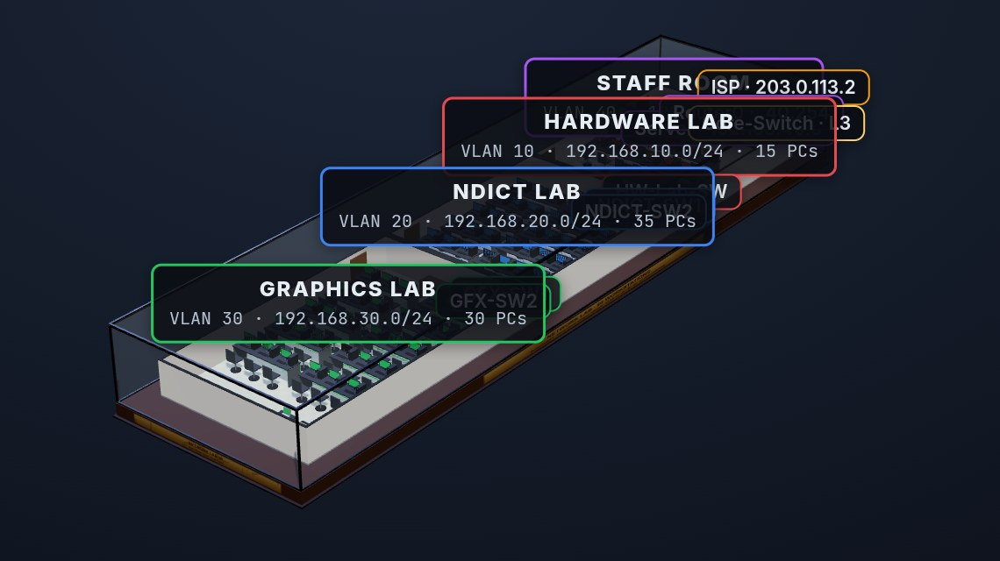

# 📡 Networking Packet Tracer Labs & Enterprise Network Project

<div align="center">


[](https://github.com/HomemadeICT)
[](https://www.linkedin.com/in/theekshana-prabodha/)

**A comprehensive, hands-on Networking Practical Book built in Cisco Packet Tracer**  
*From basic LAN connectivity to a full 80-Workstation Enterprise Network Design*

**Author**: D.M. Theekshana Prabodha | **Brand**: TheekMind | **Qualification**: NDICT NVQ Level 5

</div>

---

## ✨ Featured — Network Lab 80: 3D Lab in a Box

<div align="center">

[](https://theekmind.com/network-lab-80/)

**[▶ Launch the live 3D lab → theekmind.com/network-lab-80](https://theekmind.com/network-lab-80/)**

</div>

An interactive 3D model of the 80-workstation campus lab from the final project (Project 6.2). Orbit, zoom and click any device to see its configuration, and watch live packet animation across 4 VLANs, the Layer 3 core switch, DHCP relay and NAT/PAT.

- **Live:** [theekmind.com/network-lab-80](https://theekmind.com/network-lab-80/) (also mirrored on [GitHub Pages](https://homemadeict.github.io/networking-packet-tracer-labs/))
- **Offline:** open [`index.html`](index.html) in any modern browser (internet needed for the Three.js CDN)

---

## 📋 Labs Index

Each lab folder holds the `.pkt` file, screenshots and a `README.md` with objective, topology, step-by-step configuration and verification.

### 🔌 01 — Basic Connectivity
| Lab | Topic |
|-----|-------|
| [1.1 One Router, 4 Switches, 8 PCs](01_Basic_Connectivity/one-router-4-switch-8pcs/) | LAN topology, router interface, ping tests |

### 🌐 02 — Network Services
| Lab | Topic |
|-----|-------|
| [2.1 DHCP Server](02_Network_Services/dhcp-server/) | Server DHCP pool, dynamic client addressing |
| [2.2 DNS & Web Server](02_Network_Services/dns-web-server/) | HTTP + DNS on one server |
| [2.3 DNS + Web Servers With Router](02_Network_Services/dns-web-router/) | Cross-network browsing via router |
| [2.4 Mail Server](02_Network_Services/mail-server/) | SMTP/POP3, DNS dependency |
| [2.5 Web Project with 2 Routers](02_Network_Services/web-project/) | Static routing between routers |

### 🔀 03 — VLAN & Switching
| Lab | Topic |
|-----|-------|
| [3.1 VTP](03_VLAN_and_Switching/1.vtp/) | VTP on Cisco 2950 switches |
| [3.2 VLAN Basic](03_VLAN_and_Switching/2.vlan-basic/) | VLAN creation, port assignment, isolation |
| [3.3 Inter-VLAN Routing](03_VLAN_and_Switching/3.inter-vlan-routing/) | Layer 3 switch SVIs |
| [3.4 Router-on-a-Stick](03_VLAN_and_Switching/4.router-on-a-stick/) | Trunk + router subinterfaces |
| [3.5 Inter-VLAN Advanced](03_VLAN_and_Switching/5.inter-vlan-advanced/) | Multi-switch trunks |

### 🔒 04 — Security & Remote Access
| Lab | Topic |
|-----|-------|
| [4.1 Telnet](04_Security_and_Remote_Access/telnet/) | VTY/console passwords, banners, remote login |
| [4.2 Port Security](04_Security_and_Remote_Access/port-security/) | Sticky MAC, violation modes, recovery |

### 📶 05 — Wireless & IoT
| Lab | Topic |
|-----|-------|
| [5.1 Wireless Networking](05_Wireless/Wireless%20Networking/) | WRT300N, SSID/security, DHCP |
| [5.2 IoT Practical](05_Wireless/IOT%20Practical/) | Smart-home gateway and device control |

### 🏢 06 — Final Projects
| Project | Topic |
|---------|-------|
| [6.1 TechNova Enterprise Network (Capstone)](06_Final_Project/Capstone%20Project/TechNova-Enterprise-Network-Design/) | Hierarchical design, VLANs, OSPF/static, STP, security, guest Wi-Fi |
| [6.2 Network Lab 80 Workstations (NVQ Proposal)](06_Final_Project/Network%20Lab%2080%20%28%20Workstations%20%29%20Projects%20Proposal/) | 80 PCs in 3 labs, L3 core, DHCP, NAT, full proposal PDF/DOCX. See also the [live 3D model](https://theekmind.com/network-lab-80/) |

---

## 🛠️ Technologies & Skills

Cisco Packet Tracer · VLANs & VTP · inter-VLAN routing (SVI, router-on-a-stick) · static/OSPF routing · DHCP / DNS / HTTP / SMTP · port security, ACLs, Telnet/SSH · WRT300N wireless · IoT integration · Cat6 structured cabling · enterprise planning, costing and technical documentation.

---

## 🚀 Getting Started — Open & Experiment with the Labs

All labs include a **Cisco Packet Tracer `.pkt` file** — a fully built and configured network you can open, inspect, modify, and break (then fix). This is the best way to learn.

---

### Step 1 — Get Cisco Packet Tracer (Free)

Packet Tracer is free via Cisco Networking Academy. No prior enrolment is needed.

1. Go to **[netacad.com](https://www.netacad.com/courses/packet-tracer)**
2. Click **"Get Packet Tracer"** → Create a free Cisco NetAcad account
3. Download and install the version for your OS (Windows / macOS / Linux)

> [!IMPORTANT]
> These labs were built on **Cisco Packet Tracer 8.1.0.0722**. Use version **8.1 or newer** to guarantee all features work correctly. Older versions (e.g., 7.x) may not support some device models or IoT components used in these labs.

---

### Step 2 — Get the Repository

**Option A — Clone with Git:**
```bash
git clone https://github.com/HomemadeICT/networking-packet-tracer-labs.git
```

**Option B — Download as ZIP:**
> GitHub → **Code** → **Download ZIP** → Extract to a folder of your choice

---

### Step 3 — Open a Lab

1. Navigate to any lab folder (e.g., `03_VLAN_and_Switching/4.router-on-a-stick/`)
2. Double-click the `.pkt` file — it opens directly in Packet Tracer
3. Read the `README.md` in the same folder for the full configuration guide and verification steps

---

### 💡 Tips for Experimenting

| Tip | Detail |
|-----|--------|
| **Use Simulation Mode** | Switch from Realtime to Simulation (bottom-right clock icon) to watch packets travel hop-by-hop through the network |
| **Break and fix it** | Delete a trunk link, remove a VLAN, or change an IP — then use the verification commands in the README to diagnose and fix the problem |
| **Check the CLI** | Click any router or switch → CLI tab to run `show` commands and explore the running configuration |
| **Save your changes** | Use **File → Save As** with a new name so the original lab file stays intact |
| **Start from scratch** | Delete all configs on a device with `erase startup-config` + `reload` and reconfigure it following the README step-by-step |

---

## 📄 License

This project is licensed under the [MIT License](LICENSE) — see the LICENSE file for details.  
Created for educational purposes as part of the NDICT NVQ Level 5 programme.

---

## 📫 Contact

**D.M. Theekshana Prabodha**  
TheekMind *(networking enthusiast 📡)*

[](https://github.com/HomemadeICT)
[](https://www.linkedin.com/in/theekshana-prabodha/)

---

<div align="center">

*Built with ❤️ and lots of `ping` commands* 📡

</div>
